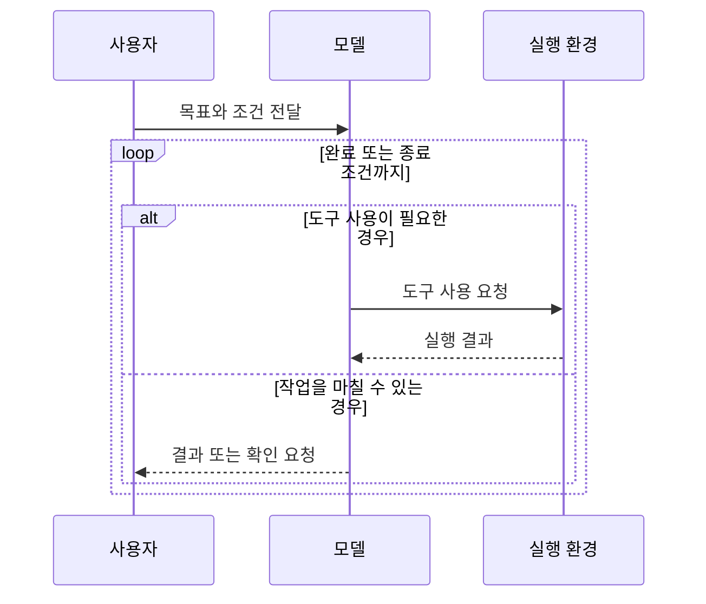

## 1. 개요

AI 에이전트는 대규모 언어 모델(LLM)을 이용해 목표를 수행하는 소프트웨어 시스템이다. 일반적인 프로그램은 개발자가 미리 정한 순서와 조건을 따라 작업을 처리한다. 에이전트도 목표와 사용할 수 있는 도구, 따라야 할 규칙은 개발자가 정하지만, 그 범위 안에서 다음 단계를 모델이 선택할 수 있다. 시스템은 모델의 요청에 따라 도구를 실행하고 결과를 돌려주며, 모델은 그 결과를 바탕으로 작업을 이어가거나 마무리한다.

에이전트라는 용어는 문맥에 따라 단순한 도구 사용 시스템부터 장시간 자율적으로 동작하는 시스템까지 다양하게 쓰인다. 이 문서에서는 모델이 도구를 선택하고 여러 단계에 걸쳐 작업을 진행하는 시스템을 에이전트라고 부른다.

## 2. 구성 요소

에이전트는 모델, 지침, 도구, 실행 환경으로 구성된다. 작업이 여러 단계나 세션에 걸치는 경우에는 대화 기록과 별도의 저장소를 사용해 상태를 유지하기도 한다.

### 2.1. 모델

모델은 사용자 요청과 지금까지의 작업 결과를 바탕으로 답변하거나 다음 행동을 정한다. 모델마다 성능, 비용, 응답 속도, 입력 가능한 정보량이 다르므로 작업의 난이도와 요구사항에 맞춰 선택한다. 예를 들어 Anthropic의 Claude, OpenAI의 GPT, Google의 Gemini 계열 모델을 사용할 수 있다.

### 2.2. 지침

지침은 에이전트가 수행할 목표와 따라야 할 규칙을 설명한다. 요청과 함께 직접 전달하거나 설정 파일에 저장할 수 있다. 프로젝트 지침을 파일로 관리하는 경우 `AGENTS.md`, `CLAUDE.md` 같은 이름을 사용할 수 있지만, 파일명과 읽는 방식은 사용하는 도구에 따라 다르다.

지침에는 작업 범위, 사용할 수 있는 정보와 도구, 결과 형식, 실패하거나 판단이 어려울 때의 처리 방법을 적는다. 예를 들어 “문서를 검토한다”보다 “주장의 근거를 확인하고, 근거가 부족한 항목은 별도로 표시한다”처럼 기대하는 행동을 구체적으로 설명한다.

### 2.3. 도구

도구는 모델이 직접 수행할 수 없는 작업을 대신한다. 검색, 데이터 조회, 계산, 코드 실행, 파일 수정, 외부 서비스 호출 등이 도구의 예다.

도구는 정보를 읽기만 할 수도 있고, 파일을 변경하거나 외부 시스템에 영향을 줄 수도 있다. 따라서 각 도구가 할 수 있는 일과 접근 가능한 데이터 범위를 명확하게 제한해야 한다.

### 2.4. 실행 환경

실행 환경은 모델의 요청을 받아 도구를 실행하고 결과를 모델에 돌려준다. 또한 모델과 도구를 번갈아 호출하는 흐름을 관리하고, 호출 횟수 제한, 접근 권한, 입력 검증, 실행 기록을 담당한다.

모델은 도구 실행을 요청할 뿐, 그 자체로 파일이나 외부 시스템을 조작하지 않는다. 실제 실행은 애플리케이션이나 에이전트 실행 환경이 맡는다.

### 2.5. 상태와 메모리

상태는 현재 대화와 작업 중 얻은 결과를 말한다. 에이전트는 이를 참고해 이미 완료한 단계와 남은 작업을 파악한다. 긴 작업에서는 대화 기록이 너무 커지지 않도록 핵심 내용을 요약하거나, 나중에 다시 쓸 정보를 별도 저장소에 보관할 수 있다.

예를 들어 고객 지원 에이전트는 현재 문의 내용과 조회한 주문 정보를 대화 상태로 유지하고, 반복해서 참고할 정보는 별도 저장소에 둘 수 있다. 어떤 정보를 저장할지, 얼마나 보관할지, 누가 접근할 수 있는지도 함께 정해야 한다.

## 3. 동작 방식

에이전트는 목표를 입력받고, 모델이 답변이나 도구 사용을 선택하는 것으로 작업을 시작한다. 도구를 요청하면 실행 환경이 이를 처리해 결과를 돌려주고, 모델은 그 결과를 바탕으로 작업을 계속하거나 추가 정보를 요청하거나 최종 답변을 만든다.

이 반복 구조가 모든 작업에 필요한 것은 아니다. 사실 확인이나 짧은 요약처럼 한 번의 모델 호출로 끝나는 작업은 일반적인 요청·응답 방식이 더 단순하다. 중간 결과에 따라 다음 단계나 사용할 도구가 달라지는 작업에서는 에이전트 방식이 유용할 수 있다.

## 4. 작업 구조

에이전트의 작업 흐름은 다음 단계가 얼마나 미리 정해져 있는지에 따라 달라진다. 절차가 명확하면 프로그램이 흐름을 통제하고, 다음 행동을 예측하기 어려우면 모델이 작업 중 계획을 세우도록 할 수 있다.

### 4.1. 정해진 단계

작업을 순서가 고정된 단계로 나누고 각 단계에서 모델이나 도구를 호출한다. 예를 들어 문서를 읽고 핵심 항목을 추출한 다음, 정해진 형식으로 바꾸고, 마지막에 필수 항목이 있는지 검사할 수 있다.

각 단계의 입력과 출력이 분명해 결과를 확인하기 쉽다. 반면 예외가 많거나 입력에 따라 절차 자체가 달라지는 작업에는 유연성이 부족할 수 있다.

### 4.2. 조건에 따른 분기

입력이나 중간 결과를 분류해 적절한 처리 경로를 선택한다. 예를 들어 고객 문의를 배송, 결제, 계정 문제로 나누고 각 유형에 맞는 정보를 조회할 수 있다.

분류 결과가 틀리면 잘못된 작업으로 이어질 수 있으므로, 분류 기준과 선택 가능한 범주를 제한하고 불확실한 경우에는 추가 질문을 하거나 사람에게 전달하는 경로를 마련한다.

### 4.3. 병렬 처리

서로의 결과를 기다릴 필요가 없는 하위 작업을 동시에 수행한 뒤 결과를 합친다. 예를 들어 여러 문서를 각각 요약하거나, 코드의 보안·성능·호환성을 별도로 검토할 수 있다.

병렬 처리는 작업 시간을 줄이거나 여러 관점을 얻는 데 유용하다. 다만 하위 작업이 서로 의존하면 병렬화하기 어렵고, 결과가 서로 다를 때 무엇을 채택할지 결정하는 기준도 필요하다. 동시에 실행하는 호출이 늘면 비용도 증가할 수 있다.

### 4.4. 동적 계획

필요한 하위 작업을 사전에 모두 정하기 어려우면 모델이 목표를 작은 작업으로 나누고, 각 결과를 확인해 다음 단계를 결정할 수 있다. 예를 들어 여러 파일에 걸친 변경 요청은 저장소를 조사한 뒤 수정 대상과 순서를 정하고, 각 변경 결과를 확인하는 식으로 진행할 수 있다.

이 방식은 변화가 큰 작업에 유연하지만, 모델이 불필요한 작업을 만들거나 잘못된 계획을 따를 수 있다. 따라서 목표와 종료 조건을 명확하게 두고, 중요한 단계에서 결과를 확인해야 한다. 필요한 경우 하위 작업을 다른 에이전트나 작업자에게 맡길 수 있다. 이를 위임이라고 하며, 동적 계획과 함께 사용할 수 있지만 별도의 조정 복잡도가 생긴다.

### 4.5. 생성과 평가의 반복

한 단계에서 결과를 만들고 다른 단계에서 정해진 기준으로 검토한 뒤, 필요하면 개선을 반복한다. 예를 들어 보고서를 작성한 다음 필수 항목, 출처, 형식을 검사할 수 있다.

평가 기준이 구체적이고 개선 여부를 확인할 수 있을 때 유용하다. 평가 기준이 모호하면 반복해도 결과가 나아진다고 보기 어렵고, 호출만 늘어날 수 있으므로 반복 횟수와 중단 조건을 정한다.

## 5. 적용 기준

에이전트는 다음 단계가 현재 결과에 따라 달라지거나, 여러 도구를 선택해 사용해야 하거나, 예외가 많아 고정 규칙만으로 처리하기 어려운 작업에 고려할 수 있다. 목표와 성공 여부를 판단할 기준이 있고, 도구 실행 결과를 확인할 수 있으면 더 안정적으로 설계할 수 있다.

반면 작업 순서와 조건이 고정되어 있거나 한 번의 모델 호출로 충분하다면 일반 프로그램이나 고정된 호출 흐름이 더 단순하고 예측 가능하다. 먼저 가장 단순한 방식으로 작업을 구현하고, 에이전트 구조가 작업 성능이나 처리 범위를 실제로 개선하는지 비교한다.

## 6. 신뢰성과 검증

### 6.1. 성공 기준과 종료 조건

작업을 시작하기 전에 무엇을 완료로 볼지 정한다. 자연어 기준은 지침 파일이나 시스템 설정에 기록해 모델이 참고하게 할 수 있다. 예를 들어 보고서 작업에는 포함할 항목, 허용할 출처, 결과 형식을 명시할 수 있다.

다만 지침만으로 기준 준수가 보장되지는 않는다. 필수 항목이나 출력 형식처럼 기계적으로 판정할 수 있는 기준은 코드 검사나 테스트로 확인하고, 내용의 품질은 평가 사례를 만들어 변경 전후 결과를 비교하거나 사람이 검토한다. 반복 횟수나 실행 시간에도 한도를 두고, 한도에 도달하면 중단하거나 사람에게 넘긴다.

### 6.2. 결과 검증

도구의 입력과 출력을 검증하고, 작업의 중요도에 맞는 확인 절차를 둔다. 예를 들어 데이터 형식은 스키마 검사로 확인하고, 코드 변경은 테스트나 정적 분석으로 확인할 수 있다. 검색 기반 답변은 사용한 자료가 실제 주장을 뒷받침하는지 확인한다.

자동 평가는 정답이 있는 사례와 비교하거나 형식, 필수 항목, 도구 실행 결과를 검사하는 방식으로 구성할 수 있다. 평가 사례에는 성공 여부와 오류 유형을 기록해 변경 전후를 비교한다. 별도 모델을 평가자로 사용할 수도 있지만, 평가 모델의 판단도 틀릴 수 있으므로 중요한 작업은 자동 검사나 사람의 검토를 함께 사용한다. 실제 사용 중 발견한 실패 사례는 평가 항목에 추가해 같은 문제가 반복되는지 확인한다.

### 6.3. 실패와 불확실성 처리

모델이 답을 확신하지 못하거나 도구 호출이 실패했을 때의 행동을 정한다. 무작정 재시도하기보다 횟수를 제한하고, 입력을 보완하거나 다른 경로를 사용하거나 사람에게 넘길 조건을 둔다.

앞 단계의 잘못된 결과가 후속 작업에 전달되지 않도록 중요한 단계마다 입력과 결과를 확인한다. 작업이 실패했을 때는 부분 결과와 실패 원인을 구분해 사용자에게 알린다.

## 7. 안전과 운영

### 7.1. 권한 제한

에이전트에는 작업에 필요한 최소한의 권한만 제공한다. 예를 들어 정보를 검색하는 에이전트에는 읽기 권한만 주고, 파일 삭제나 결제처럼 영향이 큰 작업에는 별도의 권한과 승인 절차를 요구한다.

도구별로 읽기와 쓰기 권한을 나누고 접근 가능한 파일, 계정, 데이터 범위를 제한한다. 비밀번호나 API 키 같은 비밀 정보는 지침이나 대화에 직접 넣지 않고, 애플리케이션의 비밀 관리 기능을 통해 필요한 도구만 접근하게 한다. 코드 실행이나 파일 조작은 가능한 경우 제한된 환경에서 수행한다.

### 7.2. 고위험 작업의 승인

외부에 메시지를 보내거나 데이터를 변경·삭제하거나 금전과 계정에 영향을 주는 작업은 실행 전에 사람이 검토하도록 설계할 수 있다. 승인 요청에는 작업 대상과 예상 결과를 표시해 사용자가 실행 내용을 확인할 수 있게 한다.

“승인을 요청하라”는 모델 지침만으로 작업이 차단되지는 않는다. 고위험 도구는 실행 환경이나 외부 시스템의 권한 설정에서 승인 전 실행을 막아야 한다. 승인 기준은 작업의 영향과 되돌릴 수 있는지를 고려해 정한다.

### 7.3. 외부 입력과 프롬프트 인젝션

웹 페이지, 문서, 이메일처럼 외부에서 가져온 내용에는 모델의 지침을 바꾸려는 문장이 포함될 수 있다. 이를 프롬프트 인젝션이라고 한다. 에이전트는 외부 콘텐츠를 지침과 구분해 취급하도록 설계하되, 모델의 지시만으로 공격을 완전히 막을 수 있다고 가정해서는 안 된다.

도구 권한을 제한하고, 민감한 작업은 별도 검증과 승인 절차를 거치게 하며, 외부 입력이 도구 실행에 미치는 영향을 점검한다. 특히 외부 콘텐츠를 읽은 뒤 권한이 큰 도구를 사용할 수 있는 구조는 주의해서 검토한다.

### 7.4. 개인정보와 작업 기록

작업에 필요하지 않은 개인정보는 모델에 전달하거나 저장하지 않는다. 대화 기록과 실행 로그에는 민감한 값이 포함될 수 있으므로 접근 권한, 보관 기간, 삭제 기준을 정한다. 기록은 문제 분석에 도움이 되지만 수집 범위와 보관 기간을 필요한 수준으로 제한한다.

### 7.5. 비용과 상태 관리

모델 호출과 도구 실행이 늘어나면 비용과 지연 시간이 증가한다. 긴 대화나 큰 도구 결과는 처리할 정보량도 늘린다. 필요한 정보만 다음 단계로 전달하고 호출 횟수와 실행 시간에 한도를 둔다. 긴 작업에서는 진행 상태를 요약하거나 필요한 정보를 별도로 저장해 대화가 불필요하게 커지지 않도록 한다. 자세한 컨텍스트 관리 방법은 [[context-engineering]] §6을 참고한다.

### 7.6. 모니터링과 점진적 배포

운영 중에는 에이전트가 어떤 도구를 호출했고 어디서 실패했는지 확인할 수 있도록 작업 기록과 오류를 수집한다. 기록에 민감 정보가 남지 않도록 접근 권한과 보관 기준을 함께 정한다.

처음부터 모든 사용자와 작업에 자율 실행을 허용하기보다 결과를 사람이 검토하는 방식으로 시작할 수 있다. 평가 결과와 실제 실패 사례를 바탕으로 자동화 범위와 권한을 점진적으로 조정한다.

---

## Sources
- [OpenAI: A practical guide to building agents](https://openai.com/business/guides-and-resources/a-practical-guide-to-building-ai-agents/)
- [Anthropic: Building effective agents](https://www.anthropic.com/engineering/building-effective-agents)
- [OWASP: LLM06:2025 Excessive Agency](https://genai.owasp.org/llmrisk/llm062025-excessive-agency/)

---

## Related pages
- [[ai-agent-schema]]
- [[ai-agent-skill]]
- [[context-engineering]]
- [[harness-engineering]]
- [[llm-wiki]]
