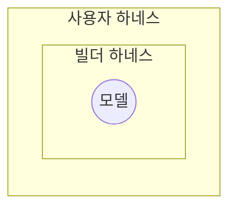
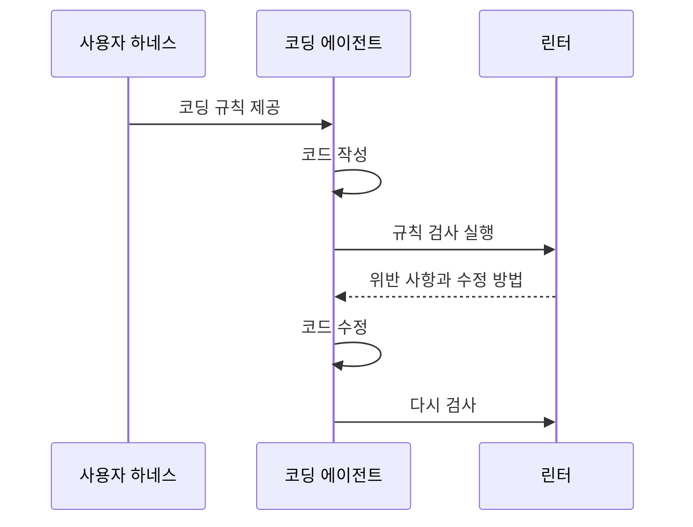
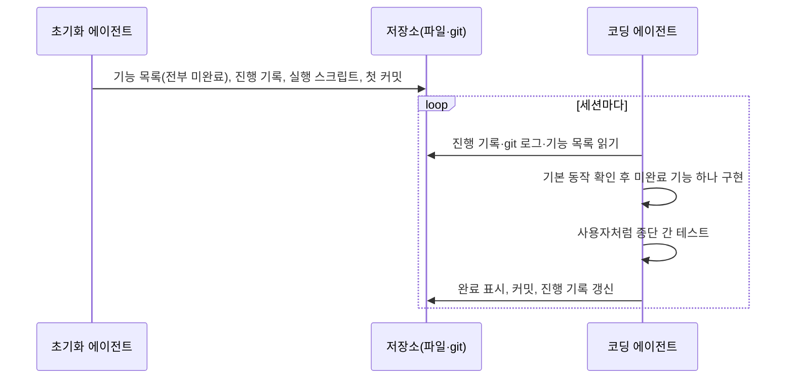

## 1. 개요

하네스(harness)는 AI 에이전트가 모델을 사용해 작업하도록 돕는 지침, 도구, 실행 환경과 제어 로직이다. 모델이 사용할 정보를 제공하고, 도구를 실행하며, 결과를 확인해 다음 작업으로 이어 준다. 모델과 이를 둘러싼 하네스를 합쳐 에이전트가 된다는 뜻에서 "Agent = Model + Harness"로 표현한다.

하네스 엔지니어링(harness engineering)은 모델이 유용한 일을 하도록 모델 주변 시스템을 설계하는 작업이다. Mitchell Hashimoto는 이를 "에이전트가 실수할 때마다, 그 실수를 다시는 하지 않도록 해결책을 설계하는 것"으로 설명했다. OpenAI의 한 팀은 사용자 정의 린터와 구조 테스트로 계층형 아키텍처를 강제하고, 코드 드리프트를 주기적으로 점검해 에이전트가 수정안을 제안하게 하는 하네스를 운영한 경험을 공개했다.[^1]

코딩 에이전트 사용자는 프로젝트의 규칙과 작업 방법을 제공하고, 테스트와 린터의 결과를 에이전트가 확인하도록 사용자 하네스를 구성한다. Böckeler는 이처럼 지침과 검증 결과를 에이전트에게 제공하는 설계를 [[context-engineering]]의 한 형태로 설명한다.[^2]

## 2. 범위

하네스라는 말은 맥락에 따라 범위가 다르다. 코딩 에이전트를 기준으로 Böckeler는 세 층으로 구분한다.

- **모델**: 하네스가 제어하는 대상
- **빌더 하네스**: 에이전트 제품에 내장된 부분. 시스템 프롬프트, 코드 검색 방식, 오케스트레이션 등
- **사용자 하네스**: 사용자가 자신의 프로젝트에 맞게 바깥에 구성하는 부분. 지시 파일([[ai-agent-schema]]), 스킬([[ai-agent-skill]]), 훅(hook), 린터, 테스트 등

§3은 빌더 하네스와 사용자 하네스를 아우르는 구성 요소를, §4와 §5는 사용자 하네스의 설계를 다룬다. 잘 만든 사용자 하네스는 에이전트가 처음부터 올바른 결과를 낼 확률을 높이고, 문제가 사람에게 도달하기 전에 에이전트가 스스로 고치게 한다. 그 결과 리뷰 부담과 낭비되는 토큰이 줄어든다.

## 3. 구성 요소

LangChain은 에이전트에게 필요한 동작을 기준으로 하네스의 구성 요소를 설명한다.

- **지침과 제어 로직**: 시스템 프롬프트와 도구 설명으로 작업 방향을 제공한다. 하위 에이전트의 호출과 작업 인계를 조정하고, 특정 이벤트가 발생하면 훅으로 정해진 처리를 실행한다.
- **파일 시스템**: 컨텍스트 창에 다 들어가지 않는 정보를 저장하고, 세션이 끝나도 작업을 유지하며, 여러 에이전트와 사람이 파일을 통해 협업한다. git을 더하면 작업 이력 추적과 되돌리기가 가능하다.
- **범용 실행 도구**: 필요한 도구를 사람이 모두 미리 만들 수 없으므로, bash나 코드 실행을 제공해 모델이 필요한 도구를 직접 만들어 쓰게 한다.
- **샌드박스와 검증 도구**: 에이전트가 생성한 코드를 격리된 환경에서 안전하게 실행한다. 테스트 실행기, 로그, 브라우저와 스크린샷으로 실행 결과를 확인하고 오류를 수정하게 한다.
- **메모리와 검색**: 모델은 가중치와 현재 컨텍스트 밖의 지식을 알지 못한다. `AGENTS.md` 같은 메모리 파일을 시작 시 주입하고, 웹 검색으로 학습 이후의 정보를 가져온다.
- **컨텍스트 관리**: 대화 요약(compaction), 큰 도구 출력의 파일 저장, 필요한 스킬만 불러오기 등으로 입력에 포함할 정보를 관리한다. 세부 전략은 [[context-engineering]] §5를 따른다.
- **장기 실행 지원**: 계획 파일로 작업을 분해하고, 각 단계 뒤에 테스트로 자체 검증하고, 에이전트가 종료하려 할 때 목표가 달성되지 않았으면 작업을 계속하게 한다. 적용 사례는 §6에서 다룬다.

## 4. 제어 방식

### 4.1. 가이드와 센서

Böckeler는 하네스의 제어를 행동 전과 행동 후로 나눈다.

- **가이드(feedforward)**: 에이전트가 행동하기 전에 방향을 잡아 첫 시도에서 좋은 결과가 나올 확률을 높인다. 코딩 규칙 문서, 아키텍처 설명, 작업 방법을 담은 스킬이 해당한다.
- **센서(feedback)**: 에이전트가 행동한 뒤 결과를 관찰해 스스로 고치게 한다. 테스트, 린터, 리뷰 에이전트가 해당한다. 오류 메시지에 수정 방법까지 담아 LLM(Large Language Model)이 바로 활용할 수 있게 만들면 효과가 크다.

예를 들어 코딩 규칙을 제공하면 에이전트가 이를 참고해 코드를 작성하고, 린터가 위반 사항을 알려 주면 코드를 수정할 수 있다. 가이드는 사전에 규칙을 알리고, 센서는 실제 준수 여부를 확인한다.

### 4.2. 계산적 제어와 추론적 제어

행동 전후를 구분하는 §4.1과 별개로, 가이드와 센서는 정해진 코드를 실행하는지 모델이 추론하는지에 따라 나뉜다.

| 구분 | 계산적(computational) | 추론적(inferential) |
| :--- | :--- | :--- |
| 실행 방법 | 정해진 코드와 규칙 | 모델의 추론 |
| 예 | 테스트, 린터, 타입 검사, 구조 분석 | AI 코드 리뷰, LLM 평가자(LLM as judge), 지시 문서 |
| 속도·비용 | 빠른 린터나 타입 검사는 자주 실행하기 쉬움 | 모델 호출 비용과 응답 시간이 필요함 |
| 결과 | 정해진 규칙에 따른 판정 | 확률적인 판단 |
| 적용 시점 | 빠른 검사는 변경마다 실행 | 의미 판단이 필요한 시점에 실행 |

Böckeler는 빠른 계산적 검사를 코드 변경마다 실행하고, 추론적 제어로 규칙만으로 표현하기 어려운 의미를 판단하는 방식을 설명한다. 두 방식 모두 검사 범위와 기준을 확인해야 한다. 정해진 규칙에 따라 판정한다고 해서 모든 오류를 찾는 것은 아니다. 가이드와 센서는 각각 두 방식 모두로 구현할 수 있다.

| 예 | 방향 | 방식 |
| :--- | :--- | :--- |
| 코딩 규칙(`AGENTS.md`, 스킬) | 가이드 | 추론적 |
| 코드 자동 변환 도구 | 가이드 | 계산적 |
| 커밋 전에 실행하는 모듈 경계 검사 | 센서 | 계산적 |
| 리뷰 방법을 담은 스킬 | 센서 | 추론적 |

코드 자동 변환 도구의 예로 OpenRewrite가 있고, 모듈 경계 검사는 ArchUnit 구조 테스트를 실행하는 훅으로 구현할 수 있다.

### 4.3. 조향 루프

사람은 하네스를 반복해서 개선하며 에이전트의 작업 방향을 조정한다. 같은 문제가 여러 번 발생하면 가이드나 센서를 보강해 재발 가능성을 낮추거나 아예 막는다. Hashimoto는 이를 두 가지로 실천한다. 에이전트가 잘못된 명령을 실행하거나 잘못된 API를 찾는 것 같은 단순한 문제는 `AGENTS.md`에 한 줄을 추가한다. 스크린샷 촬영이나 필터링된 테스트 실행처럼 검증이 필요한 부분은 스크립트를 만들고 `AGENTS.md`에 그 존재를 알린다. 하네스를 만드는 일에도 에이전트를 활용할 수 있다. 구조 테스트 작성, 관찰된 패턴에서 규칙 초안 생성, 커스텀 린터 작성을 에이전트에게 맡긴다.

### 4.4. 적용 시점

문제는 일찍 발견할수록 고치기 싸다. 따라서 센서를 개발 흐름의 비용과 속도에 맞게 배치한다.

- **커밋 전**: 린터, 빠른 테스트, 기본 리뷰 에이전트처럼 빠른 센서
- **통합 후 파이프라인**: 빠른 센서를 다시 실행하고, 뮤테이션 테스트나 큰 맥락을 보는 리뷰처럼 비싼 센서를 추가
- **상시**: 죽은 코드, 테스트 커버리지 품질, 의존성 스캔처럼 서서히 쌓이는 드리프트를 변경과 별개로 점검

## 5. 제어 대상

Böckeler는 사용자 하네스가 관리할 대상을 세 범주로 나눈다.

| 대상 | 지침 예시 | 검증 예시 |
| :--- | :--- | :--- |
| 유지보수성: 중복, 복잡도, 코드 스타일 등 내부 코드 품질 | 코딩 규칙, 모듈 경계 규칙 | 린터, 구조 테스트, 코드 리뷰 |
| 아키텍처 적합성: 성능, 관측성 등 아키텍처 특성 | 성능 요구사항, 로깅 규칙 | 성능 테스트, 로그 품질 검토 |
| 동작: 요구한 기능의 실행 결과 | 기능 명세 | 기능 테스트, 수동 테스트 |

아키텍처 적합성의 지침과 검증은 아키텍처 적합도 함수(fitness function)로 구성할 수 있다. 각 범주의 검증에는 한계가 있다. Böckeler는 구조적 문제는 기존 검사 도구로 찾기 쉽지만, 의미상 중복이나 과도한 설계에 대한 모델의 판단은 비용이 들고 확률적이라고 설명한다. 문제를 잘못 진단하거나 지시를 오해한 경우도 안정적으로 탐지하기 어렵다고 본다.

기능 검증에 대해서는 AI가 생성한 테스트와 수동 테스트를 함께 사용하는 방식을 관찰했으며, 생성된 테스트에 대한 의존이 커서 아직 충분하지 않다고 평가한다. 이는 Böckeler의 관찰과 평가다. 사람이 원하는 동작을 명확히 명시하지 않았다면 검증 기준도 정하기 어렵다.

## 6. 장기 실행

긴 작업이 여러 세션으로 나뉘면 다음 세션에 목표와 진행 상태를 전달해야 한다. Anthropic은 웹 앱 개발 실험에서 대화 요약만으로는 작업을 안정적으로 이어 가기 어려웠다고 보고했다.[^3]

- 한 번에 많은 기능을 구현하려다 입력 한도에 도달해 미완성 코드와 기록되지 않은 작업을 남김
- 일부 기능만 완성된 상태에서 전체 작업이 끝났다고 판단함
- 단위 테스트만으로 기능을 완료 처리하고 실제 사용 흐름을 확인하지 않음

이 실험에서는 첫 세션이 작업 환경을 준비하고, 이후 세션이 기능을 하나씩 구현하도록 역할을 나눴다. 기능 목록, 진행 기록과 검증 결과를 남겨 다음 세션이 현재 상태를 파악하게 했다.

실험에서는 기능 목록을 JSON으로 관리하고, 검증한 기능의 완료 여부만 바꾸도록 지시했다. Anthropic은 JSON이 마크다운보다 부적절하게 변경되는 일이 적었다고 보고했다. 기능을 하나씩 구현하고 브라우저 자동화로 검증한 것도 이 웹 앱 실험에서 사용한 방법이다.

## 7. 한계

### 7.1. 하네스 적용성

모든 코드베이스에 자동 검사와 제약을 적용하기 쉬운 것은 아니다. 정적 타입 언어는 타입 검사가 자연스러운 센서가 되고, 모듈 경계가 명확하면 아키텍처 규칙을 강제할 수 있으며, Spring 같은 프레임워크는 에이전트가 신경 쓸 세부 사항을 줄여 준다. 신규 프로젝트는 처음부터 이런 특성을 설계에 넣을 수 있다. 기술 부채가 쌓인 레거시에서는 검사 기준과 도구를 마련하기가 더 어렵다.

### 7.2. 사람의 역할

Böckeler는 개발자가 경험으로 익힌 관례와 조직의 맥락도 일종의 하네스로 본다. 에이전트가 이를 활용하려면 문서, 도구와 검사 규칙으로 옮겨야 한다. 다만 모든 판단을 명시적인 규칙으로 바꾸기는 어렵다. 사람이 판단해야 할 작업에 검토를 집중할 수 있도록 하네스를 설계한다.

### 7.3. 모델과의 관계

Claude Code, Codex 같은 에이전트 제품은 모델을 해당 하네스 안에서 사후 학습(post-training)한다. 그래서 모델은 학습된 하네스의 도구 형식에 익숙해지고, 도구 동작을 바꾸면 성능이 떨어지기도 한다. 그렇다고 학습에 쓰인 하네스가 항상 최선은 아니며, 같은 모델이라도 하네스에 따라 벤치마크 성적이 크게 달라진다.[^4] 모델이 계획, 자체 검증, 장기 일관성을 스스로 잘하게 되면 지금 하네스가 담당하는 일 일부는 모델로 흡수될 수 있다. 하지만 잘 구성된 환경, 적절한 도구, 영속 상태, 검증 루프는 모델 성능과 무관하게 효율을 높이므로 하네스 엔지니어링의 역할은 계속될 것으로 본다.[^5]

---

## Sources
- [LangChain: The Anatomy of an Agent Harness](https://blog.langchain.com/the-anatomy-of-an-agent-harness/)
- [Birgitta Böckeler(martinfowler.com): Harness engineering for coding agent users](https://martinfowler.com/articles/exploring-gen-ai/harness-engineering.html)
- [Mitchell Hashimoto: My AI Adoption Journey](https://mitchellh.com/writing/my-ai-adoption-journey)
- [Anthropic: Effective harnesses for long-running agents](https://www.anthropic.com/engineering/effective-harnesses-for-long-running-agents)

---

## Related pages
- [[ai-agent]]
- [[context-engineering]]
- [[ai-agent-schema]]
- [[ai-agent-skill]]
- [[multi-agent]]

---

[^1]: OpenAI 원문(Harness engineering)은 접근이 차단(HTTP 403)되어 직접 확인하지 못했다. 내용은 Böckeler의 글이 요약한 범위에서만 인용했다. Hashimoto는 글에서 업계에서 통용되는 용어가 있는지 모르겠다며 이 용어를 쓴다고 밝혔고, Böckeler는 이 용어가 처음 등장한 2026-02 초에 첫 메모를 썼다고 밝힌다. 용어의 최초 제안자는 출처마다 서술이 달라 특정하지 않았다.
[^2]: 코딩 에이전트 사용자가 프로젝트에 맞게 구성하는 사용자 하네스에 한정한 관점이다.
[^3]: Anthropic이 Claude Agent SDK와 Opus 4.5로 웹 애플리케이션을 만드는 내부 실험에서 관찰한 결과다. 다른 모델이나 하네스에서도 같은 양상이 나타난다는 근거는 원문에 없다.
[^4]: LangChain은 Terminal Bench 2.0에서 Claude Code로 실행한 Opus 4.6이 다른 하네스로 실행한 같은 모델보다 크게 낮은 점수를 받았다고 서술한다. 리더보드 원문은 직접 확인하지 않았다.
[^5]: LangChain의 전망이며 검증된 사실이 아니다.
