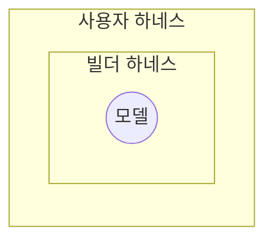
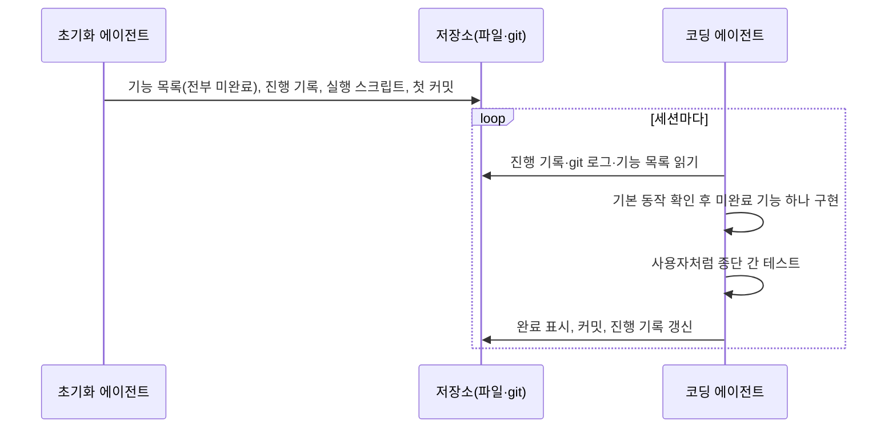

## 1. 개요

하네스(harness)는 AI 에이전트에서 모델을 제외한 나머지 전부를 가리킨다. 시스템 프롬프트, 도구와 그 설명, 파일 시스템이나 샌드박스 같은 실행 환경, 서브에이전트 호출 같은 오케스트레이션 로직, 결정적으로 실행되는 hook이 여기에 포함된다. 이를 "Agent = Model + Harness"로 표현한다. 모델 자체는 텍스트를 받아 텍스트를 내놓을 뿐이며, 하네스가 상태 유지, 도구 실행, 피드백 루프, 강제 가능한 제약을 더해야 에이전트가 된다.

하네스 엔지니어링(harness engineering)은 모델이 유용한 일을 하도록 모델 주변 시스템을 설계하는 작업이다. Mitchell Hashimoto는 이를 "에이전트가 실수할 때마다, 그 실수를 다시는 하지 않도록 해결책을 설계하는 것"으로 설명했다. OpenAI의 한 팀은 사용자 정의 린터와 구조 테스트로 계층형 아키텍처를 강제하고, 코드 드리프트를 주기적으로 점검해 에이전트가 수정안을 제안하게 하는 하네스를 운영한 경험을 공개했다.[^1]

[[context-engineering]]과의 관계에서 보면, 하네스는 좋은 컨텍스트를 모델에 전달하는 수단이다. compaction, 큰 도구 출력의 파일 저장, 스킬의 점진적 로드 같은 컨텍스트 관리 기법은 모두 하네스 기능으로 구현된다.

## 2. 범위

하네스라는 말은 맥락에 따라 범위가 다르다. 코딩 에이전트를 기준으로 Böckeler는 세 층으로 구분한다.

- **모델**: 하네스가 제어하는 대상
- **빌더 하네스**: 에이전트 제품에 내장된 부분. 시스템 프롬프트, 코드 검색 방식, 오케스트레이션 등
- **사용자 하네스**: 사용자가 자신의 프로젝트에 맞게 바깥에 구성하는 부분. 지시 파일([[ai-agent-schema]]), 스킬([[ai-agent-skill]]), hook, 린터, 테스트 등

이 문서에서 다루는 엔지니어링은 주로 사용자 하네스에 해당한다. 잘 만든 사용자 하네스는 에이전트가 처음부터 올바른 결과를 낼 확률을 높이고, 문제가 사람에게 도달하기 전에 에이전트가 스스로 고치게 한다. 그 결과 리뷰 부담과 낭비되는 토큰이 줄어든다.

## 3. 구성 요소

LangChain은 에이전트에게 원하는 동작에서 출발해 필요한 하네스 기능을 도출한다.

- **파일 시스템**: 컨텍스트 창에 다 들어가지 않는 정보를 저장하고, 세션이 끝나도 작업을 유지하며, 여러 에이전트와 사람이 파일을 통해 협업한다. git을 더하면 작업 이력 추적과 되돌리기가 가능하다.
- **범용 실행 도구**: 필요한 도구를 사람이 모두 미리 만들 수 없으므로, bash나 코드 실행을 제공해 모델이 필요한 도구를 직접 만들어 쓰게 한다.
- **샌드박스와 검증 도구**: 에이전트가 생성한 코드를 격리된 환경에서 안전하게 실행한다. 테스트 실행기, 로그, 브라우저, 스크린샷을 제공하면 에이전트가 작성, 테스트, 로그 확인, 수정을 반복하며 스스로 검증할 수 있다.
- **메모리와 검색**: 모델은 가중치와 현재 컨텍스트 밖의 지식을 알지 못한다. `AGENTS.md` 같은 메모리 파일을 시작 시 주입하고, 웹 검색으로 학습 이후의 정보를 가져온다.
- **컨텍스트 관리**: 작업이 진행될수록 컨텍스트가 차서 성능이 떨어지는 문제(context rot)에 대응한다. 세부 전략은 [[context-engineering]] §6을 따른다.
- **장기 실행 지원**: 계획 파일로 작업을 분해하고, 각 단계 뒤에 테스트로 자체 검증하고, 에이전트가 종료하려 할 때 목표가 달성되지 않았으면 작업을 계속하게 한다.

## 4. 제어 방식

### 4.1. 가이드와 센서

Böckeler는 하네스의 제어를 행동 전과 행동 후로 나눈다.

- **가이드(feedforward)**: 에이전트가 행동하기 전에 방향을 잡아 첫 시도에서 좋은 결과가 나올 확률을 높인다. 코딩 규칙 문서, 아키텍처 설명, 작업 방법을 담은 스킬이 해당한다.
- **센서(feedback)**: 에이전트가 행동한 뒤 결과를 관찰해 스스로 고치게 한다. 테스트, 린터, 리뷰 에이전트가 해당한다. 오류 메시지에 수정 방법까지 담아 LLM이 바로 활용할 수 있게 만들면 효과가 크다.

둘 중 하나만 있으면 문제가 생긴다. 센서만 있으면 에이전트가 같은 실수를 반복하고, 가이드만 있으면 규칙이 실제로 지켜졌는지 알 수 없다.

### 4.2. 계산적 제어와 추론적 제어

가이드와 센서는 실행 방식에 따라 다시 나뉜다.

| 구분 | 계산적(computational) | 추론적(inferential) |
| :--- | :--- | :--- |
| 실행 주체 | CPU | LLM |
| 예 | 테스트, 린터, 타입 검사, 구조 분석 | AI 코드 리뷰, LLM 평가자(LLM as judge), 지시 문서 |
| 속도·비용 | 빠르고 저렴 | 느리고 비쌈 |
| 결과 | 결정적, 신뢰 가능 | 비결정적 |
| 적용 시점 | 모든 변경마다 | 의미 판단이 필요한 시점 |

계산적 제어는 저렴해서 에이전트 옆에서 매 변경마다 실행할 수 있다. 추론적 제어는 비용이 들고 결과가 확률적이지만, 규칙으로 표현하기 어려운 의미 판단을 더할 수 있다. 지시 파일이나 스킬처럼 LLM이 읽고 따르는 가이드는 추론적 제어이고, hook으로 실행하는 테스트는 계산적 제어다.

### 4.3. 조향 루프

사람의 역할은 하네스를 반복 개선해 에이전트를 조향(steer)하는 것이다. 같은 문제가 여러 번 발생하면 가이드나 센서를 보강해 재발 가능성을 낮추거나 아예 막는다. Hashimoto는 이를 두 가지로 실천한다. 에이전트가 잘못된 명령을 실행하거나 잘못된 API를 찾는 것 같은 단순한 문제는 `AGENTS.md`에 한 줄을 추가한다. 스크린샷 촬영이나 필터링된 테스트 실행처럼 검증이 필요한 부분은 실제 도구(스크립트)를 만들고 `AGENTS.md`에 그 존재를 알린다. 하네스를 만드는 일에도 에이전트를 활용할 수 있다. 구조 테스트 작성, 관찰된 패턴에서 규칙 초안 생성, 커스텀 린터 작성을 에이전트에게 맡긴다.

### 4.4. 적용 시점

문제는 일찍 발견할수록 고치기 싸다. 따라서 센서를 개발 흐름의 비용과 속도에 맞게 배치한다.

- **커밋 전**: 린터, 빠른 테스트, 기본 리뷰 에이전트처럼 빠른 센서
- **통합 후 파이프라인**: 빠른 센서를 다시 실행하고, 뮤테이션 테스트나 큰 맥락을 보는 리뷰처럼 비싼 센서를 추가
- **상시**: 죽은 코드, 테스트 커버리지 품질, 의존성 취약점처럼 서서히 쌓이는 드리프트를 변경과 별개로 점검

## 5. 제어 대상

Böckeler는 하네스가 무엇을 바람직한 상태로 유지하려 하는지에 따라 세 범주로 나눈다.

- **유지보수성**: 내부 코드 품질. 기존 도구가 많아 가장 만들기 쉽다. 중복 코드, 복잡도, 커버리지 누락, 스타일 위반 같은 구조적 문제는 계산적 센서가 안정적으로 잡는다. 의미상 중복이나 과도한 설계는 LLM이 부분적으로 잡지만 비용이 크다. 문제를 잘못 진단하거나 지시를 오해한 경우는 어느 쪽도 안정적으로 잡지 못한다.
- **아키텍처 적합성**: 성능, 관측성 같은 아키텍처 특성. 성능 요구사항을 가이드로 주고 성능 테스트를 센서로 둔다. 아키텍처 적합도 함수(fitness function)와 같은 개념이다.
- **동작**: 애플리케이션이 기능적으로 의도대로 동작하는지. 현재는 기능 명세를 가이드로 주고, AI가 생성한 테스트의 통과 여부와 수동 테스트를 센서로 쓰는 경우가 많다. AI가 만든 테스트를 지나치게 신뢰하게 되므로 아직 충분하지 않다.

사람이 원하는 것을 명확히 명시하지 않았다면 정확성은 어떤 센서로도 보장할 수 없다.

## 6. 장기 실행

에이전트가 몇 시간에서 며칠에 걸친 작업을 할 때는 여러 컨텍스트 창을 거쳐야 하고, 새 세션은 이전 세션을 기억하지 못한다. Anthropic은 교대 근무하는 엔지니어가 매번 기억 없이 출근하는 상황에 비유한다. compaction만으로는 부족했고, 실험에서 다음 실패가 관찰되었다.[^2]

- 한 번에 너무 많은 것을 구현하려다 컨텍스트가 중간에 바닥나, 다음 세션이 반쯤 구현되고 기록되지 않은 상태에서 시작함
- 일부 기능이 완성된 것을 보고 다음 세션이 작업 전체가 끝났다고 판단함
- 단위 테스트만 하고 실제로 끝까지 동작하는지 확인하지 않은 채 기능을 완료로 표시함

해결책은 첫 세션과 이후 세션의 역할을 나누는 것이다.

- **초기화 에이전트**: 사용자의 요청을 수백 개의 세부 기능 목록으로 확장하고 모두 미완료로 표시한다. 진행 기록 파일, 개발 서버 실행 스크립트, 첫 커밋을 만든다.
- **코딩 에이전트**: 세션마다 진행 기록과 git 로그를 읽어 현재 상태를 파악하고, 기존 기능이 동작하는지 먼저 확인한다. 그다음 기능을 하나만 구현하고, 브라우저 자동화로 사람처럼 테스트한 뒤, 커밋과 진행 기록으로 다음 세션이 바로 이어받을 수 있는 깨끗한 상태를 남긴다.

기능 목록은 에이전트가 완료 여부 필드만 바꾸도록 지시하고, 마크다운보다 함부로 고쳐 쓰지 않는 경향이 있는 JSON으로 관리했다. 이 방식은 숙련된 엔지니어가 매일 하는 작업 습관을 하네스로 옮긴 것이다.

## 7. 한계

### 7.1. 하네스 적용성

모든 코드베이스가 하네스를 붙이기 쉬운 것은 아니다. 정적 타입 언어는 타입 검사가 자연스러운 센서가 되고, 모듈 경계가 명확하면 아키텍처 규칙을 강제할 수 있으며, Spring 같은 프레임워크는 에이전트가 신경 쓸 세부 사항을 줄여 준다. 신규 프로젝트는 처음부터 이런 특성을 설계에 넣을 수 있다. 반면 기술 부채가 쌓인 레거시는 하네스가 가장 필요한 곳에서 하네스를 만들기가 가장 어렵다.

### 7.2. 사람의 역할

사람 개발자는 경험 자체가 암묵적인 하네스다. 관례를 체득하고, 복잡도에서 오는 고통을 알고, 커밋에 자기 이름이 남는다는 책임감과 팀이 무엇을 용인하는지에 대한 조직적 맥락을 갖고 있다. 에이전트에는 이런 것이 없다. 하네스는 이 경험을 외부화해 명시하려는 시도지만 한계가 있다. 좋은 하네스의 목표는 사람의 개입을 없애는 것이 아니라, 사람의 판단이 가장 중요한 곳으로 개입을 모으는 것이다.

### 7.3. 모델과의 관계

Claude Code, Codex 같은 에이전트 제품은 모델을 해당 하네스 안에서 사후 학습한다. 그래서 모델은 학습된 하네스의 도구 형식에 익숙해지고, 도구 동작을 바꾸면 성능이 떨어지기도 한다. 그렇다고 학습에 쓰인 하네스가 항상 최선은 아니며, 같은 모델이라도 하네스에 따라 벤치마크 성적이 크게 달라진다.[^3] 모델이 계획, 자체 검증, 장기 일관성을 스스로 잘하게 되면 지금 하네스가 담당하는 일 일부는 모델로 흡수될 수 있다. 하지만 잘 구성된 환경, 적절한 도구, 영속 상태, 검증 루프는 모델 성능과 무관하게 효율을 높이므로 하네스 엔지니어링의 역할은 계속될 것으로 본다.[^4]

---

## Sources
- [LangChain: The Anatomy of an Agent Harness](https://blog.langchain.com/the-anatomy-of-an-agent-harness/)
- [Birgitta Böckeler(martinfowler.com): Harness engineering for coding agent users](https://martinfowler.com/articles/exploring-gen-ai/harness-engineering.html)
- [Mitchell Hashimoto: My AI Adoption Journey](https://mitchellh.com/writing/my-ai-adoption-journey)
- [Anthropic: Effective harnesses for long-running agents](https://www.anthropic.com/engineering/effective-harnesses-for-long-running-agents)

---

## Related pages
- [[ai-agent]]
- [[context-engineering]]
- [[ai-agent-schema]]
- [[ai-agent-skill]]

---

[^1]: OpenAI 원문(Harness engineering)은 접근이 차단(HTTP 403)되어 직접 확인하지 못했다. 내용은 Böckeler의 글이 요약한 범위에서만 인용했다. Hashimoto는 글에서 업계에서 통용되는 용어가 있는지 모르겠다며 이 용어를 쓴다고 밝혔고, Böckeler는 2026-02 메모에서 이 용어가 막 등장했다고 서술한다. 용어의 최초 제안자는 출처마다 서술이 달라 특정하지 않았다.
[^2]: Anthropic이 Claude Agent SDK로 웹 애플리케이션을 만드는 내부 실험에서 관찰한 결과다. 다른 모델이나 하네스에서도 같은 양상이 나타난다는 근거는 원문에 없다.
[^3]: LangChain은 Terminal Bench 2.0에서 Claude Code로 실행한 Opus 4.6이 다른 하네스로 실행한 같은 모델보다 크게 낮은 점수를 받았다고 서술한다. 리더보드 원문은 직접 확인하지 않았다.
[^4]: LangChain의 전망이며 검증된 사실이 아니다.
