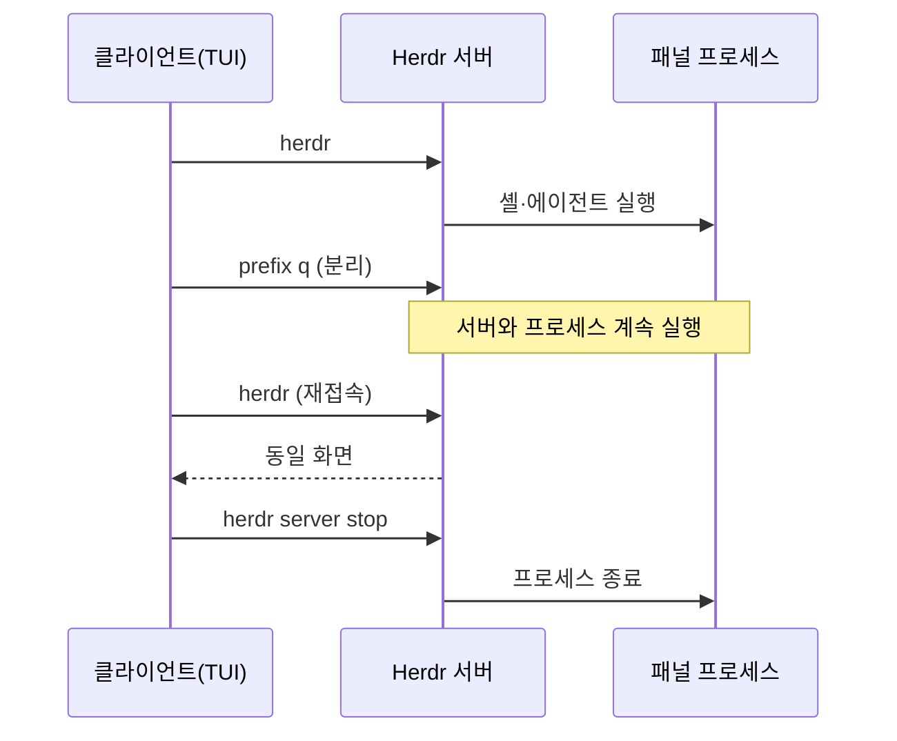

## 1. 개요

Herdr는 여러 AI 코딩 에이전트를 동시에 실행하기 위한 터미널 멀티플렉서(terminal multiplexer)다. tmux처럼 화면 분할과 세션 유지를 제공하고, 각 패널에서 실행 중인 Claude Code, Codex, OpenCode 같은 에이전트를 감지해 상태를 사이드바에 모아 표시한다. 실행 중인 서버는 CLI(Command-Line Interface)와 로컬 소켓 API(Application Programming Interface)를 제공하므로 에이전트가 다른 에이전트를 직접 제어할 수도 있다.

Herdr는 Ghostty, iTerm2, Kitty 같은 기존 터미널 안에서 실행되는 단일 Rust 바이너리이며, 패널 내부 터미널 에뮬레이션은 Ghostty 엔진인 libghostty가 담당한다. 웹 대시보드나 계정 없이 로컬 서버와 소켓으로 동작하고, 라이선스는 Apache 2.0이다.[^1] 여러 에이전트를 병렬로 실행하는 구조 자체는 [[multi-agent]]를 참고한다.

## 2. 설치

```sh
brew install herdr                              # macOS
curl -fsSL https://herdr.dev/install.sh | sh    # Linux, macOS
herdr                                           # 기본 세션 생성 또는 재접속
```

Windows는 0.8.2부터 stable 채널로 지원하며 PowerShell에서 설치한다. 프리뷰 버전 사용자는 stable 채널로 자동 전환되지 않으므로 `herdr channel set stable`로 직접 바꾼다.

```powershell
powershell -ExecutionPolicy Bypass -c "irm https://herdr.dev/install.ps1 | iex"
```

## 3. 구조

### 3.1. 계층

| 단위 | 역할 |
| :--- | :--- |
| 세션 | 독립된 Herdr 서버 네임스페이스. 패널, 소켓, 저장 상태가 세션별로 분리 |
| 워크스페이스 | 저장소, 작업, 조사 단위의 최상위 컨테이너 |
| 탭 | `agents`, `server`, `review`처럼 워크스페이스 안에서 구분하는 화면 배치 |
| 패널 | 셸과 프로세스가 실행되는 실제 터미널 |
| 에이전트 | 패널 안에서 Herdr가 인식한 프로세스 |

세션은 디렉터리별로 생성되지 않으며 어느 경로에서 `herdr`를 실행해도 기본 세션에 붙는다. 프로젝트는 워크스페이스로 나누고, 서버와 패널, 저장 상태를 따로 관리해야 할 때만 이름 있는 세션을 만든다.

```sh
herdr session list
herdr session attach work
```

### 3.2. 클라이언트와 서버

백그라운드 서버가 패널과 프로세스를 소유하고, 화면에 보이는 TUI(Terminal User Interface)는 서버에 붙는 클라이언트다. 0.9.0부터 서버 없이 실행하던 `--no-session` 모드가 제거되어 항상 서버를 거친다. 한 서버에 여러 클라이언트가 붙으면 클라이언트마다 다른 워크스페이스와 탭을 볼 수 있다. 분리와 종료 동작은 §6에서 다룬다.

## 4. 조작

### 4.1. 입력 방식

마우스로 패널·탭·워크스페이스를 선택하고 경계선을 드래그해 크기를 조절한다. 우클릭 메뉴에서 패널을 분할할 수 있다. 텍스트를 드래그하면 복사되므로 `Ctrl+C`로 패널 프로세스를 중단할 일이 줄어든다.

키보드는 tmux와 같은 프리픽스(prefix) 방식이며 기본값은 `Ctrl+b`다. 프리픽스를 누르고 뗀 뒤 동작 키를 누른다. 이하 `prefix v`는 `Ctrl+b`를 누르고 뗀 다음 `v`를 누른다는 뜻이다.

### 4.2. 기본 단축키

| 키 | 동작 |
| :--- | :--- |
| `prefix ?` | 단축키 목록 |
| `prefix c` | 새 탭 |
| `prefix v` | 오른쪽에 새 패널을 만드는 세로 분할 |
| `prefix -` | 아래에 새 패널을 만드는 가로 분할 |
| `prefix h/j/k/l` | 왼쪽/아래/위/오른쪽 패널로 이동 |
| `prefix Tab` | 다음 패널로 순환 |
| `prefix w` | 워크스페이스 탐색 화면 |
| `prefix g` | Go To 선택기 |
| `prefix q` | 클라이언트 분리 |

추가 단축키는 §10.2에서 다룬다.

### 4.3. 탐색

탐색 화면 안에서는 프리픽스 없이 입력한다. 워크스페이스 탐색 화면인 `prefix w`의 조작은 다음과 같다.

| 키 | 동작 |
| :--- | :--- |
| `↑` `↓` | 워크스페이스 목록 이동 |
| `h/j/k/l`, 방향키 | 포커스 이동 |
| `Tab`, `Shift+Tab` | 패널 순환 |
| `Enter` | 선택한 워크스페이스 열기 |
| `1`~`9` | 해당 번호 워크스페이스로 전환 |
| `Esc` | 뒤로 |

Go To 선택기인 `prefix g`는 에이전트와 터미널을 워크스페이스별로 묶어 나열한다. 검색하지 않을 때의 조작은 다음과 같다. 검색 중에는 좌우 방향키로 커서를 옮긴다.

| 키 | 동작 |
| :--- | :--- |
| `↑` `↓`, `j/k` | 목록 이동 |
| `←` `→` | 이전·다음 워크스페이스 그룹으로 이동 |
| `/` | 이름, 에이전트 종류, 탭, 브랜치, 경로 검색 |
| `b/w/i/d` | `blocked`/`working`/`idle`/`done` 상태로 필터 |
| `a` | 모든 터미널 표시 |
| `Enter` | 선택한 에이전트 또는 터미널로 이동 |
| `Esc` | 닫기 |

### 4.4. 패널 배치

`prefix Shift+h/j/k/l`은 현재 패널을 왼쪽/아래/위/오른쪽 패널과 교환한다. `prefix h/j/k/l`이 포커스만 옮기는 것과 달리 패널 자체의 위치가 바뀐다.

CLI로 패널 위치를 교환하거나 새 탭·워크스페이스로 옮길 수도 있다. 다음 명령은 Herdr 패널 안에서 실행한다.

```sh
# 오른쪽 패널과 위치 교환
herdr pane swap --current --direction right

# 지정한 두 패널의 위치 교환
herdr pane swap --source-pane <패널_ID> --target-pane <패널_ID>

# 현재 패널을 새 탭으로 이동
herdr pane move "$HERDR_PANE_ID" --new-tab

# 현재 패널을 새 워크스페이스로 이동
herdr pane move "$HERDR_PANE_ID" --new-workspace
```

## 5. 에이전트

### 5.1. 상태

| 상태 | 의미 |
| :--- | :--- |
| `blocked` | 질문, 승인, 결정 등 사람의 입력 필요 |
| `working` | 도구 실행 또는 응답 생성 중 |
| `done` | 작업 완료, 아직 확인하지 않음 |
| `idle` | 완료 또는 대기 상태이며 확인함 |
| `unknown` | 상태를 확신할 수 없음 |

`done`과 `idle`은 사용자가 결과를 봤는지로 구분하며, CLI·API에서는 둘 다 입력 가능 상태로 취급한다. 상태는 패널에서 탭, 워크스페이스로 집계되어 에이전트 하나가 `blocked`면 해당 워크스페이스도 `blocked`로 표시된다.

사이드바 정렬은 워크스페이스별 고정 순서(`grouped`)와 입력이 필요한 순서(`priority`) 중에서 선택한다. 설정 파일에서는 `grouped`를 `spaces`로 쓴다.

```toml
[ui]
agent_panel_sort = "priority"    # spaces | priority
```

### 5.2. 감지

Herdr는 패널의 전경 프로세스로 에이전트를 찾고, 화면 하단을 감지 매니페스트(detection manifest) 규칙과 대조해 상태를 판별한다. 통합(integration)이 상태를 보고하는 에이전트는 화면 판독 대신 그 보고를 사용한다. 화면 감지를 사용하는 에이전트는 알려진 승인·질문 화면과 일치할 때만 `blocked`로 표시한다. 인식된 에이전트에 일치하는 화면 규칙이 없으면 `idle`로 처리한다. 따라서 `idle`이나 `unknown`을 작업 완료나 승인 가능 신호로 간주하지 않고 결과를 직접 확인한다.

```sh
herdr agent explain <에이전트_또는_패널>    # 일치한 규칙과 최종 상태 판정 근거
```

Herdr 패널 안에서 tmux를 다시 실행하면 전경 프로세스가 tmux로 보여 에이전트를 감지하지 못한다. 셸 시작 스크립트가 tmux에 자동 접속한다면 Herdr 패널을 제외한다.

```zsh
if [[ -z ${TMUX:-} && ${HERDR_ENV:-} != 1 ]]; then
  tmux new-session -A -s main
fi
```

### 5.3. 통합

통합은 별도 데몬 없이 각 에이전트의 확장 방식에 맞춰 훅이나 플러그인을 설치한다. Claude Code에는 `~/.claude/hooks/`에 셸 스크립트를 설치하고 `settings.json`에 훅을 등록한다. OpenCode에는 JavaScript 플러그인을 설치한다.

```sh
herdr integration install claude          # Claude Code 통합 설치
herdr integration status                  # 설치 여부와 버전
herdr integration status --outdated-only  # 재설치가 필요한 통합만
```

통합은 에이전트의 고유 세션 ID를 Herdr에 전달하며, 이 ID는 서버 재시작 후 대화 재개에 사용된다. Claude Code와 Codex의 통합은 세션 ID를 전달하고, `working`과 `blocked` 상태는 §5.2의 화면 감지로 판별한다. OpenCode처럼 통합이 상태도 직접 보고하는 에이전트가 있다. 대화 복원 조건은 §6에서 다룬다.

## 6. 세션 유지

`prefix q`는 클라이언트만 분리하고, `herdr server stop`은 서버와 패널 프로세스를 종료한다.



| 경우 | 프로세스 | 레이아웃 | 에이전트 대화 |
| :--- | :--- | :--- | :--- |
| 분리 후 재접속 | 유지 | 유지 | 유지 |
| 서버 재시작 | 종료 | 워크스페이스, 탭, 패널, 작업 디렉터리 복원 | 지원되는 세션 참조가 있고 대화 복원이 활성화된 경우 재개 |

대화 복원에는 호환되는 공식 통합이 보고한 유효한 세션 참조나 에이전트가 직접 보고한 재개 명령이 필요하다. 기본값은 활성화이며 `[session] resume_agents_on_restore = false`로 끈다. 조건을 충족하지 못한 패널은 저장된 디렉터리에서 새 셸로 시작한다. 개발 서버나 임의의 셸 명령은 다시 실행되지 않는다.

재시작 시 화면 내용 복원은 `[experimental] pane_history = true`로 켤 수 있으나, 출력에 비밀값이 포함될 수 있어 기본값은 꺼져 있다.

## 7. 워크트리

여러 에이전트가 같은 체크아웃의 파일을 수정하면 서로의 변경을 덮어쓸 수 있으므로, git worktree를 워크스페이스와 연결해 작업 디렉터리를 분리한다. 새 워크트리는 원본 저장소 워크스페이스 아래에 묶여 표시된다.

```sh
herdr worktree create --cwd "$PWD" --branch feature/auth --base main --label auth --no-focus
herdr worktree list --cwd "$PWD"
herdr worktree remove --workspace <워크스페이스_ID>
```

`herdr workspace close`는 화면에서 워크스페이스만 닫고 체크아웃은 남긴다. 0.9.0부터 연결된 워크트리가 있는 원본 워크스페이스를 닫으려면 `--group`을 명시해야 한다. `herdr worktree remove`는 `git worktree remove`를 실행하며, 브랜치는 삭제하지 않고 커밋하지 않은 변경이 있으면 거부한다.

## 8. CLI 자동화

CLI로 패널을 만들고 다른 에이전트를 실행한 뒤 결과를 기다려 읽을 수 있다. 다음은 현재 패널 오른쪽에 코드 검토용 Codex를 실행하는 예다. Herdr 패널 안에서 실행하며 Codex와 jq가 설치되어 있어야 한다.

```sh
split=$(herdr pane split --current --direction right --cwd "$PWD" --no-focus)
pane=$(printf '%s\n' "$split" | jq -r '.result.pane.pane_id')

herdr agent start reviewer --kind codex --pane "$pane"
herdr agent prompt reviewer "현재 변경분을 리뷰하고 실제 버그만 보고" --wait --timeout 120000
herdr agent read reviewer --source recent-unwrapped --lines 120
```

패널 ID는 화면 순서로 추정하지 않고 생성 응답의 JSON에서 읽는다. `agent start`는 기존 프로세스를 정리하지 않으므로 셸 프롬프트가 떠 있는 패널을 지정한다. `agent wait`와 `agent prompt --wait`는 에이전트 상태만 관찰하므로, 에이전트가 프롬프트로 돌아온 뒤에도 백그라운드 작업이 남아 있을 수 있다.

종료·삭제 명령은 대상 범위를 확인한 뒤 실행한다. 패널은 `herdr pane close <패널_ID>`로, 워크트리는 `herdr worktree remove --workspace <워크스페이스_ID>`로 지정한다. ID는 생성 응답에서 읽는다. `--current`는 이를 지원하는 패널 명령에서만 사용한다. `herdr server stop`으로 서버를 종료하기 전에는 대상 세션을 확인하고, 이름 있는 세션은 `herdr --session <세션명> server stop`으로 지정한다.

CLI 사용법을 에이전트에게 알려주는 [[ai-agent-skill]]도 제공된다. 이 스킬은 `HERDR_ENV=1`로 Herdr 내부 실행 여부를 확인하고, 현재 패널 기준으로 분할하고 출력을 읽는 방법을 기술한다.

```sh
bunx skills add herdrdev/herdr --skill herdr -g   # 설치
herdr --skill                                     # 바이너리 내장 사본 출력
```

## 9. 원격 머신

### 9.1. 단일 접속

원격 서버에서 직접 실행하는 방식은 tmux와 같다. SSH(Secure Shell)로 접속해 `herdr`를 실행하고, 분리하면 원격 서버와 에이전트가 계속 실행된다. `herdr --remote <호스트>`를 쓰면 로컬 Herdr가 `~/.ssh/config`의 호스트를 사용해 원격 서버에 접속하는 클라이언트로 동작한다. 이 방식은 로컬 단축키와 이미지 클립보드 붙여넣기를 유지한다.

### 9.2. 여러 머신 관리

0.9.0부터 SSH 머신을 저장해 로컬과 원격 에이전트를 한 창에서 관리할 수 있다. `machine add`는 원격에 호환되는 Herdr가 없으면 확인 후 설치하고 서버를 띄운 뒤 프로필을 저장한다.

```sh
herdr machine add workbox --label "Build machine"
herdr machine list
herdr machine disable <프로필_ID>
herdr machine remove <프로필_ID>
herdr --machine "Build machine" agent list        # 0.9.1부터
```

사이드바에 `Local`과 저장한 머신이 함께 표시되고 에이전트 목록도 합쳐진다. 머신별 연결은 독립적이어서 한 머신의 연결이 끊겨도 다른 머신에는 영향이 없고, 끊긴 머신은 자동으로 재연결을 시도한다. 머신을 비활성화하거나 제거해도 원격 세션은 계속 실행된다.

패널 ID와 에이전트 이름은 서버마다 따로 매겨지고, 화면에서 원격 머신을 선택해도 기존 패널에서 실행하는 CLI의 대상은 바뀌지 않으므로 원격 대상에는 `--machine`을 명시한다.

## 10. 설정

### 10.1. 설정 파일

설정 파일은 Linux와 macOS에서 `~/.config/herdr/config.toml`이며 Windows에서는 `%APPDATA%\herdr\config.toml`이다. `herdr config check`로 문법을 검사하고, `herdr server reload-config` 또는 `prefix Shift+r`로 재시작 없이 적용한다.

```toml
[ui.sound]
enabled = true

[ui.sound.agents]
codex = "off"                    # default | on | off

[ui.toast]
delivery = "terminal"            # off(기본) | herdr | terminal | system
delay_seconds = 1

[keys]
prefix = "ctrl+a"
switch_workspace = "prefix+shift+1..9"
next_tab = ["prefix+n", "ctrl+alt+]"]

[[keys.command]]
key = "prefix+alt+g"
type = "popup"                   # popup | pane | shell
command = "lazygit"
width = "80%"
height = "80%"
```

알림음을 잠시 끌 때는 `HERDR_DISABLE_SOUND` 환경변수를 쓴다. `delivery = "terminal"`은 원격 서버에서 작업할 때 알림을 로컬 터미널에 띄운다. `delay_seconds`를 두면 잠깐 `blocked`였다가 바로 풀리는 상태 변화는 알리지 않는다. `prefix`를 바꾸면 `prefix+...` 정의 전체에 적용되고, 키 설정은 `herdr config reset-keys`로 초기화한다.

### 10.2. 추가 단축키

| 범위 | 키 | 동작 |
| :--- | :--- | :--- |
| 전역 | `prefix s` | 설정 화면 |
| 전역 | `prefix Shift+r` | 설정 파일 다시 읽기 |
| 전역 | `prefix o` | 알림 발생 위치로 이동 |
| 패널 | `prefix z` | 현재 패널 확대 |
| 패널 | `prefix r` | 크기 조절 모드 |
| 패널 | `prefix x` | 패널 닫기 |
| 패널 | `prefix Shift+p` | 패널 이름 변경 |
| 패널 | `prefix [` | 복사 모드 |
| 패널 | `prefix e` | 스크롤백을 편집기로 열기 |
| 화면 | `prefix b` | 사이드바 접기·펼치기 |
| 탭 | `prefix n` | 다음 탭 |
| 워크스페이스 | `prefix Shift+n` | 새 워크스페이스 |
| 워크스페이스 | `prefix Shift+g` | 새 워크트리 |
| 워크스페이스 | `prefix Shift+w` | 워크스페이스 이름 변경 |
| 워크스페이스 | `prefix Shift+d` | 워크스페이스 닫기 |

`prefix ?` 목록에서 `unset`으로 표시된 동작은 기본 키가 없다. 이전·다음 에이전트 이동, 번호로 에이전트 포커스, 워크트리 열기, 체크아웃 삭제가 여기에 속하며 §10.1의 `[keys]`에서 지정한다.

---

## Sources
- [Dale Seo: Herdr, AI 코딩 에이전트를 위한 터미널 멀티플렉서](https://daleseo.com/herdr/)
- [Herdr: Docs](https://herdr.dev/docs/)
- [Herdr: Concepts](https://herdr.dev/tui/docs/concepts/)
- [Herdr: Agents](https://herdr.dev/tui/docs/agents/)
- [Herdr: Session state](https://herdr.dev/tui/docs/session-state/)
- [Herdr: CLI reference](https://herdr.dev/tui/docs/cli-reference/)
- [Herdr: Integrations](https://herdr.dev/tui/docs/integrations/)
- [Herdr: Keyboard](https://herdr.dev/tui/docs/keyboard/)
- [Herdr: Config reference](https://herdr.dev/tui/docs/config-reference/)
- [GitHub: herdrdev/herdr](https://github.com/herdrdev/herdr)
- `raw/ai/Herdr, AI 코딩 에이전트를 위한 터미널 멀티플렉서.md`

---

## Related pages
- [[multi-agent]]
- [[ai-agent-skill]]
- [[harness-engineering]]
- [[ssh]]

---

[^1]: 원문은 0.9.1 기준이다. 작성 시점 GitHub 최신 릴리스는 v0.9.5(2026-10-14)이므로, 이후 변경된 CLI는 `herdr --help`로 확인한다.
