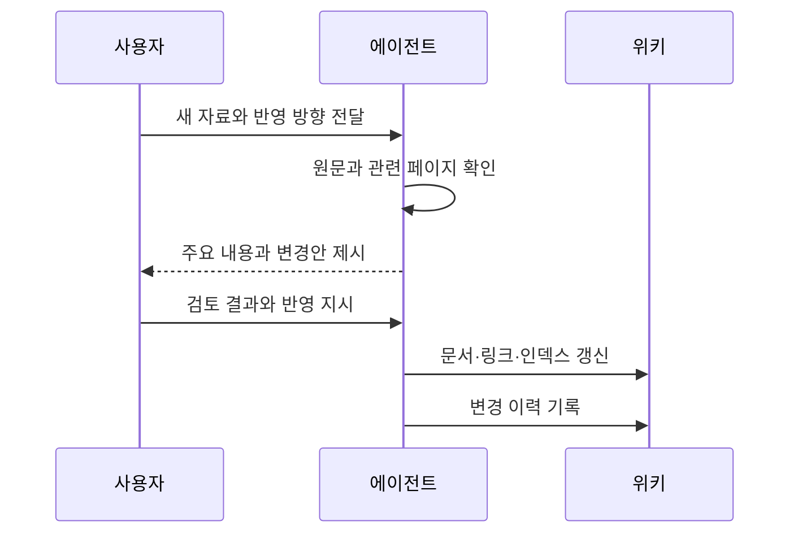
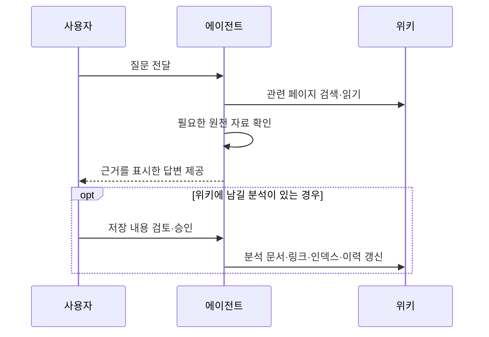
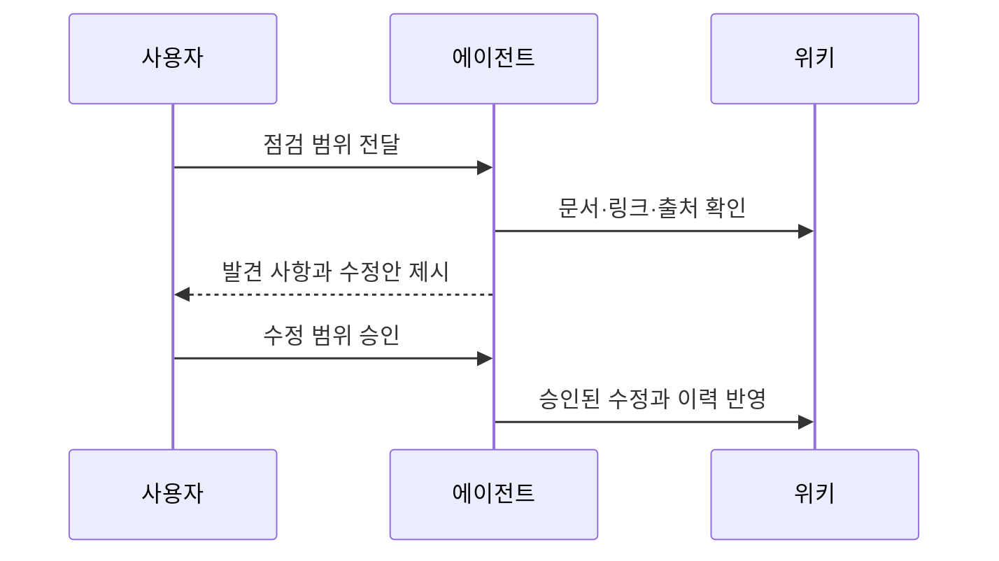

## 1. 개요

LLM Wiki는 Andrej Karpathy가 제안한 개인 지식 관리 패턴이다. 대규모 언어 모델(LLM, Large Language Model)을 사용하는 에이전트가 원천 자료를 읽고, 내용을 통합한 위키 문서를 지속적으로 관리한다. 사용자는 자료를 선정하고 질문하며, 에이전트가 작성한 내용과 변경 사항을 검토한다.

에이전트는 자료 요약, 관련 문서 갱신, 상호 참조 유지와 모순 표시를 담당한다. 새 자료뿐 아니라 질의에서 얻은 분석과 점검 결과도 위키에 반영할 수 있다. 대화에서 만든 답변을 문서로 남기고 기존 지식과 연결하는 것이 특징이다.

### 1.1. RAG와의 차이

검색 증강 생성(RAG, Retrieval-Augmented Generation)은 검색한 정보를 모델 입력에 포함해 답변을 생성하는 방식이다. 기본적인 문서 검색형 RAG는 질문마다 관련 자료를 찾아 답변을 구성한다. LLM Wiki는 여러 출처를 통합한 문서를 먼저 만들고 유지하며, 질문할 때 이 문서를 활용한다.[^1]

| 구분 | 기본적인 문서 검색형 RAG | LLM Wiki |
| :--- | :--- | :--- |
| 자료 처리 | 자료를 검색할 수 있도록 분할하고 색인 | 자료의 내용을 기존 위키 문서에 통합 |
| 질의 | 관련 자료를 검색해 답변 생성 | 관련 위키 문서를 읽고 필요하면 원천 자료 확인 |
| 관리 대상 | 원천 자료와 검색 색인 | 원천 자료와 이를 통합한 문서 및 상호 참조 |

두 방식은 함께 사용할 수 있다. 위키 문서를 검색 대상으로 삼거나, §4.4의 검색 기능으로 관련 페이지를 찾을 수 있다. GraphRAG처럼 지식 그래프와 요약을 미리 생성하는 RAG도 있으므로, 지식의 사전 통합 여부만으로 RAG 전체와 LLM Wiki를 구분할 수는 없다.

## 2. 구조

Karpathy는 원천 자료, 위키, 스키마의 세 계층으로 구분한다. 각 계층은 근거 보관, 지식 통합, 관리 규칙이라는 역할을 맡는다.

### 2.1. 원천 자료

`raw/`에는 기사, 논문, 공식 문서, 이미지와 데이터 등 사용자가 선정한 원본을 보관한다. 에이전트는 이를 읽되 수정하지 않는다. 위키의 설명을 확인하거나 다시 작성할 때 원본을 근거로 사용한다.

자료는 요약본과 구분해서 보관한다. 위키에는 해당 파일 경로나 웹 출처를 남겨 어떤 자료를 바탕으로 작성했는지 추적할 수 있게 한다. 웹 자료를 로컬 파일로 수집하거나 첨부 이미지를 함께 저장하는 방식도 사용할 수 있다.

### 2.2. 위키

`wiki/`에는 출처 요약, 개념 설명, 대상별 정보, 비교와 분석을 마크다운 문서로 저장한다. 관련 페이지는 `[[페이지명]]` 형식의 링크로 연결한다. 에이전트가 문서 관리를 주로 담당하고 사용자는 내용과 변경 사항을 검토한다.

`index.md`는 페이지 목록과 짧은 설명을 제공하는 카탈로그다. 변경 이력은 무엇을 언제 처리했는지 기록한다. 원본 패턴은 `log.md`를 예로 들지만, 실제 저장 위치와 기록 형식은 저장소의 규칙에 맞게 정한다.

위키 문서는 원천 자료를 통합한 결과이므로 원본 자체와 구분해야 한다. 새로운 자료가 기존 주장과 다르면 관련 페이지와 근거를 함께 확인하고, 차이를 표시하거나 내용을 갱신한다.

### 2.3. 스키마

스키마는 에이전트가 위키를 어떻게 관리할지 정의하는 운영 지침이다. 여기서 스키마는 데이터 구조를 검사하는 형식 정의가 아니라, 문서 형식과 작업 규칙을 담은 지침을 뜻한다. [[ai-agent-schema]] 같은 파일로 관리할 수 있다.

지침에는 디렉터리 구조, 파일명, 문서 형식, 출처 표기, 링크 규칙과 §3의 작업 절차를 담는다. 원천 자료의 수정 금지, 변경 전 승인, 이력 기록 같은 관리 규칙도 포함한다. 사용자는 에이전트와 작업하면서 필요한 규칙을 보완한다.

## 3. 워크플로우

### 3.1. 자료 통합

자료 통합(ingest)은 새 자료를 읽고 기존 위키에 반영하는 작업이다. 자료를 개별적으로 요약하는 데 그치지 않고, 관련 개념과 분석 문서를 함께 갱신한다. Karpathy는 자료를 하나씩 처리하며 요약과 변경 내용을 검토하는 방식을 예로 든다.

자료에 접근하지 못했거나 내용을 확인하지 못했다면 확인된 근거로 다루지 않는다. 원문에 있는 사실과 에이전트의 해석을 구분하고, 출처가 충돌하면 차이를 남긴다.

### 3.2. 질의

질의(query)는 관련 위키 문서를 찾아 질문에 답하는 작업이다. 인덱스나 검색 도구로 페이지를 찾고, 필요한 문서와 출처를 읽어 답변을 구성한다. 답변에는 근거가 된 문서나 자료를 표시한다.

질의에서 만든 비교나 분석은 새 페이지로 저장하거나 기존 문서에 통합할 수 있다. 저장 여부와 승인 절차는 §2.3의 지침으로 정한다. 답변을 저장할 때도 원천 자료와의 연결을 유지한다.

### 3.3. 점검

점검(lint)은 위키의 연결 상태와 내용의 품질을 확인하는 작업이다. 링크 대상과 문서 형식 같은 구조적 문제뿐 아니라, 오래된 주장이나 출처 간 모순도 살핀다.

| 항목 | 확인 내용 |
| :--- | :--- |
| 링크 | 존재하지 않는 페이지, 접근할 수 없는 웹 출처, 누락된 상호 참조 |
| 고아 페이지 | 다른 페이지에서 참조하지 않는 문서 |
| 정확성과 최신성 | 근거가 없는 서술, 출처 간 모순, 새 자료로 대체된 주장 |
| 지식 공백 | 설명이 필요한 개념, 근거가 부족한 부분, 추가 조사할 질문 |

LLM이 작성한 내용에도 오류와 누락이 있을 수 있다. 점검 결과는 수정 제안이며, 중요한 주장은 원천 자료로 확인한다. 이 문서의 검토·승인 절차는 현재 저장소의 운영 규칙을 반영한다.[^2]

## 4. 확장

rohitg00는 「LLM Wiki v2」라는 글에서 지식의 수명주기, 관계 표현, 검색과 자동화를 보완하는 방안을 제안했다. 다음 항목은 이 글의 확장 제안을 정리한 것이며, Karpathy 패턴의 공식 후속 버전이나 필수 구성은 아니다.[^3]

### 4.1. 신뢰도

주장마다 근거 출처, 마지막 확인 시점과 모순 여부를 기록한다. 새로운 근거가 추가되거나 기존 근거가 오래되면 신뢰도를 조정하는 방식이다. 문서에 적힌 주장들을 모두 같은 수준으로 취급하지 않고, 재확인이 필요한 내용을 구분하려는 목적이다.

제안자는 이를 점수로 표현할 것을 권한다. 다만 글에서 든 수치는 예시이며, 해당 점수가 실제 정확성과 일치한다는 검증 결과는 제시하지 않는다.

### 4.2. 지식 수명주기

새 정보가 기존 주장을 대체하면 두 내용을 연결하고, 이전 주장은 이력과 함께 오래된 정보로 표시한다. 파일의 변경 이력뿐 아니라 어떤 주장이 무엇으로 대체됐는지 관리하는 방식이다.

오랫동안 확인하거나 사용하지 않은 정보는 우선순위를 낮추고, 반복해서 확인한 관찰은 더 지속적으로 사용할 지식으로 통합하는 방안도 제안한다. 정보의 중요도와 종류에 따라 보존 기준을 다르게 둔다.

### 4.3. 지식 그래프

페이지 간 연결에 관계 유형을 부여한다. 단순한 관련 링크 외에 사용, 의존, 모순과 대체 같은 관계를 기록한다. 예를 들어 특정 라이브러리를 사용하는 프로젝트를 관계를 따라 찾을 수 있다.

그래프는 문서를 대체하지 않고 탐색을 보완한다. 문서는 설명을 제공하고, 그래프는 대상 사이의 관계를 찾는 데 사용한다.

### 4.4. 검색

인덱스가 커지면 전체 목록을 읽는 대신 필요한 페이지를 검색한다. 키워드 검색은 정확한 이름이나 용어를 찾고, 의미 검색은 표현이 다른 관련 내용을 찾으며, 그래프 탐색은 연결된 대상을 찾는다.

Karpathy도 선택적인 검색 도구 추가를 제안했다. rohitg00의 확장안은 키워드·의미·그래프 검색을 함께 사용하는 방식을 강조한다. 특정 페이지 수를 모든 위키에 적용되는 검색 도입 기준으로 보지는 않는다.[^4]

### 4.5. 자동화

새 자료가 추가되면 통합 작업을 시작하거나, 세션이 끝나면 분석 결과를 기록하거나, 정해진 주기로 점검을 실행한다. 반복 작업을 이벤트나 일정에 연결하는 방식이다.

확장안은 자동 모순 검사와 수정도 제안하지만, 사용자가 자료와 방향을 검토하는 역할은 유지한다. 자동 실행 범위와 승인 조건은 §2.3의 지침에서 정한다.

## 5. 구현 예시

다음은 공개 문서에서 확인한 구현 사례다. 설치와 실행은 검증하지 않았으며, 지원 기능과 운영 방식은 각 프로젝트의 문서를 기준으로 설명한다.

### 5.1. llm-wiki-agent

[SamurAIGPT/llm-wiki-agent](https://github.com/SamurAIGPT/llm-wiki-agent)는 마크다운 파일과 에이전트 지침을 중심으로 위키를 관리하는 구현이다. 출처 요약, 대상별 정보, 개념과 분석을 별도 디렉터리에 저장하고 인덱스와 변경 이력을 유지한다.

자료 통합, 질의와 점검 절차를 제공하며, 링크를 바탕으로 그래프를 생성하는 도구도 포함한다. 공개 지침은 구조 검사와 내용 점검을 구분한다. 기본 위키 작업은 에이전트가 파일을 읽고 쓰는 방식이며, 문서 변환과 그래프 생성 등은 별도 도구를 사용한다.

### 5.2. agentmemory

[rohitg00/agentmemory](https://github.com/rohitg00/agentmemory)는 코딩 세션의 기록, 결정과 해결 방법을 저장하고 이후 작업에서 검색하는 메모리 시스템이다. 프로젝트는 §4의 확장 제안을 구현한 시스템으로 소개한다.

세션 기록 수집, 키워드 검색, 선택적인 의미 검색과 기록 조회 기능을 제공한다. 마크다운 위키만 사용하는 구성과 달리 로컬 메모리 서버와 별도 저장소를 운영한다. 사람이 읽는 문서를 관리하는 기본 패턴에서 에이전트 간 기록 공유와 검색으로 범위를 확장한 사례다.

---

## Sources
- [Andrej Karpathy: LLM Wiki](https://gist.github.com/karpathy/442a6bf555914893e9891c11519de94f)
- [Microsoft: GraphRAG](https://microsoft.github.io/graphrag/)
- [rohitg00: LLM Wiki v2](https://gist.github.com/rohitg00/2067ab416f7bbe447c1977edaaa681e2)
- [SamurAIGPT: llm-wiki-agent](https://github.com/SamurAIGPT/llm-wiki-agent)
- [SamurAIGPT: llm-wiki-agent schema and workflow instructions](https://github.com/SamurAIGPT/llm-wiki-agent/blob/main/CLAUDE.md)
- [rohitg00: agentmemory](https://github.com/rohitg00/agentmemory)
- `AGENTS.md`

---

## Related pages
- [[ai-agent-schema]]
- [[okf]]
- [[ai-agent-skill]]

---

[^1]: Karpathy의 원문은 질문마다 원천 자료에서 답변을 구성하는 RAG와의 차이를 강조한다. 반면 Microsoft의 GraphRAG는 그래프와 요약을 사전 생성한다. 본문은 비교 대상을 기본적인 문서 검색형 RAG로 한정하고, RAG 전체에 지식의 축적이 없다고 보지는 않는다.
[^2]: 原본 패턴은 사용자의 관여 수준과 작업 절차를 스키마로 정하도록 한다. 변경안 제시와 승인 후 반영은 현재 저장소의 `AGENTS.md`에 따른 운영 방식이며, LLM Wiki 전체의 필수 조건은 아니다.
[^3]: 확장 제안과 효과에 대한 설명은 rohitg00의 관점이다. 「LLM Wiki v2」라는 제목은 해당 글의 명칭이며, 공식 버전 체계로 확인된 것은 아니다.
[^4]: Karpathy는 수백 페이지 규모에서 인덱스를 사용하는 경험을 설명하고, rohitg00는 약 100~200페이지 이후 검색이 필요하다고 주장한다. 두 글은 서로 다른 경험과 제안이며, 공통 조건에서 측정한 한계가 아니므로 고정된 도입 기준으로 일반화하지 않았다.
