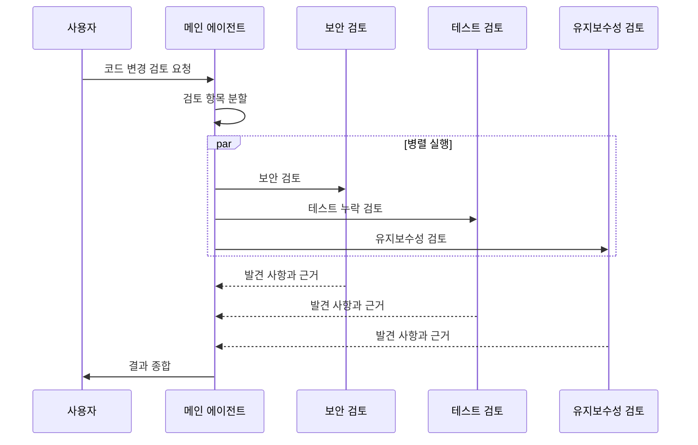

## 1. 개요

멀티 에이전트는 여러 AI 에이전트가 하나의 큰 작업을 나누어 수행하는 구조다. 예를 들어 코드 변경을 검토할 때 보안, 테스트 누락, 유지보수성을 각각 살펴보게 한 뒤, 메인 에이전트가 결과를 모아 사용자에게 전달할 수 있다.

여기서 메인 에이전트는 사용자 요청을 받고 하위 작업을 나누며 결과를 종합하는 에이전트다. 서브에이전트(subagent)는 메인 에이전트가 맡긴 하위 작업을 수행하는 에이전트다. 일반적인 서브에이전트 구성에서는 각 에이전트가 별도의 컨텍스트 창(context window)에서 작업하고, 메인 에이전트가 결과를 전달받는다. 구체적인 대화 기록과 결과 전달 방식은 도구마다 다르다.

멀티 에이전트는 [[ai-agent]] §4.4에서 설명한 위임을 여러 에이전트 사이에서 사용하는 구조다. 독립적인 하위 작업을 동시에 진행하면 전체 작업 시간을 줄일 수 있고, 탐색 기록이나 도구 출력 같은 중간 결과가 메인 에이전트의 컨텍스트를 차지하는 양도 줄일 수 있다. 반면 작업을 나누고 결과를 조정하는 비용이 추가된다.

## 2. 패턴

멀티 에이전트 시스템은 작업을 누가 조정하고 결과를 누가 사용자에게 전달하는지에 따라 여러 방식으로 구성할 수 있다. 이 문서에서는 두 가지 대표 패턴을 설명한다.

- **매니저**: 한 에이전트가 작업을 나누고 다른 에이전트에게 하위 작업을 맡긴다. 서브에이전트의 결과는 매니저가 모아 사용자에게 전달한다.
- **탈중앙**: 에이전트가 작업을 서로 넘긴다(handoff). 작업을 넘겨받은 에이전트가 이후 실행을 이어가고 사용자에게 응답할 수도 있다. 예를 들어 문의를 분류한 에이전트가 배송 문의 담당 에이전트에 작업을 넘길 수 있다.

에이전트 CLI에서 제공하는 서브에이전트 기능은 보통 매니저 패턴으로 동작한다. 다음은 코드 검토를 세 가지 독립 작업으로 나눈 예다.



## 3. 적용 기준

먼저 단일 에이전트나 고정된 작업 흐름으로 해결할 수 있는지 살펴본다. 여러 에이전트를 쓰면 작업 분배와 결과 취합 과정이 추가되므로, 병렬 처리나 작업 분리에서 얻는 이점이 조정 비용보다 클 때 적용한다.

| 판단 | 상황 |
| :--- | :--- |
| 적합 | 서로의 결과를 기다리지 않는 하위 작업을 동시에 처리할 때 |
| 적합 | 탐색, 테스트 실행, 로그 분석처럼 중간 출력은 많고 필요한 결론은 짧을 때 |
| 적합 | 하위 작업마다 사용할 도구나 접근 권한을 다르게 제한할 때 |
| 주의 | 여러 하위 작업이 같은 맥락이나 결정을 계속 공유해야 할 때 |
| 주의 | 여러 에이전트가 같은 파일이나 데이터를 동시에 수정할 때 |
| 부적합 | 사용자와 자주 대화하며 한 가지 결과를 함께 다듬어야 할 때 |

Anthropic은 조사처럼 여러 방향을 독립적으로 탐색할 수 있는 작업에서 멀티 에이전트의 이점을 보고했다. 반면 Cognition은 맥락 공유가 중요하고 하위 작업 간 결정이 서로 영향을 주는 코딩 작업에서 멀티 에이전트가 조정 문제를 일으킬 수 있다고 설명한다. 따라서 작업 특성과 에이전트 구성에 따라 적합성이 달라진다.[^1]

Codex 문서도 처음에는 탐색, 테스트, 분류, 요약처럼 읽기 위주의 작업에 병렬 에이전트를 사용하고, 여러 에이전트가 동시에 쓰는 작업은 신중하게 다루도록 권한다. Anthropic 역시 대부분의 코딩 작업에서 조사보다 실제 변경을 병렬화할 수 있는 범위가 작다고 설명한다.[^2]

## 4. 비용

서브에이전트는 각자 모델과 도구를 사용하므로, 에이전트 수와 작업량이 늘면 토큰 사용량과 실행 시간이 증가할 수 있다. Anthropic이 공개한 멀티 에이전트 조사 시스템의 비용 비교에서는 일반적인 대화보다 토큰 사용량이 크게 늘었다고 보고했다. 이 수치는 특정 시스템과 조사 작업에서 얻은 결과이므로, 다른 모델이나 작업에 그대로 적용할 수 없다.[^3]

작업이 단순하거나 결과를 합치는 비용이 큰 경우에는 서브에이전트를 추가해도 이득이 작을 수 있다. 반복되는 단순 작업에 더 빠르고 비용이 낮은 모델을 지정하면 비용을 줄일 수 있지만, 결과 품질이 요구사항을 충족하는지 확인해야 한다.

## 5. 실패 원인

- **맥락 부족**: 서브에이전트가 메인 에이전트의 대화나 결정을 전달받지 못하면 하위 작업을 다르게 해석할 수 있다.
- **결정 불일치**: 각 서브에이전트가 다른 가정을 바탕으로 결과를 만들면, 결과를 합칠 때 기준이나 형식이 맞지 않을 수 있다.
- **중복과 누락**: 작업 경계가 분명하지 않으면 여러 에이전트가 같은 일을 하거나 일부 작업이 빠질 수 있다.
- **과도한 위임**: 간단한 작업을 잘게 나누면 에이전트 간 조정에 드는 시간과 비용이 작업 자체보다 커질 수 있다.

Cognition은 에이전트가 필요한 맥락을 공유하지 못하는 문제와 각자의 행동에 내재한 결정이 충돌하는 문제를 지적한다. 이는 멀티 에이전트가 특히 작업 간 의존성이 높을 때 취약할 수 있음을 보여준다. 다만 이를 모든 작업에서 단일 에이전트를 써야 한다는 일반 규칙으로 해석해서는 안 된다.[^4]

## 6. 작성 원칙

- **명확한 위임**: 각 하위 작업의 목표, 작업 범위, 결과 형식, 사용할 도구를 지정한다.
- **좁은 역할**: 서브에이전트마다 한 가지 하위 작업을 맡기고, 그 작업에 필요한 도구를 제공한다.
- **필요한 맥락 전달**: 하위 작업에 필요한 사용자 요구사항, 결정 사항, 관련 자료를 함께 제공한다.
- **요약 반환**: 전체 탐색 기록 대신 결론과 근거 위치를 전달받는다.
- **수정 작업 분리**: 여러 에이전트가 같은 파일을 동시에 수정하지 않게 한다. 가능하면 한 에이전트가 수정하고 다른 에이전트는 읽기 전용 검토를 맡는다.

## 7. CLI 구성 예시

일부 에이전트 CLI에서는 정의 파일과 프롬프트로 서브에이전트를 구성할 수 있다. 정의 파일은 반복해서 사용할 역할과 지침을 저장할 때 유용하다. 일회성 작업이라면 별도 파일 없이 프롬프트로 하위 작업을 맡길 수도 있다. 파일 경로와 설정 항목은 도구 버전에 따라 달라질 수 있다.[^5]

### 7.1. Claude Code

프로젝트의 `.claude/agents/` 또는 사용자 디렉터리의 `~/.claude/agents/`에 Markdown 파일을 만든다. 예를 들어 다음과 같이 역할, 설명, 사용할 도구, 작업 지침을 적을 수 있다.

```markdown
---
name: reviewer
description: 변경된 코드의 정확성, 보안, 테스트 누락을 검토한다. 파일을 수정하지 않는다.
tools: Read, Grep, Glob
---
변경된 코드를 검토한다. 파일을 수정하지 않는다.
발견 사항마다 파일 경로와 근거를 붙여 요약으로 반환한다.
```

### 7.2. Codex

프로젝트의 `.codex/agents/` 또는 사용자 디렉터리의 `~/.codex/agents/`에 TOML 파일을 만든다. 다음은 이름, 설명, 지침을 지정하는 예다.

```toml
name = "reviewer"
description = "변경된 코드의 정확성, 보안, 테스트 누락을 검토한다."
developer_instructions = """
변경된 코드를 검토한다. 파일을 수정하지 않는다.
발견 사항마다 파일 경로와 근거를 붙여 요약으로 반환한다.
"""
```

Codex 서브에이전트는 메인 세션의 샌드박스와 승인 설정을 물려받는다. 지침에 “수정하지 않는다”고 적는 것만으로 파일 쓰기 권한이 차단되지는 않는다. 실제 권한은 메인 세션에서 설정한다.

### 7.3. 호출

위임을 요청할 때는 작업 분할 방식, 완료를 기다릴지 여부, 결과 형식을 함께 지정한다.

```text
현재 브랜치를 main과 비교해 검토해줘.
보안, 테스트 누락, 유지보수성을 각각 별도 서브에이전트에 맡겨줘.
모두 끝나면 항목별로 발견 사항과 파일 위치를 요약해줘.
```

프로젝트 지침 파일이나 스킬에 위임 규칙을 둘 수도 있다. 이 경우 실제 위임 동작은 사용하는 도구가 해당 지침을 읽고 적용하는 방식에 따라 달라진다.

---

## Sources

- [OpenAI: A practical guide to building agents](https://cdn.openai.com/business-guides-and-resources/a-practical-guide-to-building-agents.pdf)
- [OpenAI: Codex Subagents](https://developers.openai.com/codex/concepts/multi-agents)
- [Anthropic: Claude Code Subagents](https://code.claude.com/docs/en/sub-agents)
- [Anthropic: How we built our multi-agent research system](https://www.anthropic.com/engineering/multi-agent-research-system)
- [Anthropic: Building effective agents](https://www.anthropic.com/engineering/building-effective-agents)
- [Cognition: Don't Build Multi-Agents](https://cognition.com/blog/dont-build-multi-agents)

---

## Related pages

- [[ai-agent]]
- [[context-engineering]]
- [[harness-engineering]]
- [[ai-agent-skill]]

---

[^1]: Anthropic은 독립적인 조사 방향을 병렬로 탐색하는 작업에서 성능 향상을 보고했다. Cognition은 코딩 에이전트에서 맥락 공유와 하위 작업 간 결정 충돌 문제를 설명했다. 두 자료는 서로 다른 작업 유형과 시스템을 다루므로, 멀티 에이전트의 적합성은 작업 특성에 따라 판단해야 한다.
[^2]: Codex와 Anthropic 문서의 권고를 요약했다. 병렬화할 수 있는 작업의 범위는 저장소 구조와 변경 간 의존성에 따라 달라진다.
[^3]: Anthropic의 공개 수치는 해당 연구 시스템의 측정 결과다. 다른 작업의 토큰 비용을 예측하는 보편적 비율로 볼 수 없다.
[^4]: Cognition의 글은 맥락 공유와 에이전트 간 결정 충돌을 중심으로 멀티 에이전트의 단점을 설명한다. 본문은 이를 작업 간 의존성이 높은 경우에 대한 주의점으로 요약했다.
[^5]: 2026-11-09 기준 각 공식 문서의 내용을 반영했다. 파일 경로와 필드는 도구 버전에 따라 바뀔 수 있다.
