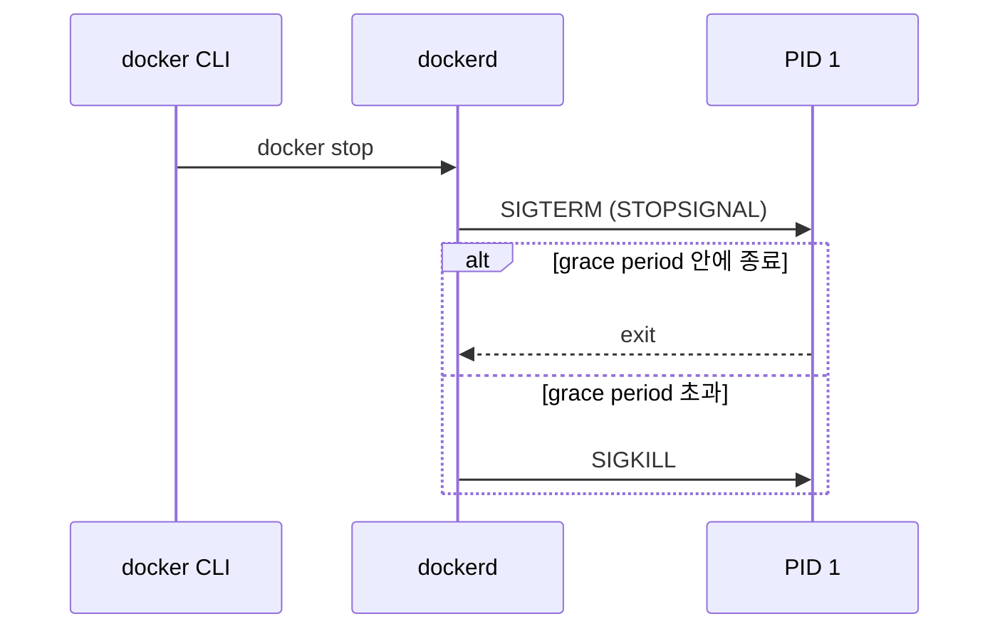

## 1. 라이프사이클

### 1.1. docker run

이미지로 새 컨테이너를 생성하고 실행한다.

- **`-d, --detach`**: 백그라운드로 실행하고 컨테이너 ID만 출력한다.
- **`-i, --interactive`**: 표준 입력(STDIN)을 열어 둔다.
- **`-t, --tty`**: 가상 터미널(TTY, Teletypewriter)을 할당한다. 셸을 쓸 때 `-it`로 함께 지정한다.
- **`-p, --publish`**: `호스트포트:컨테이너포트` 형식으로 포트를 매핑한다.
- **`-v, --volume`**: named 볼륨 또는 호스트 경로를 컨테이너 내부 경로에 마운트한다.
- **`-e, --env`**: 환경 변수를 설정한다.
- **`--rm`**: 컨테이너가 종료되면 컨테이너와 연결된 익명 볼륨을 함께 삭제한다.
- **`--restart`**: 재시작 정책을 지정한다. 기본값 `no`는 재시작하지 않고, `always`는 항상, `on-failure[:max-retries]`는 non-zero 종료 코드일 때만, `unless-stopped`는 수동 정지 전까지 재시작한다.

---

## 2. 운영

### 2.1. docker exec

실행 중인 컨테이너 안에서 새 프로세스를 실행한다.

- **`-it`**: 컨테이너 내부 셸에 접속할 때 사용한다.
- **`-u, --user`**: 지정한 사용자(UID 또는 이름)로 실행한다. 기본값은 컨테이너에 설정된 사용자이며, root 권한이 필요하면 `-u root`를 지정한다.
- **`-w, --workdir`**: 명령의 작업 디렉터리를 지정한다.

```bash
# root 사용자로 패키지 목록 갱신
docker exec -u root -it my-web-server apt-get update
```

### 2.2. docker cp

호스트와 컨테이너 사이에서 파일을 복사한다. 형식은 `docker cp <소스> <대상>`이며 컨테이너 쪽 경로는 `컨테이너명:경로`로 쓴다. 정지된 컨테이너에도 동작한다.

### 2.3. 정지·삭제

- **`docker stop`**: 메인 프로세스에 `SIGTERM`을 보내고 grace period(Linux 기본 10초)가 지나면 `SIGKILL`을 보낸다. 첫 시그널은 Dockerfile `STOPSIGNAL` 또는 `-s, --signal`로 바꿀 수 있다.
- **`docker kill`**: 즉시 `SIGKILL`을 보내 강제 종료한다.
- **`docker restart`**: 컨테이너를 정지한 뒤 다시 시작한다.
- **`docker rm`**: 정지된 컨테이너를 삭제한다. `-f`를 지정하면 실행 중인 컨테이너도 강제 삭제한다.
- **`docker container prune`**: 정지된 컨테이너를 모두 삭제한다.



---

## 3. 조회

### 3.1. docker inspect

컨테이너 메타데이터를 JSON으로 출력한다. `-f, --format`에 Go 템플릿을 지정하면 특정 필드만 추출한다.

```bash
# 컨테이너 상태
docker inspect -f '{{.State.Status}}' <ID>

# 컨테이너 IP 주소
docker inspect -f '{{range .NetworkSettings.Networks}}{{.IPAddress}}{{end}}' <ID>

# 로그 파일 경로
docker inspect -f '{{.LogPath}}' <ID>

# 마운트 목록
docker inspect -f '{{json .Mounts}}' <ID>
```

### 3.2. docker ps

컨테이너 목록을 조회한다.

- **`-a, --all`**: 종료된 컨테이너까지 모두 출력한다.
- **`-q, --quiet`**: 컨테이너 ID만 출력한다. `docker rm $(docker ps -aq)`처럼 일괄 작업에 쓴다.
- **`-s, --size`**: 쓰기 가능 레이어의 데이터 양(size)과, 여기에 컨테이너가 쓰는 읽기 전용 이미지 데이터를 더한 크기(virtual size)를 출력한다.
- **`-f, --filter`**: `status=exited`, `name=my-app` 등의 조건으로 필터링한다.

### 3.3. docker logs

컨테이너 로그를 출력한다.

- **`-f, --follow`**: 새 로그를 계속 출력한다.
- **`-n, --tail`**: 끝에서부터 출력할 줄 수를 지정한다. 기본값은 `all`이다.
- **`-t, --timestamps`**: 각 줄 앞에 타임스탬프를 붙인다.
- **`--since`**: `10m`, `2024-05-01` 등 지정 시점 이후의 로그만 출력한다.

---

## 4. 자원 관리

### 4.1. docker stats

실행 중인 컨테이너의 자원 사용량을 실시간으로 출력한다.

- **CPU %**: 호스트 CPU 대비 사용률
- **MEM USAGE / LIMIT**: 메모리 사용량과 제한값
- **NET I/O**: 네트워크 송수신량
- **BLOCK I/O**: 블록 장치 읽기·쓰기량
- **PIDS**: 컨테이너가 생성한 프로세스·스레드 수

```bash
# 실시간 스트리밍
docker stats

# 한 번만 출력
docker stats --no-stream
```

### 4.2. docker update

컨테이너의 자원 한도를 재시작 없이 변경한다.

```bash
docker update --cpus 2 --memory 4g my-app
```

---

## Sources
- [Docker Docs: docker container](https://docs.docker.com/reference/cli/docker/container/)
- [Docker Docs: docker container stats](https://docs.docker.com/reference/cli/docker/container/stats/)
- [Docker Docs: Storage drivers](https://docs.docker.com/engine/storage/drivers/)
- [Docker Docs: docker container run](https://docs.docker.com/reference/cli/docker/container/run/)
- [Docker Docs: docker container stop](https://docs.docker.com/reference/cli/docker/container/stop/)

---

## Related pages
- [[docker-container]]
- [[docker-overview]]
- [[docker-volume-commands]]
