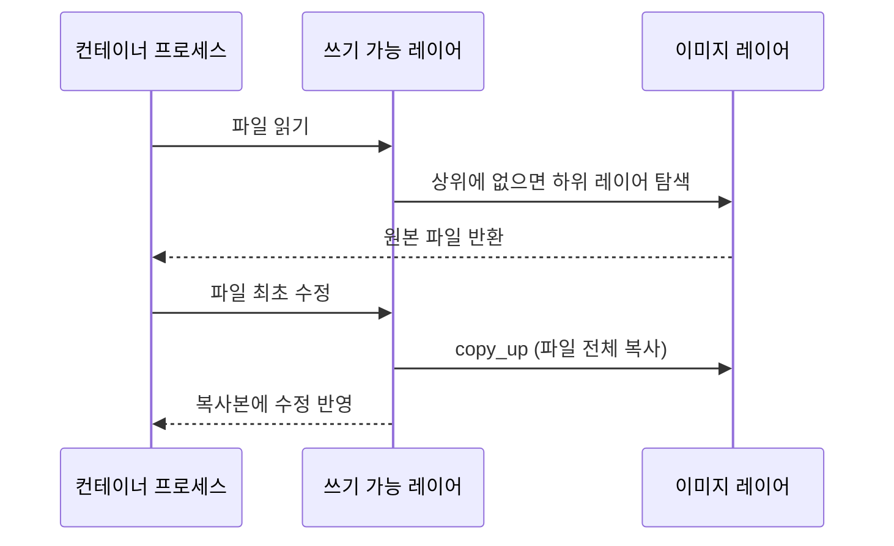

## 1. 개요

Docker 이미지는 컨테이너를 생성할 때 사용하는 읽기 전용 템플릿이다. 이미지에는 애플리케이션 파일과 실행 설정이 포함된다. 이미지 내용은 생성 후 바뀌지 않지만, 태그는 다른 이미지 digest를 가리키도록 갱신될 수 있다.

이미지 크기 최적화는 [[dockerfile]] §3.1에서 다룬다.

---

## 2. 구조

### 2.1. 레이어

- **읽기 전용 레이어**: 이미지는 Dockerfile 지시어(`RUN`, `COPY`, `ADD` 등)가 만든 읽기 전용 레이어를 쌓아 구성한다. 각 레이어는 이전 레이어와의 차이만 저장한다.
- **레이어 공유**: 같은 베이스 레이어를 쓰는 이미지들은 그 레이어를 한 번만 저장하므로 디스크 공간과 네트워크 대역폭이 절약된다.
- **콘텐츠 주소 지정**: 각 레이어는 내용의 SHA-256 해시로 식별되어 무결성을 검증할 수 있다.

### 2.2. 매니페스트

매니페스트는 특정 아키텍처·OS용 단일 이미지의 config와 레이어 목록을 digest로 참조하는 JSON 메타데이터이며, 레이어는 쌓이는 순서대로 나열된다. 환경 변수, `Entrypoint`, `Cmd`, `architecture`, `os`는 매니페스트가 참조하는 image config에 들어 있다. 여러 플랫폼의 이미지는 image index가 플랫폼별 매니페스트를 묶는다.

---

## 3. 스토리지 드라이버

도커는 이미지 레이어와 컨테이너의 쓰기 가능 레이어를 스토리지 드라이버로 관리한다. Docker Engine 29.0부터 새로 설치하면 containerd image store(snapshotter)가 기본이며, 아래 표는 classic storage driver 기준이다.

| 드라이버 | 특징 |
| :--- | :--- |
| `overlay2` | 현재 지원되는 모든 Linux 배포판의 권장 classic 드라이버 |
| `fuse-overlayfs` | rootless overlay2를 지원하지 않는 호스트에서 Rootless Docker를 실행할 때만 사용. Linux 5.11부터는 overlay2가 rootless에서 동작해 불필요 |
| `btrfs`, `zfs` | 해당 파일 시스템을 쓰는 호스트에서 사용하며 스냅샷 기능 제공 |
| `vfs` | CoW를 지원하지 않아 매번 전체 복사. 테스트용 |

---

## 4. CoW(Copy-on-Write)

고전 스토리지 드라이버에서 CoW는 이미지 레이어의 파일을 공유하다가 컨테이너 쓰기 가능 레이어에서 수정할 때 복사하는 전략이다. containerd 이미지 저장소는 snapshotter를 사용하므로 구체적인 저장 동작은 snapshotter 구현에 따라 다르다.

- **공유**: 하위 레이어의 파일을 읽기만 할 때는 복사하지 않고 기존 파일을 참조한다.
- **copy-up**: 고전 스토리지 드라이버에서 컨테이너가 이미지 레이어의 파일을 처음 수정할 때 파일을 쓰기 가능 레이어로 복사한 뒤 수정한다.
- **장점**: 변경분만 저장해 공간을 절약하고, 컨테이너 생성 시 얇은 쓰기 가능 레이어만 추가하므로 빠르게 시작한다.
- **단점**: 대용량 파일이나 깊은 디렉터리 트리에서 처음 수정할 때 발생하는 `copy_up`이 성능을 떨어뜨릴 수 있다. 쓰기가 많은 데이터는 [[docker-volume]] 사용이 권장된다.

---

## 5. 명령어

| 명령어 | 설명 |
| :--- | :--- |
| `docker build -t <이름>:<태그> .` | Dockerfile로 이미지 빌드 |
| `docker image ls` | 로컬 이미지 목록과 크기 조회 |
| `docker image inspect <이름>` | 레이어 digest 등 메타데이터 조회 |
| `docker image history <이름>` | 레이어 생성 이력과 실행 명령 조회 |
| `docker image prune` | 태그가 없는 dangling 이미지 삭제 |

---

## Sources
- [Baeldung: Difference Between Docker Images and Containers](https://www.baeldung.com/ops/docker-images-vs-containers)
- [Baeldung: Tips for Creating Efficient Docker Images](https://www.baeldung.com/ops/efficient-docker-images)
- [Docker Docs: Storage drivers](https://docs.docker.com/engine/storage/drivers/)
- [OCI: Image Manifest Specification](https://github.com/opencontainers/image-spec/blob/main/manifest.md)
- [OCI: Image Configuration](https://github.com/opencontainers/image-spec/blob/main/config.md)
- [Docker Docs: Select a storage driver](https://docs.docker.com/engine/storage/drivers/select-storage-driver/)

---

## Related pages
- [[docker-overview]]
- [[docker-container]]
- [[docker-volume]]
- [[dockerfile]]
