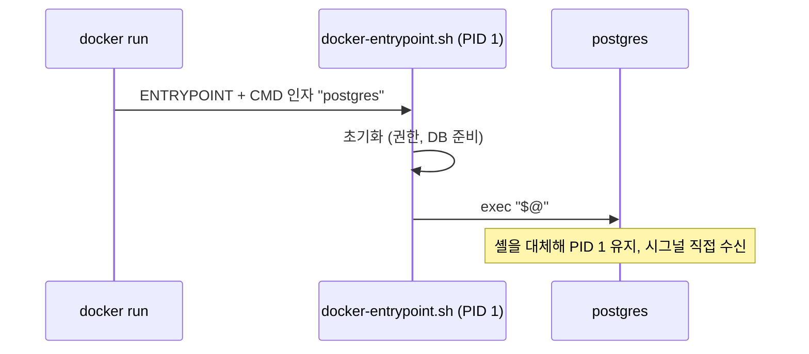

## 1. 개요

이 문서는 Dockerfile의 실행 형식과 `RUN`, `COPY`, `ADD`, `ENTRYPOINT`, `CMD` 등 주요 지시어의 동작을 설명한다.

---

## 2. 실행 형식

`RUN`, `CMD`, `ENTRYPOINT`는 exec form과 shell form 두 형식을 지원한다.

### 2.1. Exec Form

`["executable", "param1", "param2"]`처럼 JSON 배열로 작성한다. 셸을 거치지 않고 실행 파일을 직접 실행하므로 `$VAR` 같은 셸 변수 확장이 일어나지 않는다. 컨테이너의 주 프로세스를 exec form으로 실행하면 실행 파일이 PID 1이 되어 `docker stop`의 종료 시그널을 직접 처리할 수 있다.

```dockerfile
ENTRYPOINT ["java", "-jar", "app.jar"]
```

### 2.2. Shell Form

`command param1 param2`처럼 셸 명령 형태로 작성하며 `/bin/sh -c`로 실행된다. 셸 변수 확장, 파이프(`|`), 리다이렉션(`>`)을 쓸 수 있다. `ENTRYPOINT`에 이 형식을 쓰면 실행 파일이 PID 1인 셸의 자식 프로세스가 되어 Unix 시그널을 받지 못하고, `docker stop` 시 grace period가 지나 `SIGKILL`로 종료된다.

```dockerfile
RUN apt-get update && apt-get install -y git
```

---

## 3. RUN

### 3.1. 캐시 버스팅

`RUN apt-get update`와 `RUN apt-get install -y curl`을 별도 지시어로 두면, 이후 설치 패키지만 바꿔도 `update` 레이어는 캐시를 재사용해 오래된 패키지 목록으로 설치하게 된다. `update`와 `install`을 하나의 `RUN`으로 묶으면 설치 목록이 바뀔 때 `update`도 다시 실행된다.

```dockerfile
RUN apt-get update && apt-get install -y \
    curl \
    git
```

---

## 4. COPY·ADD

### 4.1. COPY

빌드 컨텍스트나 다른 빌드 스테이지의 파일을 이미지로 복사한다. 기능이 단순해 일반적인 파일 복사에 권장된다. 복사할 필요가 없는 파일은 `.dockerignore`로 빌드 컨텍스트에서 제외한다.

### 4.2. ADD

`ADD`는 `COPY`의 기본 복사 기능에 원격 HTTPS·Git URL 가져오기와 빌드 컨텍스트 tar 아카이브 자동 압축 해제를 더한 지시어다. 로컬 tar 아카이브는 복사하면서 압축을 풀지만, 원격 URL에서 받은 tar 파일은 기본적으로 압축을 풀지 않는다. 원격 파일을 가져올 때는 `ADD --checksum`으로 체크섬을 검증할 수 있다. 일반 파일 복사에는 `COPY`를 사용하고, `ADD`는 원격 소스나 자동 압축 해제가 필요한 경우에 선택한다.

```dockerfile
ADD --checksum=sha256:<digest> https://example.com/app.tar.gz /tmp/
```

---

## 5. ENTRYPOINT·CMD

`ENTRYPOINT`는 컨테이너의 주 실행 파일을 지정하고, `CMD`는 기본 명령이나 기본 인자를 지정한다. 두 지시어를 함께 사용할 때와 `docker run`에서 인자를 전달할 때의 관계는 다음과 같다.

| 구성 | 동작 |
|---|---|
| `CMD`만 지정 | 컨테이너 시작 시 실행할 기본 명령과 인자를 지정한다. |
| `ENTRYPOINT`와 `CMD` 지정 | `ENTRYPOINT`를 주 명령으로 실행하고 `CMD`를 기본 인자로 전달한다. |
| `docker run`에 인자 전달 | 이미지의 `CMD` 기본값을 대체한다. |
| `docker run --entrypoint` 지정 | 이미지의 `ENTRYPOINT`를 대체한다. |

### 5.1. 헬퍼 스크립트

권한 설정, DB 준비 등 초기화가 필요하면 `ENTRYPOINT`에 셸 스크립트를 지정한다. 스크립트 끝에서 `exec "$@"`로 `CMD`를 실행하면 셸 프로세스가 애플리케이션으로 대체되어 애플리케이션이 PID 1로 시그널을 받는다.

```dockerfile
COPY ./docker-entrypoint.sh /
ENTRYPOINT ["/docker-entrypoint.sh"]
CMD ["postgres"]
```



---

## 6. ARG·ENV

- **ARG**: 빌드 시점 변수로 `--build-arg`로 값을 전달하며, ENV처럼 이미지에 영속되지 않는다. 값이 `docker history`와 max 모드 provenance에 노출되므로 시크릿은 `RUN --mount=type=secret`으로 전달한다.
- **ENV**: 이미지에 영속되어 컨테이너 실행 시에도 유지되는 환경 변수이다.

---

## Sources
- [Baeldung: Difference Between run, cmd and entrypoint in a Dockerfile](https://www.baeldung.com/ops/dockerfile-run-cmd-entrypoint)
- [Docker Docs: Building best practices](https://docs.docker.com/build/building/best-practices/)
- [Docker Docs: Dockerfile reference](https://docs.docker.com/reference/dockerfile/)

---

## Related pages
- [[dockerfile]]
- [[docker-image]]
