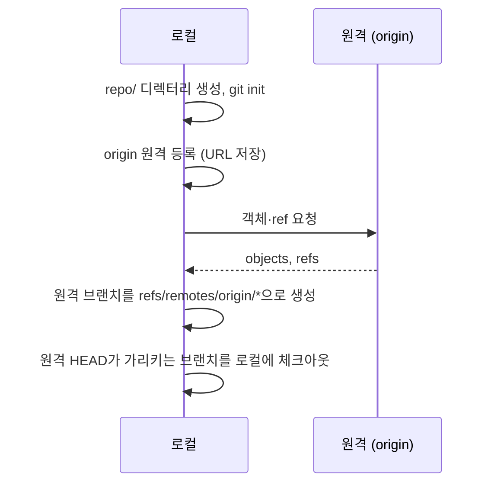

## 1. 개요

원격(또는 로컬) 저장소를 로컬에 복제한다. 전체 히스토리와 모든 브랜치를 포함한 완전한 사본을 만들고, `origin`이라는 이름으로 원격을 자동 등록한다.

---

## 2. 동작 순서

```bash
git clone https://github.com/user/repo.git
```



---

## 3. URL 형식

| 프로토콜 | 형식 | 특징 |
|----------|------|------|
| HTTPS | `https://github.com/user/repo.git` | 방화벽 통과 용이. 토큰/비밀번호 인증 |
| SSH | `git@github.com:user/repo.git` | 공개키 인증. 비밀번호 없이 사용 편리 |
| SSH (URL) | `ssh://git@github.com/user/repo.git` | SSH 명시적 URL 형식 |
| 로컬 | `/path/to/repo.git` | 같은 파일시스템. hardlink 사용으로 빠름 |
| 로컬 (file://) | `file:///path/to/repo.git` | 로컬이지만 네트워크 전송 방식 사용 |

---

## 4. 기본 옵션

### 4.1. 디렉터리명 지정

```bash
git clone https://github.com/user/repo.git           # → ./repo/
git clone https://github.com/user/repo.git myproject  # → ./myproject/
git clone https://github.com/user/repo.git .          # 현재 디렉터리 (비어 있어야 함)
```

### 4.2. `-b` / `--branch`

```bash
git clone -b develop https://github.com/user/repo.git
git clone -b release/1.2.0 https://github.com/user/repo.git
```

브랜치명 대신 태그도 지정할 수 있으며 이 경우 해당 커밋에서 Detached HEAD 상태가 된다([[git-detached-head]]). 히스토리는 전체를 받고 체크아웃 대상만 달라진다.

### 4.3. `-o` / `--origin`

```bash
git clone -o upstream https://github.com/original/repo.git
# origin 대신 upstream으로 원격이 등록됨
```

오픈소스 기여 시 `upstream`(원본)과 `origin`(내 fork)을 구분할 때 사용한다.

---

## 5. 얕은 복제 (Shallow Clone)

히스토리 전체가 아닌 최근 N개 커밋만 복제한다. 저장소가 크거나 CI/CD 파이프라인처럼 전체 히스토리가 불필요한 경우에 유용하다.

```bash
git clone --depth 1 https://github.com/user/repo.git          # 최신 커밋 1개
git clone --depth 10 https://github.com/user/repo.git         # 최근 10개 커밋
git clone --shallow-since="2025-01-01" https://...            # 날짜 이후 히스토리만
git clone --depth 1 --no-tags https://github.com/user/repo.git  # CI: 태그 제외
```

얕은 복제의 특성:
- 불완전한 히스토리이므로 `git log`에서 이전 커밋이 보이지 않음
- 나중에 `git fetch --unshallow`로 전체 히스토리를 보완할 수 있음
- `--depth`는 암묵적으로 `--single-branch`를 적용 (다른 브랜치는 받지 않음)

---

## 6. 단일 브랜치 복제

```bash
git clone --single-branch -b main https://github.com/user/repo.git
```

지정한 브랜치의 히스토리만 복제한다. 이후 `git fetch`는 해당 브랜치의 원격 추적 브랜치만 갱신하므로, 다른 브랜치는 refspec을 명시해 fetch하거나 `remote.origin.fetch`를 변경해야 한다.

반대로 모든 브랜치를 명시적으로 받으려면:

```bash
git clone --no-single-branch https://github.com/user/repo.git
```

---

## 7. 부분 복제 (Partial Clone)

blob(파일 내용) 객체를 나중에 필요할 때만 받는다. 매우 큰 저장소에서 clone 속도를 높일 때 사용하며, 파일에 실제로 접근하는 시점에 해당 blob을 내려받는다.

```bash
# blob을 전혀 받지 않음 (메타데이터만)
git clone --filter=blob:none https://github.com/user/repo.git

# 1MB 이상 파일은 나중에 받음
git clone --filter=blob:limit=1m https://github.com/user/repo.git
```

---

## 8. 서브모듈 포함 복제

```bash
git clone --recurse-submodules https://github.com/user/repo.git

# 서브모듈도 shallow clone으로
git clone --recurse-submodules --shallow-submodules https://...
```

`--recurse-submodules` 없이 복제하면 서브모듈 디렉터리가 비어 있다. 나중에 초기화하려면:

```bash
git submodule update --init --recursive
```

---

## 9. Bare / Mirror 복제

```bash
# Bare: 워킹 트리 없는 서버용 저장소
git clone --bare https://github.com/user/repo.git repo.git

# Mirror: --bare + 모든 refs(브랜치, 태그, 원격 추적 브랜치, notes 등) 복제
#         저장소 완전 백업 또는 미러 서버 구축에 사용
git clone --mirror https://github.com/user/repo.git repo.git
```

`--mirror`는 원본의 모든 ref를 그대로 매핑하는 refspec을 설정하므로, 이후 `git remote update`를 실행하면 이 ref들이 원본 값으로 덮어써진다.

---

## 10. 설정 주입

```bash
git clone -c core.autocrlf=false \
          -c user.email="ci@company.com" \
          https://github.com/user/repo.git
```

clone과 동시에 로컬 설정을 주입한다. CI 환경에서 전역 설정 없이 저장소별 설정을 적용할 때 유용하다.

---

## Sources
- [git-clone](https://git-scm.com/docs/git-clone)
- [git-fetch](https://git-scm.com/docs/git-fetch)
- [Pro Git: Git Basics Getting a Git Repository](https://git-scm.com/book/en/v2/Git-Basics-Getting-a-Git-Repository)

---

## Related pages
- [[git-init]]
- [[git-internals]]
- [[git-file-states]]
- [[git-fetch-pull-push]]
