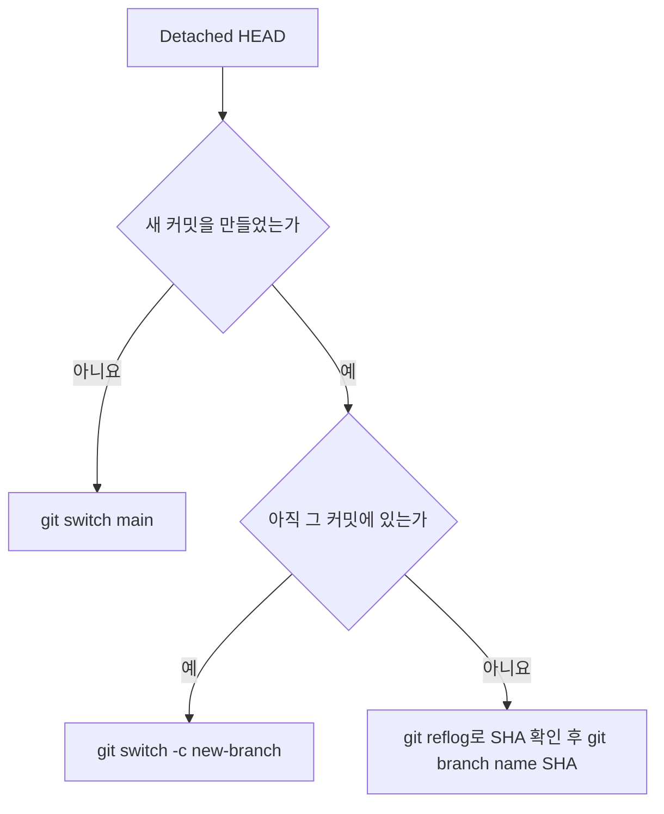

## 1. 개요

정상 상태에서 `HEAD`는 브랜치를 가리키는 심볼릭 참조다.

```
# 정상 (Attached HEAD)
$ cat .git/HEAD
ref: refs/heads/main
```

Detached HEAD는 HEAD가 브랜치가 아닌 커밋 SHA를 직접 가리키는 상태다.

```
# Detached HEAD
$ cat .git/HEAD
a3f1d2e8b9c4f7e6d5a2b1c8f3e9d7a4b2c6e1f0
```

```bash
# 현재 상태 확인
git status
# HEAD detached at a3f1d2e

git branch
# * (HEAD detached at a3f1d2e)
#   main
#   develop
```

`git rev-parse --abbrev-ref HEAD`는 Attached 상태에서 브랜치 이름을, Detached 상태에서 `HEAD`를 출력하므로 스크립트에서 상태를 판별할 수 있다.

```bash
if [ "$(git rev-parse --abbrev-ref HEAD)" = "HEAD" ]; then
    echo "Detached HEAD 상태"
fi
```

---

## 2. 발생 원인

### 2.1. 커밋 SHA / 태그로 직접 체크아웃

```bash
git checkout a3f1d2e          # SHA 직접 지정
git checkout v1.2.0           # 태그
git checkout HEAD~3           # 상대 참조
```

### 2.2. 원격 추적 브랜치 체크아웃

```bash
git checkout origin/main      # 원격 브랜치는 로컬 브랜치가 아님
```

`origin/main`은 브랜치가 아닌 원격 추적 참조이므로 그 커밋을 직접 가리키게 된다.

### 2.3. `git rebase` 진행 중

rebase는 내부적으로 각 커밋을 순서대로 replay하면서 HEAD를 커밋에 직접 붙인다. 충돌이 발생하면 그 상태에서 멈춘다.

### 2.4. `git bisect` 진행 중

`git bisect start` 이후 Git이 이진 탐색으로 커밋을 체크아웃할 때 항상 Detached HEAD 상태다.

### 2.5. CI 체크아웃

CI/CD 시스템이 브랜치가 아닌 특정 커밋을 직접 체크아웃할 때도 발생한다.

---

## 3. 작업 범위

Detached HEAD 자체는 에러 상태가 아니다. 탐색·실험 목적으로는 그냥 사용해도 된다.

```bash
# 과거 코드 탐색 및 빌드 테스트
git checkout v1.1.0
./gradlew build

# 커밋도 가능 (단, 브랜치에 연결되지 않음)
vim src/Main.java
git add .
git commit -m "실험적 수정"
```

단, 브랜치로 돌아가면 이 커밋들은 어떤 브랜치에도 속하지 않게 된다. 일정 시간 후 GC에 의해 삭제될 수 있다.

---

## 4. 해결 방법



### 4.1. 탐색만 한 경우

작업한 내용이 없거나 버려도 된다면 그냥 브랜치로 이동한다.

```bash
git switch main
# 또는
git checkout main
```

### 4.2. 새 커밋 보존

즉시 새 브랜치를 만들어 연결한다.

```bash
git switch -c my-experiment        # 현재 HEAD를 새 브랜치로
# 또는
git checkout -b my-experiment
```

그 후 다른 브랜치에 반영:
```bash
git switch main
git merge my-experiment            # 머지
# 또는
git cherry-pick <SHA>              # 특정 커밋만 가져오기
```

### 4.3. 잃어버린 커밋 복구

`git reflog`로 잃어버린 커밋 SHA를 찾아 브랜치로 복구한다.

```bash
# 1. reflog에서 잃어버린 커밋 찾기
git reflog
# a3f1d2e HEAD@{1}: commit: 실험적 수정   ← 이 SHA
# 9c2b4f1 HEAD@{2}: checkout: moving from main to a3f1d2e

# 2. 해당 SHA로 브랜치 생성
git branch rescued-work a3f1d2e

# 3. (선택) 필요하다면 cherry-pick
git switch main
git cherry-pick a3f1d2e
```

reflog 항목은 기본 90일(`gc.reflogExpire`) 보존되지만, 현재 끝에서 도달할 수 없는 커밋의 항목은 기본 30일(`gc.reflogExpireUnreachable`)이다. Detached HEAD에서 만든 뒤 떠난 커밋은 후자에 해당한다.

### 4.4. 원격 브랜치 추적

```bash
# 잘못된 방법 (Detached HEAD 발생)
git checkout origin/feature/login

# 올바른 방법 — 로컬 추적 브랜치 생성
git checkout -b feature/login origin/feature/login
# 또는 (Git 2.23+)
git switch feature/login           # origin에 같은 이름이 있으면 자동 추적 설정
```

---

## Sources
- [gitrevisions](https://git-scm.com/docs/gitrevisions)
- [git-rev-parse](https://git-scm.com/docs/git-rev-parse)
- [git-gc](https://git-scm.com/docs/git-gc)

---

## Related pages
- [[git-revisions]]
- [[git-internals]]
- [[git-log]]
