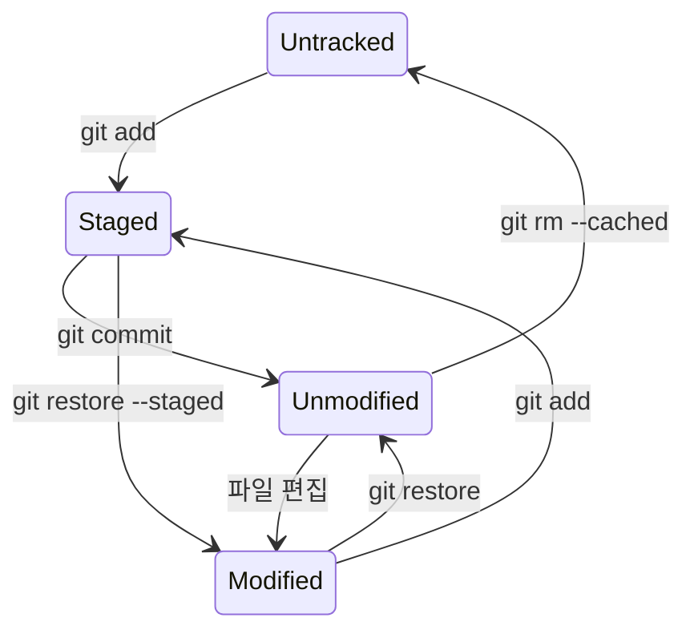

## 1. 개요

작업 트리의 파일은 추적 여부와 변경·스테이징 여부에 따라 상태가 나뉜다. 각 상태와 상태를 확인·전환하는 명령을 다루며, 상태가 놓이는 영역 구조는 [[git-internals]] §3에서 다룬다.

---

## 2. 파일 상태



| 상태 | 위치 | 설명 |
|------|------|------|
| Untracked | Working Tree | Git이 전혀 모르는 새 파일. 마지막 스냅샷에도, 스테이징에도 없음 |
| Unmodified | Working Tree | 추적 중이며 마지막 커밋 이후 변경 없음 |
| Modified | Working Tree | 추적 중이며 마지막 커밋 이후 변경됨. 아직 스테이징 안 됨 |
| Staged | Staging Area | 다음 커밋에 포함될 것으로 표시됨 (`git add` 이후) |

---

## 3. 상태 확인

### 3.1. git status

```bash
git status           # 전체 상태
git status -s        # 짧은 형식 (short)
git status --short
```

`-s` 출력은 `[Staging Area][Working Tree]` 두 자리 컬럼으로 상태를 표시한다.

```
?? new-file.txt        # Untracked
A  staged-new.txt      # 새 파일, Staged
 M modified.txt        # Modified (스테이징 안 됨)
M  staged-mod.txt      # Modified + Staged
MM both.txt            # Staged 이후 Working Tree에서 또 수정됨
D  deleted.txt         # 삭제, Staged
 D removed.txt         # 삭제 (스테이징 안 됨)
```

| 기호 | 의미 |
|------|------|
| `??` | Untracked |
| `A` | Staging Area에 새로 추가됨 |
| `M` | Modified |
| `D` | Deleted |
| `R` | Renamed |
| `C` | Copied |

### 3.2. git diff

```bash
git diff             # Working Tree vs Staging Area (Unstaged 변경)
git diff --staged    # Staging Area vs 마지막 커밋 (Staged 변경)
git diff --cached    # --staged 와 동일
git diff HEAD        # Working Tree vs 마지막 커밋 (전체 변경)
git diff <commit>    # 특정 커밋과 비교
```

`git diff`는 스테이징되지 않은 변경만 보여주므로 모든 변경을 스테이징하면 아무것도 출력하지 않는다. 스테이징된 변경은 `--staged`로 확인한다.

---

## 4. 상태 전환 명령어

각 명령의 옵션은 [[git-add]], [[git-commit]], [[git-switch-restore]]에서 다룬다.

### 4.1. git add

`git add`는 실행 시점의 파일 내용을 스테이징한다. `git add` 이후 파일을 다시 수정하면 이전 버전만 스테이징된 상태이므로 `git add`를 다시 실행해야 한다.

`git add`의 3가지 역할:
1. Untracked 파일 추적 시작
2. Modified 파일 스테이징
3. Merge 충돌 파일을 해결됨으로 표시

### 4.2. git commit

`git commit -a`는 추적 중인 Modified 파일을 자동 스테이징한 뒤 커밋하며 Untracked 파일은 포함하지 않는다.

커밋 출력 읽기:
```
[main 463dc4f] feat: 로그인 기능 추가
 2 files changed, 45 insertions(+), 3 deletions(-)
 create mode 100644 src/LoginService.java
```

| 필드 | 설명 |
|------|------|
| `main` | 브랜치명 |
| `463dc4f` | 커밋 SHA 앞 7자 |
| `create mode 100644` | 새 파일 생성 (권한 644) |

### 4.3. git restore

```bash
git restore <file>             # Working Tree 변경 취소 → 스테이지 상태로
git restore --staged <file>    # Staged → Unstaged (스테이징 취소, 파일 내용은 유지)
```

### 4.4. git rm

```bash
git rm <file>              # Working Tree에서 삭제 + 스테이징 영역에서 제거
git rm --cached <file>     # 스테이징 영역에서만 제거 (파일은 디스크에 유지)
                           # → 이후 Untracked 상태
git rm -f <file>           # Modified 또는 Staged 상태인 파일 강제 삭제
git rm -r --cached <dir>/  # 디렉터리 전체를 추적 중단 (.gitignore 적용 전 커밋된 파일 제거 시)
```

실수로 커밋된 파일 추적 중단:
```bash
git rm --cached .env
echo ".env" >> .gitignore
git commit -m "chore: remove .env from tracking"
```

### 4.5. git mv

```bash
git mv old-name.java NewName.java
git mv src/Foo.java src/bar/Foo.java
```

내부적으로 `git rm` + `git add`와 동일하다. Git은 명시적 `mv` 없이 수동으로 파일을 이동/삭제한 뒤 `add`해도 rename으로 자동 감지한다.

---

## 5. .gitignore

Untracked 파일 중 Git이 무시해야 할 파일 패턴을 정의한다.

```
# 주석
*.class          # 확장자 일치
*.jar
target/          # 디렉터리 전체 (하위 포함)
build/
.env             # 특정 파일
*.log

/TODO            # 루트의 TODO만 (하위 디렉터리 TODO는 제외)
doc/*.txt        # doc 바로 아래 .txt (doc/sub/a.txt 제외)
doc/**/*.pdf     # doc 하위 전체 .pdf

!lib.a           # 예외: *.a 무시하지만 lib.a는 추적
```

자바 백엔드 프로젝트 기본:
```
# Build
target/
build/
*.class
*.jar
*.war

# IDE
.idea/
*.iml
.eclipse/
.settings/
.classpath
.project

# 환경 설정
.env
*.env.local
application-local.yml
application-local.properties

# OS
.DS_Store
Thumbs.db
```

이미 커밋된 파일은 `.gitignore`를 추가해도 무시되지 않는다. `git rm --cached`로 추적을 먼저 중단해야 한다.

---

## 6. 상태 전환 표

| 명령어 | Before | After |
|--------|--------|-------|
| `git add <file>` | Untracked | Staged |
| `git add <file>` | Modified | Staged |
| `git commit` | Staged | Committed (Unmodified) |
| 파일 편집 | Unmodified | Modified |
| `git restore <file>` | Modified | Unmodified |
| `git restore --staged <file>` | Staged | Modified 또는 Untracked |
| `git rm <file>` | Unmodified/Modified | 삭제됨 (Staged for deletion) |
| `git rm --cached <file>` | Staged/Unmodified | Untracked (파일 유지) |

---

## Sources
- [Pro Git: Git Basics Recording Changes to the Repository](https://git-scm.com/book/en/v2/Git-Basics-Recording-Changes-to-the-Repository)
- [Pro Git: Getting Started What is Git?](https://git-scm.com/book/en/v2/Getting-Started-What-is-Git%3F)
- [git-status](https://git-scm.com/docs/git-status)
- [git-diff](https://git-scm.com/docs/git-diff)

---

## Related pages
- [[git-internals]]
- [[git-add]]
- [[git-commit]]
- [[git-switch-restore]]
