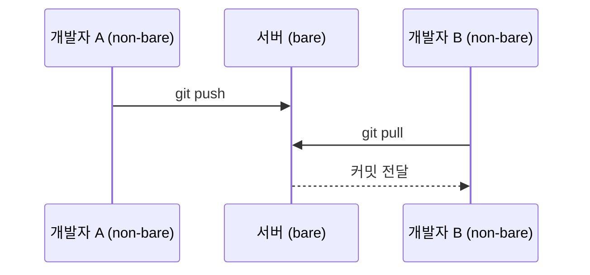

## 1. 개요

기존 디렉터리를 Git 저장소로 변환하거나 새 빈 저장소를 만든다. 실행하면 `.git/` 디렉터리가 생성되며, 이 시점에는 아직 어떤 파일도 추적되지 않는다.

---

## 2. 기본 사용법

```bash
# 현재 디렉터리를 저장소로 초기화
git init

# 새 디렉터리를 만들고 초기화
git init <directory>
git init /opt/myproject
```

초기화 후 첫 커밋까지의 흐름:

```bash
git init
git add .
git commit -m "initial commit"
```

이미 초기화된 저장소에서 `git init`을 다시 실행해도 안전하다. 기존 내용을 덮어쓰지 않고 새 템플릿만 반영한다.

---

## 3. .git 디렉터리

`git init` 실행 시 생성되는 `.git/` 의 초기 골격:

```
.git/
├── HEAD          # ref: refs/heads/main (또는 master)
├── config        # 저장소 로컬 설정
├── objects/      # 객체 저장소 (비어 있음)
│   ├── pack/
│   └── info/
└── refs/
    ├── heads/    # 로컬 브랜치 (비어 있음)
    └── tags/     # 태그 (비어 있음)
```

내부 구조는 [[git-internals]] §4에서 다룬다.

---

## 4. 주요 옵션

### 4.1. `-b` / `--initial-branch`

```bash
git init -b main
git init --initial-branch=main
```

기본값은 `master`이며 Git 3.0에서 `main`으로 바뀔 예정이다. 전역 설정으로 변경할 수 있다:

```bash
git config --global init.defaultBranch main
```

### 4.2. `--bare`

```bash
git init --bare
git init --bare /srv/git/myproject.git
```

워킹 트리 없이 `.git/` 내용물만 루트에 직접 생성한다. 팀 공유 중앙 저장소에 사용하며, 관례적으로 `.git`으로 끝나는 이름을 사용한다(`myproject.git`).

```
# Non-bare (일반)          # Bare
myproject/                 myproject.git/
├── .git/                  ├── HEAD
│   ├── HEAD               ├── config
│   ├── objects/           ├── objects/
│   └── refs/              └── refs/
├── src/
└── pom.xml
```

| 구분 | Non-bare | Bare |
|---|---|---|
| 워킹 트리 | 있음 | 없음 |
| `.git/` | 서브디렉터리 | 루트 자체가 저장소 |
| 용도 | 로컬 개발 | 중앙 공유 서버 |
| push 수신 | 체크아웃된 브랜치로의 push 거부(`receive.denyCurrentBranch`) | 제한 없음 |



### 4.3. `--shared`

여러 사용자가 같은 서버에서 직접 push/pull하는 환경에서 사용:

```bash
git init --bare --shared=group    # 그룹 쓰기 권한 (g+rws)
git init --bare --shared=all      # 모든 사용자 읽기 가능
git init --bare --shared=0660     # 8진수 권한 직접 지정
```

### 4.4. `-q` / `--quiet`

```bash
git init -q
```

오류와 경고 외 모든 출력을 억제하며 CI 스크립트 등에서 사용한다.

---

## 5. 템플릿 디렉터리

```bash
git config --global init.templateDir ~/.git-templates
```

`~/.git-templates/` 에 `.gitignore`, hooks 등을 넣어두면 모든 신규 저장소에 자동 복사된다.

---

## 6. 실용 패턴

```bash
# 스프링 부트 프로젝트 신규 시작
cd ~/workspace/myapp
git init -b main
printf 'target/\n.env\n*.iml\n.idea/\n' > .gitignore
git add .
git commit -m "chore: initial commit"

# 원격 연결
git remote add origin git@github.com:user/myapp.git
git push -u origin main
```

```bash
# 로컬 Bare 저장소를 백업용으로 구성
git init --bare /backup/myproject.git
git remote add backup /backup/myproject.git
git push backup --all
```

---

## Sources
- [git-init](https://git-scm.com/docs/git-init)
- [git-config](https://git-scm.com/docs/git-config)
- [Pro Git: Git Basics Getting a Git Repository](https://git-scm.com/book/en/v2/Git-Basics-Getting-a-Git-Repository)

---

## Related pages
- [[git-clone]]
- [[git-internals]]
- [[git-file-states]]
