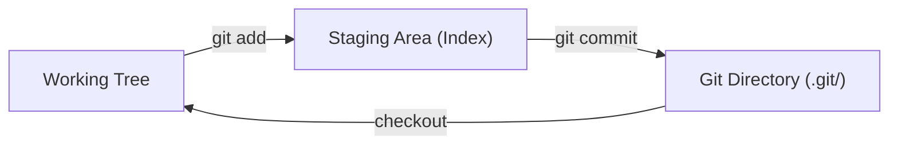

## 1. 개요

Git의 데이터 저장 모델, 작업 영역 구분, `.git` 디렉터리 구성, 객체 저장소를 다룬다. 파일 단위 상태와 전환 명령은 [[git-file-states]]에서 다룬다.

---

## 2. 스냅샷 모델

Git은 데이터를 스냅샷의 스트림으로 저장한다. 기존 VCS(SVN, CVS)는 각 버전을 이전 버전과 변경 사항(델타)으로 저장한다.

```
파일A: v1 → Δ1 → Δ2 → Δ3
파일B: v1 → Δ1 → Δ2
```

Git은 매 커밋마다 전체 파일 트리를 스냅샷으로 저장하고, 변경되지 않은 파일은 이전 스냅샷의 객체를 참조하는 링크로 처리해 용량을 절약한다.

```
커밋1: [파일A_v1, 파일B_v1, 파일C_v1]
커밋2: [파일A_v2, 파일B_v1(링크), 파일C_v2]
커밋3: [파일A_v2(링크), 파일B_v3, 파일C_v2(링크)]
```

---

## 3. 3개 영역



| 영역 | 설명 |
|------|------|
| Working Tree | 실제 파일이 있는 디렉터리. 편집기로 작업하는 공간 |
| Staging Area (Index) | 다음 커밋에 포함될 내용을 준비하는 공간. `.git/index` 파일 |
| Git Directory | 저장소 메타데이터와 객체 데이터베이스. `git clone` 시 복사되는 대상 |

각 영역에서 파일이 갖는 상태는 [[git-file-states]] §2에서 다룬다.

---

## 4. .git 디렉터리 구조

```
.git/
├── HEAD              # 현재 체크아웃된 브랜치 포인터
├── config            # 저장소 로컬 설정 (remote URL, user 등)
├── index             # 스테이징 영역 (바이너리)
├── objects/          # Content-addressable 객체 저장소
│   ├── pack/         # packfile (압축된 객체 묶음)
│   └── info/
├── refs/
│   ├── heads/        # 로컬 브랜치 (파일 내용 = 커밋 SHA)
│   ├── remotes/      # 원격 브랜치
│   └── tags/         # 태그
├── logs/
│   ├── HEAD          # HEAD 이동 이력 (reflog)
│   └── refs/heads/   # 브랜치별 이동 이력
├── COMMIT_EDITMSG    # 가장 최근 커밋 메시지
├── ORIG_HEAD         # merge/rebase 전 HEAD (복구용)
└── MERGE_HEAD        # merge 진행 중일 때 병합 대상 커밋
```

```bash
cat .git/HEAD
# ref: refs/heads/main

cat .git/refs/heads/main
# 3a8f2c1d4e7b9f6c5a2d1e8f3b4c7d9e2f5a8b1c
```

---

## 5. 객체 타입

Git의 모든 데이터는 `.git/objects/`에 SHA-1 해시를 키로 저장된다. 4가지 타입이 있다.

### 5.1. blob
파일의 내용만 저장하며 파일명, 경로, 권한은 포함하지 않는다.

```
blob <size>\0<content>
→ SHA-1 해시 계산 → objects/ab/cdef1234... 에 저장
```

### 5.2. tree
디렉터리 구조를 표현하며 blob과 다른 tree에 대한 참조(파일명, 권한 포함)를 저장한다.

```
tree
├── 100644 blob a1b2c3  README.md
├── 100644 blob d4e5f6  pom.xml
└── 040000 tree 7f8e9a  src/
```

### 5.3. commit
스냅샷의 루트 tree, 부모 커밋, 메타데이터를 저장한다.

```
tree   a1b2c3d4e5f6...   ← 루트 tree 객체 SHA
parent 9f8e7d6c5b4a...   ← 부모 커밋 SHA (최초 커밋은 없음)
author  홍길동 <hong@example.com> 1715596800 +0900
committer 홍길동 <hong@example.com> 1715596800 +0900

feat: 로그인 기능 추가
```

커밋은 부모 커밋을 가리키므로 전체 히스토리가 DAG(Directed Acyclic Graph, 비순환 방향 그래프)를 형성한다.

### 5.4. tag (annotated)
객체(주로 커밋)를 가리키며 작성자·날짜·메시지를 담는다. `git tag -a`로 생성한다.

---

## 6. SHA-1

Git은 내용(content)을 기반으로 SHA-1 해시를 계산하고 그 해시가 곧 파일 이름이 된다.

```bash
# 객체 내용 확인
git cat-file -t 3a8f2c1d   # 타입 출력 (blob/tree/commit/tag)
git cat-file -p 3a8f2c1d   # 내용 출력
```

내용 기반 주소 지정의 특성은 다음과 같다.
- 동일한 내용은 항상 동일한 SHA-1을 가지므로 중복 저장되지 않음
- 내용이 1바이트라도 바뀌면 해시가 달라져 변조를 탐지할 수 있음
- 저장소 내에서 고유하다면 해시의 앞부분만으로도 객체를 식별할 수 있음

`git init --object-format=sha256`으로 SHA-256을 쓰는 저장소를 만들 수 있다. 기본값은 SHA-1이며 현재 두 형식의 저장소는 상호 운용되지 않는다.

---

## Sources
- [Pro Git: Getting Started What is Git?](https://git-scm.com/book/en/v2/Getting-Started-What-is-Git%3F)
- [Pro Git: Git Internals Plumbing and Porcelain](https://git-scm.com/book/en/v2/Git-Internals-Plumbing-and-Porcelain)
- [Pro Git: Git Internals Git Objects](https://git-scm.com/book/en/v2/Git-Internals-Git-Objects)
- [Pro Git: Git Internals Git References](https://git-scm.com/book/en/v2/Git-Internals-Git-References)
- [git-init](https://git-scm.com/docs/git-init)
- [gitrevisions](https://git-scm.com/docs/gitrevisions)

---

## Related pages
- [[git-file-states]]
