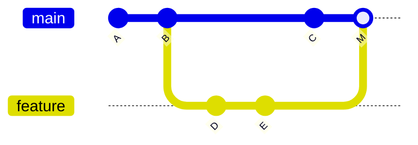
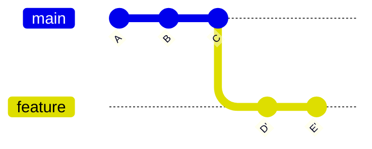

## 1. 개요

커밋 시리즈를 다른 베이스 커밋 위로 재적용한다. 머지와 달리 이력을 선형으로 유지한다. 재적용된 커밋은 SHA가 다른 새 커밋이므로, 이미 push해 공유된 커밋을 rebase하면 다른 사람의 이력과 분기된다. 원격에 공유된 커밋에는 rebase를 사용하지 않는다.

---

## 2. 기본 rebase

```bash
git rebase main              # 현재 브랜치를 main 위로 재배치
git rebase main feature      # feature 브랜치를 main 위로 재배치 (전환 없이)
```

### 2.1. merge vs rebase 이력 비교

`git merge --no-ff feature` 결과:



`git rebase main` (feature에서 실행) 결과:



---

## 3. `--onto`

```bash
git rebase --onto <newbase> <upstream> [<branch>]
```

```bash
# feature가 next에서 분기됐지만, main 위로 옮기고 싶을 때
git rebase --onto main next feature

# 특정 범위의 커밋만 제거
git rebase --onto HEAD~3 HEAD~1  # HEAD~1과 HEAD~2 두 커밋 삭제
```

---

## 4. `-i` / `--interactive`

```bash
git rebase -i HEAD~5    # 최근 5개 커밋 편집
git rebase -i <SHA>     # 해당 커밋 이후 전체
```

에디터에 커밋 목록이 열리고, 각 줄의 명령어를 변경해 동작을 지정한다. 목록 편집에 쓸 에디터는 `sequence.editor`로 지정한다.

```bash
git config sequence.editor "code --wait"
```

### 4.1. 명령어 목록

| 명령어 | 단축 | 동작 |
|--------|------|------|
| `pick` | `p` | 커밋 유지 |
| `reword` | `r` | 커밋 유지, 메시지 편집 |
| `edit` | `e` | 커밋에서 멈춤 (내용 수정 후 `--continue`) |
| `squash` | `s` | 이전 커밋과 합침 (양쪽 메시지 모두 유지) |
| `fixup` | `f` | 이전 커밋과 합침 (현재 메시지 버림) |
| `drop` | `d` | 커밋 제거 |
| `exec` | `x` | 셸 커맨드 실행 |
| `break` | `b` | 이 지점에서 일시 중단 |

### 4.2. 예시

```
pick a1b2c3 feat: 로그인 API 추가
squash d4e5f6 feat: 토큰 검증 로직 추가
fixup  g7h8i9 fix: 오타 수정
reword j0k1l2 refactor: 서비스 레이어 분리
drop   m3n4o5 WIP: 임시 작업
exec   make test
```

---

## 5. `--autosquash`

`git commit --fixup`/`--squash`로 생성된 커밋([[git-commit]] §4)을 자동으로 대상 커밋 바로 뒤에 배치한다.

```bash
git rebase -i --autosquash main     # fixup 커밋을 대상 커밋 바로 뒤로 이동 + fixup 표시

# 기본 활성화
git config rebase.autoSquash true
```

---

## 6. `--autostash`

```bash
git rebase --autostash main         # 실행 전 자동 stash → 완료 후 자동 pop
git config rebase.autoStash true    # 기본 활성화
```

---

## 7. 충돌 해결

rebase 중 충돌 발생 시:

```bash
# 1. 충돌 파일 편집
vim src/UserService.java

# 2. 해결된 파일 스테이지
git add src/UserService.java

# 3. 재개
git rebase --continue

# 또는 이 커밋 건너뜀
git rebase --skip

# 전체 취소
git rebase --abort
```

---

## 8. 커밋 분할

```bash
git rebase -i HEAD~3
# 분할할 커밋을 "edit"으로 변경 후 저장

git reset HEAD^          # 커밋 해제 (변경은 워킹 트리에 남음)
git add -p               # 일부만 스테이지
git commit -m "첫 번째 분할"
git add -p               # 나머지 스테이지
git commit -m "두 번째 분할"
git rebase --continue
```

---

## 9. 주요 옵션

```bash
git rebase --exec "./gradlew test" main   # 각 커밋마다 테스트 실행
git rebase -f main                         # 변경 없는 커밋도 강제 재작성
git rebase --keep-base main               # 현재 분기 지점을 베이스 유지
```

---

## Sources
- [git-rebase](https://git-scm.com/docs/git-rebase)

---

## Related pages
- [[git-merge]]
- [[git-commit]]
- [[git-reset-revert]]
- [[git-internals]]
- [[git-fetch-pull-push]]
