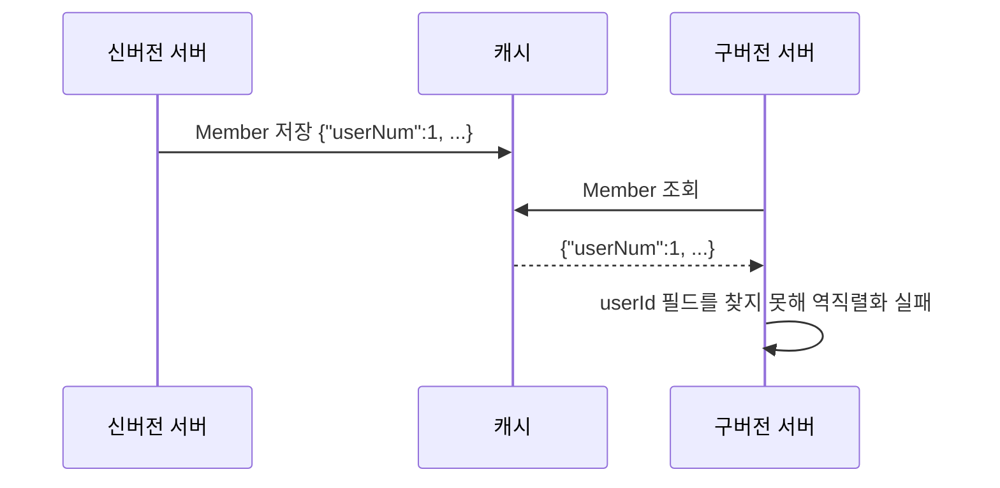
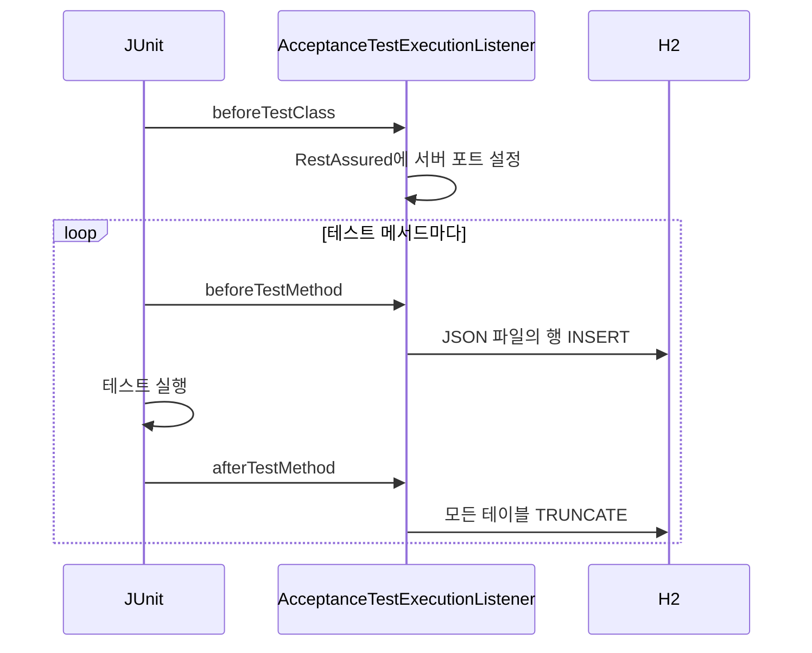

## 1. 개요

테스트 전략은 어떤 코드에 어떤 종류의 테스트를 얼마나 작성할지 정하는 기준이다. 테스트 코드도 운영 코드처럼 계속 고치고 관리해야 하므로, 모든 코드에 테스트를 붙이면 작성·유지 비용이 개발 속도를 떨어뜨린다.

현실에서 테스트를 기피하게 되는 원인은 대개 다음과 같다.

- controller, usecase, domain, persistence 계층마다 성공·실패 케이스를 모두 작성하면 테스트 수가 지나치게 많아진다.
- 구현 방식에 강하게 묶인 테스트(Fragile Test)는 동작이 그대로인데도 코드 구조만 바뀌면 실패한다.
- Mock 준비 코드가 길어지면 테스트가 무엇을 검증하는지 읽기 어렵다.
- 느리거나 실행할 때마다 결과가 달라지는 테스트는 신뢰를 잃는다.

이 문서는 작성할 테스트를 고르는 기준, 목적별 테스트 구분, Java·Spring Boot 구현 방법을 다룬다. 좋은 테스트의 일반 속성(FIRST, Test Desiderata)은 [[good-test-practices]], 테스트 더블 분류는 [[test-double]]에 정리되어 있다.

---

## 2. 기본 용어

| 용어 | 뜻 |
|------|----|
| SUT(System Under Test) | 테스트가 검증하려는 대상 클래스나 기능 |
| 협력 객체(collaborator) | SUT가 동작하면서 호출하는 다른 객체. 저장소, 외부 API 클라이언트 등 |
| 단위 테스트(Unit Test) | 클래스나 메서드처럼 작은 단위를 DB·네트워크 없이 빠르게 검증하는 테스트 |
| 통합 테스트(Integration Test) | 따로 개발된 구성 요소를 연결했을 때 함께 올바르게 동작하는지 검증하는 테스트. Spring 컨테이너, DB 등을 실제로 띄운다 |
| 인수 테스트(Acceptance Test) | 사용자 관점에서 기능이 요구 조건대로 동작하는지 검증하는 테스트. 보통 API를 호출하는 통합 테스트 형태로 작성한다 |
| 회귀 테스트(Regression Test) | 기존 기능이 변경 후에도 여전히 동작하는지 확인하는 테스트. 이미 작성된 테스트는 다음 변경부터 회귀 테스트 역할을 한다 |
| 테스트 대역(Test Double) | 테스트에서 실제 협력 객체 대신 쓰는 가짜 객체. Dummy, Stub, Spy, Mock, Fake로 나뉜다([[test-double]]) |
| flaky 테스트 | 코드가 바뀌지 않았는데 실행할 때마다 성공·실패가 달라지는 테스트 |

---

## 3. 작성 대상 선정

### 3.1. 가치 판단

테스트마다 작성 가치를 따져서 가치가 낮으면 작성하지 않는다. 가장 먼저 작성할 대상은 서비스의 핵심 기능이다. 핵심 기능은 사용 빈도와 변경 빈도가 높고, 코드를 읽는 사람도 많으며, 버그가 생길 가능성도 크다.[^1] 반대로 짧게 운영하고 내릴 이벤트 기능처럼 수동 확인으로 충분한 코드는 회귀 테스트로 남겨 둘 가치가 작다.

테스트 수 자체도 줄인다. 계층마다 테스트를 따로 쓰는 대신 API 하나를 호출해 controller부터 DB까지 모든 계층을 통과하는 통합 테스트를 쓰면 적은 수로 넓은 범위를 검증할 수 있고, 테스트 자체가 기능 사용 예시 문서가 된다.

커버리지 수치를 올리려고 작성하는 테스트는 비즈니스 규칙을 검증하지도, 문서 역할을 하지도 않으므로 작성 대상에서 뺀다. 커버리지 측정 방법은 [[jacoco]] 참고.

### 3.2. 테스트 비율

테스트 피라미드는 단위 테스트를 가장 많이 두고 위로 갈수록 통합·E2E(End-to-End) 테스트를 적게 두라는 모델이다. honeycomb·trophy 모델은 단위 테스트를 줄이고 통합 테스트 비중을 높이라고 권한다.

Martin Fowler는 두 진영이 "단위"와 "통합"이라는 말을 서로 다르게 써서 논쟁이 엇갈린다고 본다. honeycomb 측이 말하는 통합 테스트는 실제 협력 객체를 그대로 쓰는 sociable 단위 테스트([[good-test-practices]] §4.4)에 가깝고, 피라미드 측의 단위 테스트에도 sociable 방식이 포함되어 있기 때문이다. Fowler는 비율 논쟁보다 경계가 분명하고, 빠르고 안정적으로 실행되며, 의미 있는 이유로만 실패하는 테스트를 작성하는 데 집중하라는 Justin Searls의 견해를 인용한다.

### 3.3. 테스트 크기

"단위"나 "통합"처럼 해석이 갈리는 이름 대신, 테스트가 쓰는 실행 자원으로 크기를 나누는 방식도 있다.

| 크기 | 실행 범위 | 특성 |
|------|-----------|------|
| Small | 단일 스레드, 단일 프로세스, 단일 머신 | 빠르고 결과가 항상 같다 |
| Medium | 한 머신 안의 여러 프로세스 | 로컬 DB나 로컬 서버를 쓸 수 있다 |
| Large | 여러 머신 | 네트워크와 머신 상태의 영향을 받아 flaky해지기 쉽다 |

---

## 4. 목적별 분류

테스트를 목적에 따라 나누면 각 테스트가 왜 있는지 분명해진다. 구현은 §6에서 다룬다.

| 종류 | 검증 대상 | 형태 |
|------|-----------|------|
| 도메인 정책 테스트 | 도메인 객체 안에 표현된 비즈니스 규칙(예: 18세 이하만 프로모션 참가 가능) | 단위 테스트 |
| 유스케이스 테스트 | 사용자가 기능을 사용하는 흐름(user journey) 전체 | 인수 테스트 |
| 직렬화 호환성 테스트 | 캐시·저장소에 기록되는 데이터 형식이 바뀌지 않았는지 | 승인 테스트 |
| 부분 기능 테스트 | 테스트가 없던 코드에서 이번에 바꾼 판단 로직 | 단위 테스트 |
| 학습 테스트 | 외부 라이브러리가 실제로 어떻게 동작하는지 | 단위 테스트 |

유스케이스 테스트는 블랙박스로 작성한다. 블랙박스 테스트는 내부 구현을 모른 채 API 명세(요청과 응답)만 보고 검증하는 테스트다. 내부 클래스 구조를 바꾸는 리팩터링에는 실패하지 않고, 응답이 바뀌는 비즈니스 변경에만 실패한다.

부분 기능 테스트는 기존 테스트가 없는 큰 메서드를 고쳐야 하는데 전체 테스트를 작성할 시간이 없을 때 쓴다. 바꾸려는 판단 로직만 별도 메서드로 떼어 내서 그 메서드만 테스트한다. 테스트를 위해 운영 코드 구조를 바꾸는 방식이므로 수명이 짧고 범위가 좁은 기능에만 쓴다. 시간에 의존하는 로직을 떼어 내는 방법은 §7.4에서 다룬다.

---

## 5. 협력 객체 선택

SUT가 의존하는 협력 객체를 테스트에서 실제 객체로 둘지, 테스트 대역으로 바꿀지 정해야 한다.

### 5.1. 선택 순서

권장 순서는 실제 구현, Fake, Stub, 상호작용 검증(Mock) 순이다. 실제 구현이 빠르고, 실행 결과가 항상 같고, 의존성이 단순하면 실제 구현을 그대로 쓴다.

Mock을 남용하면 테스트가 SUT 내부를 알게 된다. SUT가 어떤 협력 객체의 어떤 메서드를 어떤 인자로 호출하는지 테스트에 적어야 하기 때문이다. 그러면 동작은 그대로인 리팩터링에도 테스트가 실패하고, Mock 준비 코드가 길어져 테스트를 문서로 읽기 어려워진다. Mock 설정이 실제 구현의 동작과 점점 어긋나는 문제도 생긴다. Mock을 이용한 상호작용 검증은 실제 구현이나 Fake를 쓸 수 없을 때 마지막으로 선택한다.

### 5.2. 관리 의존성과 비관리 의존성

Vladimir Khorikov는 DB, 메일 서버처럼 프로세스 밖에 있는 의존성을 다음 둘로 나누고 각각 다르게 다루라고 권한다.

| 구분 | 의미 | 예 | 테스트에서 |
|------|------|----|------------|
| 관리 의존성(managed dependency) | 우리 애플리케이션만 접근하고 완전히 통제할 수 있어서, 상호작용이 외부에 드러나지 않는 의존성 | 애플리케이션 전용 DB | 실제 인스턴스 사용 |
| 비관리 의존성(unmanaged dependency) | 다른 시스템도 상호작용 결과를 관찰하는 의존성 | SMTP 서버, 메시지 버스 | Mock으로 대체 |

애플리케이션 전용 DB에 무엇이 어떤 순서로 저장되는지는 외부에서 볼 수 없는 내부 사정이다. 그래서 Mock으로 호출을 검증하지 않고 실제 DB에서 결과 상태를 확인한다. 반면 메일 발송은 외부 시스템이 보는 결과이므로 호출 자체를 검증할 가치가 있다.

### 5.3. 충실성과 밀폐성

충실성(fidelity)은 테스트가 SUT의 실제 운영 동작을 얼마나 그대로 반영하는지를 말한다. 밀폐성(hermeticity)은 SUT가 해당 테스트 외의 다른 사용이나 상호작용으로부터 얼마나 격리되어 있는지를 말한다.

두 속성은 자주 충돌한다. 다른 팀이 운영하는 개발 서버를 실제로 호출하면 운영과 같은 경로를 타므로 충실성은 높다. 하지만 그 서버가 배포 중이거나 데이터가 바뀌면 우리 코드와 무관하게 테스트가 실패한다. 테스트 대역으로 바꾸면 결과는 안정되지만, 대역이 실제 서버와 다르게 동작해도 테스트는 이를 알려 주지 못한다. 어느 쪽을 택할지는 충실성과 비용·안정성 사이의 절충으로 정한다.

### 5.4. 상황별 기준

| 상황 | 선택 | 이유 |
|------|------|------|
| 조직 외부 서비스 | Fake | 원하는 응답을 만들 수 없고 테스트 환경이 없을 수 있다. 네트워크 상태에 따라 결과가 달라진다 |
| 조직 내부 서비스, 알림 발송 같은 비즈니스 외 부수효과 | Dummy | 테스트를 돌릴 때마다 알림이 가면 개발자가 결국 테스트를 꺼 버린다 |
| 조직 내부 서비스, 테스트 데이터 확보가 어려움 | 모의 객체 프레임워크의 Stub | "가입 7일 이내 사용자"처럼 시간이 지나면 조건이 깨지는 데이터 |
| 그 외 | 실제 객체 | 운영과 같은 경로를 검증 |

이 기준은 고정 규칙이 아니고 판단 출발점이다. Dummy는 아무 동작도 하지 않는 빈 구현이고, Fake는 실제처럼 동작하지만 운영에는 쓰지 않는 간단한 구현이다([[test-double]] §2).

### 5.5. Fake 검증

Fake가 실제 구현과 다르게 동작하면 Fake를 쓰는 테스트는 모두 잘못된 것을 검증하게 된다. 그래서 Fake도 실제 구현과 같은 API 계약을 지키는지 자체 테스트를 둔다. 같은 테스트 코드를 실제 구현과 Fake 양쪽에 실행하는 계약 테스트(contract test)가 일반적인 방법이다. Fake는 실제 구현을 소유한 팀이 작성하고 유지하는 것이 좋다.

```java
// 공통 계약: 실제 구현과 Fake가 모두 통과해야 한다
abstract class PaymentGatewayContract {
    abstract PaymentGateway gateway();

    @Test
    void 승인되면_승인번호를_반환한다() {
        PaymentResult result = gateway().approve(new PaymentRequest(1L, 10_000L));
        assertThat(result.approvalNo()).isNotBlank();
    }
}

class FakePaymentGatewayTest extends PaymentGatewayContract {
    PaymentGateway gateway() { return new FakePaymentGateway(); }
}

@Tag("external")   // 실제 샌드박스 호출은 별도 태그로 분리 실행
class HttpPaymentGatewayTest extends PaymentGatewayContract {
    PaymentGateway gateway() { return new HttpPaymentGateway(SandboxConfig.load()); }
}
```

JUnit 5는 추상 상위 클래스의 `@Test` 메서드를 하위 클래스에서 실행하므로 계약을 한 곳에만 작성하면 된다. 태그로 실행 대상을 나누는 방법은 [[junit-test-suite]] 참고.

---

## 6. 목적별 구현

예시는 Java, JUnit 5, AssertJ, Spring Boot 기준이다.[^2]

### 6.1. 도메인 정책 테스트

도메인 정책은 Spring 컨테이너 없이 객체만 만들어 단위 테스트로 검증한다. 입력값은 정책이 바뀌는 경계값을 중심으로 고른다. 18세 이하 정책이라면 18과 19가 경계값이다. 여러 입력을 한 테스트로 실행하는 방법은 [[junit-parameterized-test]] 참고.

```java
public record Member(long userId, String name, int age) {
    static final int MAX_PROMOTION_AGE = 18;

    public boolean canParticipatePromotion() {
        return age <= MAX_PROMOTION_AGE;
    }
}

class MemberTest {
    @ParameterizedTest
    @ValueSource(ints = {12, 17, 18})
    void 프로모션은_18세_이하만_참가할_수_있다(int age) {
        assertThat(new Member(1L, "kim", age).canParticipatePromotion()).isTrue();
    }

    @ParameterizedTest
    @ValueSource(ints = {19, 20, 30})
    void 프로모션은_19세_이상이면_참가할_수_없다(int age) {
        assertThat(new Member(1L, "kim", age).canParticipatePromotion()).isFalse();
    }
}
```

다른 도메인 객체와 협력하는 정책도 Mock을 쓰지 않고 실제 객체를 만들어 넘긴다. 객체 생성 코드가 반복되면 §7.5의 픽스처로 모은다.

### 6.2. 유스케이스 테스트

유스케이스 테스트는 애플리케이션을 실제 포트로 띄우고 HTTP로 API를 호출하는 인수 테스트로 작성한다. 매번 같은 설정을 반복하지 않도록 필요한 어노테이션을 하나의 합성 어노테이션(composed annotation)으로 묶는다. 합성 어노테이션은 여러 어노테이션을 붙인 사용자 정의 어노테이션이며, 붙이기만 하면 묶인 설정이 모두 적용된다.

```java
@Retention(RetentionPolicy.RUNTIME)
@Target(ElementType.TYPE)
@ActiveProfiles("test")
@SpringBootTest(webEnvironment = SpringBootTest.WebEnvironment.RANDOM_PORT)
@Import(ExternalMockConfig.class)   // §7.1
@TestExecutionListeners(
        value = AcceptanceTestExecutionListener.class,   // §7.2
        mergeMode = TestExecutionListeners.MergeMode.MERGE_WITH_DEFAULTS)
public @interface AcceptanceTest {
    String[] value() default {};   // 테스트 데이터 JSON 경로
}
```

각 설정의 역할은 다음과 같다.

| 설정 | 역할 |
|------|------|
| `@ActiveProfiles("test")` | `test` 프로파일을 켜서 테스트용 빈(§7.3)이 등록되게 한다 |
| `@SpringBootTest(RANDOM_PORT)` | 애플리케이션 전체를 비어 있는 임의 포트의 실제 웹 서버로 띄운다 |
| `@Import` | 모든 인수 테스트가 공유할 테스트 설정을 등록한다 |
| `@TestExecutionListeners` | 테스트 전후에 데이터 준비·정리 코드를 실행한다 |

모든 인수 테스트가 같은 어노테이션을 쓰면 Spring 설정이 동일해져 컨텍스트 캐시를 공유한다(§7.1).

테스트 코드는 API 명세만 사용한다. 요청 본문과 응답을 운영 코드의 DTO 클래스 대신 `Map`으로 다루면 테스트가 내부 클래스에 의존하지 않는다. HTTP 호출에는 REST Assured를 사용한다.

```java
@AcceptanceTest("acceptance/check-account.json")
class CheckAccountAcceptanceTest {

    @Test
    void 일회_충전_한도를_넘으면_한도초과를_응답한다() {
        Map<String, Object> result = checkAccount(1L, 1283912L, 200_001L);
        assertThat(result.get("resultCode")).isEqualTo("DEPOSIT_LIMIT_EXCEEDED");
    }

    @Test
    void 정상_요청이면_OK를_응답한다() {
        Map<String, Object> result = checkAccount(1L, 1283912L, 20_000L);
        assertThat(result.get("resultCode")).isEqualTo("OK");
    }

    private Map<String, Object> checkAccount(long userId, long accountNo, long amount) {
        return RestAssured.given().contentType(ContentType.JSON)
                .header("X-User-Id", userId)
                .body(Map.of("accountNo", accountNo, "amount", amount))
                .when().post("/internal/check-account")
                .then().extract().jsonPath().getMap("success");
    }
}
```

### 6.3. 직렬화 호환성 테스트

카나리 배포는 새 버전을 일부 서버에만 먼저 배포하는 방식이라, 배포가 끝날 때까지 구버전과 신버전 서버가 동시에 실행된다. 두 버전이 같은 캐시를 함께 쓰는 상태에서 캐시에 저장되는 클래스의 필드명이 바뀌면 다음 문제가 생긴다.



이런 변경을 배포 전에 알아차리려고 승인 테스트(Approval Test)를 쓴다. 골든 테스트(Golden Test)라고도 부르며, 처음 실행한 출력을 스냅샷 파일로 저장해 두고 이후 실행 결과가 스냅샷과 같은지 비교한다. 테스트가 실패하면 직렬화 형식이 바뀌었다는 뜻이므로 캐시 키에 버전을 붙이는 캐시 버저닝을 검토한다.

```kotlin
testImplementation("com.approvaltests:approvaltests:32.2.0")
```

```java
class MemberCacheApprovalTest {
    // 운영에서 캐시 저장에 쓰는 것과 같은 설정으로 구성
    private final ObjectMapper objectMapper = new ObjectMapper();

    @Test
    void 캐시_직렬화_형식이_유지된다() throws Exception {
        Member member = new Member(1L, "kim", 20);
        Approvals.verify(objectMapper.writeValueAsString(member));
    }
}
```

`Approvals.verify()`는 실행 결과를 `<클래스>.<메서드>.received.txt`에 쓰고 `<클래스>.<메서드>.approved.txt`와 비교한다. 처음 실행할 때는 approved 파일이 없어서 실패한다. received 파일 내용이 맞는지 확인한 뒤 이름을 approved로 바꾸면 그 내용이 기준이 된다. approved 파일은 Git에 커밋한다.

객체를 바로 넘기는 `JsonApprovals.verifyAsJson(object)`도 있다. 다만 이 테스트의 목적은 운영 캐시 형식 검증이므로 운영과 같은 직렬화기로 만든 문자열을 비교한다.[^3]

### 6.4. 학습 테스트

학습 테스트는 외부 라이브러리가 실제로 어떻게 동작하는지 확인하려고 작성하는 테스트다. 비즈니스 로직은 검증하지 않는다. 문서만 읽고 추측하는 대신 코드로 확인하고, 라이브러리 버전을 올렸을 때 동작이 바뀌었는지도 바로 알 수 있다.

```java
class ObjectMapperLearningTest {
    @Test
    void 클래스에_없는_필드가_오면_기본적으로_예외가_발생한다() {
        var mapper = new ObjectMapper();
        assertThatThrownBy(() -> mapper.readValue("{\"unknown\":1}", Member.class))
                .isInstanceOf(UnrecognizedPropertyException.class);
    }
}
```

---

## 7. 공통 기법

### 7.1. 컨텍스트 캐싱

`@SpringBootTest`는 테스트 전에 모든 빈을 담은 애플리케이션 컨텍스트를 만든다. 이 작업은 시간이 걸리므로 Spring TestContext 프레임워크는 한 번 만든 컨텍스트를 캐시에 저장하고, 설정이 같은 테스트 클래스끼리 재사용한다. 설정이 하나라도 다르면 새 컨텍스트를 만든다. 캐시 키를 구성하는 항목은 다음과 같다.

| 어노테이션 | 캐시 키 항목 |
|------------|--------------|
| `@ContextConfiguration` | `locations`, `classes`, `contextInitializerClasses`, `contextCustomizers`, `contextLoader` |
| `@ContextHierarchy` | `parent` |
| `@ActiveProfiles` | `activeProfiles` |
| `@TestPropertySource` | `propertySourceDescriptors`, `propertySourceProperties` |
| `@WebAppConfiguration` | `resourceBasePath` |

`@MockitoBean`, `@MockitoSpyBean`처럼 빈을 바꿔치기하는 어노테이션은 `contextCustomizers`에 들어간다. 그래서 테스트 클래스마다 다른 빈을 `@MockitoBean`으로 바꾸면 클래스마다 컨텍스트를 새로 만들어 테스트가 느려진다.

캐시는 기본적으로 최대 32개를 보관하고, 가득 차면 가장 오래 쓰이지 않은 것부터 제거한다(LRU, Least Recently Used). 최대 개수는 JVM 시스템 프로퍼티 `spring.test.context.cache.maxSize`로 바꾼다. `@DirtiesContext`를 붙이면 해당 컨텍스트를 캐시에서 지워 다음 테스트에서 새로 만든다.

Mock이 꼭 필요하면 공용 `@TestConfiguration`에 Mock 빈을 `@Primary`로 등록하고, 합성 어노테이션(§6.2)에서 `@Import`한다. 모든 테스트의 설정이 같아져 컨텍스트 하나를 공유한다. `@Primary`는 같은 타입의 빈이 여러 개일 때 이 빈을 우선 주입하라는 표시다.

```java
@TestConfiguration
public class ExternalMockConfig {
    @Bean
    @Primary
    UserQueryPort userQueryPort() {
        return Mockito.mock(UserQueryPort.class);
    }
}
```

Mock 빈 하나를 모든 테스트가 공유하므로 이전 테스트에서 설정한 Stub이 다음 테스트에 남는다. 테스트마다 초기화한다.

```java
@AcceptanceTest
class UserStatusAcceptanceTest {
    @Autowired UserQueryPort userQueryPort;

    @BeforeEach
    void resetMocks() {
        Mockito.reset(userQueryPort);
    }
}
```

Mock을 쓰면 테스트가 구현에 묶이고 운영과 다른 경로를 검증하게 되므로, 이 방법은 §5.4에서 Stub을 고른 경우에만 쓴다.

### 7.2. 데이터 준비와 격리

테스트가 서로 영향을 주지 않으려면 각 테스트 전에 필요한 데이터를 넣고, 끝난 뒤에 지워야 한다.

단위 테스트나 `MockMvc` 기반 테스트에서는 테스트에 `@Transactional`을 붙여 끝날 때 롤백하는 방식을 흔히 쓴다. `RANDOM_PORT`나 `DEFINED_PORT`로 실제 서버를 띄우는 인수 테스트에는 이 방식이 통하지 않는다. HTTP 클라이언트(테스트 코드)와 서버가 서로 다른 스레드에서 실행되어 트랜잭션도 분리되므로, 서버에서 커밋된 데이터는 롤백되지 않는다.

Spring의 `@Sql`로 SQL 스크립트를 실행해 데이터를 넣을 수도 있다. 하지만 `INSERT` 문에서는 각 값이 어느 컬럼에 들어가는지 한눈에 보기 어렵고, 컬럼이 추가되면 스크립트를 일일이 고쳐야 한다. 대안으로 테이블 이름을 키로, 행 목록을 값으로 하는 JSON 파일을 쓴다.

```json
{
  "member": [
    { "user_id": 1, "name": "kim", "age": 20 }
  ],
  "account": [
    { "account_no": 1283912, "user_id": 1, "expiration_date": "2033-01-01" }
  ]
}
```

이 JSON을 `TestExecutionListener`로 처리한다. `TestExecutionListener`는 Spring 테스트 실행 단계(클래스 시작 전, 메서드 시작 전·후 등)마다 호출되는 확장 지점이다.



```java
public class AcceptanceTestExecutionListener extends AbstractTestExecutionListener {

    @Override
    public void beforeTestClass(TestContext ctx) {
        // RANDOM_PORT로 정해진 포트를 REST Assured에 알려 준다
        RestAssured.port = ctx.getApplicationContext().getEnvironment()
                .getRequiredProperty("local.server.port", Integer.class);
    }

    @Override
    public void beforeTestMethod(TestContext ctx) throws Exception {
        AcceptanceTest ann = TestContextAnnotationUtils
                .findMergedAnnotation(ctx.getTestClass(), AcceptanceTest.class);
        if (ann == null) return;
        var app = ctx.getApplicationContext();
        var jdbc = app.getBean(NamedParameterJdbcTemplate.class);
        var mapper = app.getBean(ObjectMapper.class);
        for (String path : ann.value()) {
            Map<String, List<Map<String, Object>>> tables = mapper.readValue(
                    new ClassPathResource(path).getInputStream(), new TypeReference<>() {});
            tables.forEach((table, rows) -> rows.forEach(row -> insert(jdbc, table, row)));
        }
    }

    private void insert(NamedParameterJdbcTemplate jdbc, String table, Map<String, Object> row) {
        String columns = String.join(", ", row.keySet());
        String params = row.keySet().stream().map(c -> ":" + c).collect(Collectors.joining(", "));
        jdbc.update("INSERT INTO " + table + " (" + columns + ") VALUES (" + params + ")", row);
    }

    @Override
    public void afterTestMethod(TestContext ctx) {
        JdbcTemplate jdbc = ctx.getApplicationContext().getBean(JdbcTemplate.class);
        List<String> tables = jdbc.queryForList(
                "SELECT TABLE_NAME FROM INFORMATION_SCHEMA.TABLES WHERE TABLE_SCHEMA = 'PUBLIC'",
                String.class);
        jdbc.execute("SET REFERENTIAL_INTEGRITY FALSE");
        tables.forEach(t -> jdbc.execute("TRUNCATE TABLE " + t));
        jdbc.execute("SET REFERENTIAL_INTEGRITY TRUE");
    }
}
```

`TRUNCATE TABLE`은 테이블의 모든 행을 한 번에 지운다. 다른 테이블이 외래 키로 참조하는 테이블은 H2에서 바로 비울 수 없으므로, 참조 무결성 검사를 잠시 끄고 비운 뒤 다시 켠다.[^4]

`@TestExecutionListeners`에 리스너를 지정할 때 `mergeMode`를 생략하면 Spring 기본 리스너가 등록되지 않는다. 기본 리스너에는 `@Autowired` 주입을 처리하는 `DependencyInjectionTestExecutionListener`, `@Transactional`을 처리하는 `TransactionalTestExecutionListener` 등이 있으므로, 빠지면 의존성 주입부터 실패한다. `MERGE_WITH_DEFAULTS`로 지정하면 직접 만든 리스너가 기본 리스너 목록에 추가된다.

### 7.3. 프로파일 기반 테스트 대역

외부 시스템 호출을 인터페이스(포트) 뒤에 두면, `@Profile`로 운영용과 테스트용 구현을 바꿔 끼울 수 있다. `@Profile("test")`가 붙은 빈은 `test` 프로파일이 켜져 있을 때만 등록되고, `@Profile("!test")`는 그 반대다.

```java
public interface SendMessagePort {
    void send(String message);
}

@Component
@Profile("!test")
class MessengerAdapter implements SendMessagePort {
    private final WebClient webClient;

    MessengerAdapter(WebClient webClient) { this.webClient = webClient; }

    @Override
    public void send(String message) {
        webClient.post().uri("/alert").bodyValue(message)
                .retrieve().toBodilessEntity().block();
    }
}

@Component
@Profile("test")
class DummyMessengerAdapter implements SendMessagePort {
    @Override
    public void send(String message) { }   // 테스트에서는 알림을 보내지 않는다
}
```

모든 테스트가 같은 프로파일을 쓰므로 `@MockitoBean`과 달리 컨텍스트 캐시를 해치지 않는다(§7.1). 조직 외부 서비스용 Fake도 같은 방식으로 등록하고, 요청 값에 따라 항상 같은 응답을 돌려주게 만든다. HTTP 수준에서 대체하려면 [[mockwebserver]]나 [[mockserver]], 실제 DB·메시지 브로커가 필요하면 [[testcontainers]]를 쓴다.

### 7.4. 시간 제어

`LocalDate.now()`를 직접 호출하는 코드는 테스트하는 날짜에 따라 결과가 달라진다. 오늘 통과한 이벤트 기간 테스트가 이벤트가 끝난 다음 날에는 실패한다. `java.time.Clock` javadoc은 현재 시각이 필요한 곳에 `Clock`을 전달하고, 테스트에서는 `Clock.fixed()`나 `Clock.offset()`으로 만든 시계를 넘기라고 권장한다.

```java
@Service
public class AccountEventPolicy {
    static final LocalDate START = LocalDate.of(2024, 9, 14);
    static final LocalDate END = LocalDate.of(2024, 9, 18);
    private final Clock clock;

    public AccountEventPolicy(Clock clock) { this.clock = clock; }

    public boolean canParticipate() {
        LocalDate today = LocalDate.now(clock);
        return !today.isBefore(START) && !today.isAfter(END);
    }
}

class AccountEventPolicyTest {
    @Test
    void 종료일_당일에는_참여할_수_있다() {
        Clock clock = Clock.fixed(Instant.parse("2024-09-18T00:00:00Z"), ZoneOffset.UTC);
        assertThat(new AccountEventPolicy(clock).canParticipate()).isTrue();
    }

    @Test
    void 종료일_다음_날에는_참여할_수_없다() {
        Clock clock = Clock.fixed(Instant.parse("2024-09-19T00:00:00Z"), ZoneOffset.UTC);
        assertThat(new AccountEventPolicy(clock).canParticipate()).isFalse();
    }
}
```

운영 환경에서는 `Clock.systemDefaultZone()`을 빈으로 등록해 주입한다. 클래스에 `Clock`을 주입하기 어려운 기존 코드라면, 판단 로직을 `boolean cannotParticipate(LocalDate today)`처럼 날짜를 인자로 받는 메서드로 분리하고 Guava `@VisibleForTesting`을 붙여 테스트용으로 열어 둔 메서드임을 표시하는 방법도 있다(§4 부분 기능 테스트).

### 7.5. 픽스처 공유

픽스처(fixture)는 테스트에 필요한 객체나 데이터를 미리 만들어 두는 코드다. 모든 필드에 기본값을 넣은 픽스처 메서드를 두면 테스트에는 검증과 관련된 값만 드러난다. 도메인 클래스에 필드가 추가되어도 픽스처 한 곳만 고치면 된다.

```java
public final class MemberFixture {
    public static Member member() {
        return new Member(1L, "kim", 20);
    }

    public static Member memberAged(int age) {
        return new Member(1L, "kim", age);
    }
}

// 테스트에서는 나이만 드러난다
assertThat(MemberFixture.memberAged(19).canParticipatePromotion()).isFalse();
```

멀티 모듈 프로젝트에서는 한 모듈의 `src/test` 코드를 다른 모듈이 참조할 수 없다. 그렇다고 픽스처를 `src/main`에 두면 테스트용 코드가 운영 배포물에 섞인다. Gradle `java-test-fixtures` 플러그인을 적용하면 `src/testFixtures` 디렉터리의 코드가 별도 산출물로 빌드되고, 다른 모듈은 테스트 의존성으로만 가져갈 수 있다.

```kotlin
// domain/build.gradle.kts
plugins {
    `java-library`
    `java-test-fixtures`
}

// api/build.gradle.kts
dependencies {
    testImplementation(testFixtures(project(":domain")))
}
```

H2처럼 테스트에서만 쓰는 런타임 의존성은 제공 모듈에서 `testFixturesRuntimeOnly`로 선언하고, 사용 모듈에서 `testRuntimeOnly(testFixtures(project(":db")))`로 가져온다. Gradle 의존성 구성은 [[gradle-dependency-configurations]] 참고.

---

## 8. 한계

블랙박스 인수 테스트는 데이터에 크게 의존한다. 테스트는 내부를 모르지만 데이터를 준비하는 사람은 코드를 따라가며 어떤 테이블에 어떤 값이 필요한지 조합해야 한다. 이 비용이 크므로 가치가 낮은 기능에 인수 테스트를 쓰면 얻는 것보다 관리 부담이 커진다.

실제 객체와 실제 네트워크 호출을 많이 쓸수록 충실성은 높아지지만 테스트가 느려지고, 다른 서비스 개발 환경의 문제로 빌드가 실패하기도 한다(§5.3).

반환값이 없는 API는 블랙박스 테스트로 검증하기 어렵다. 처리 도중 조건문에서 일찍 반환되어 마지막 단계까지 가지 않아도 응답은 정상이므로 테스트가 통과한다.[^5] 이를 막으려면 라인 커버리지로 원하는 코드까지 실행되었는지 직접 확인하거나, 처리 결과를 응답 값에 추가하고 검증한다. 응답 값을 추가하는 방법은 테스트를 위해 운영 코드를 바꾸는 것이므로 팀 합의가 필요하다.[^6]

직렬화 호환성 테스트(§6.3)가 엔티티 직렬화만 검증하면 실제 조회 단위인 캐시 이름과 캐시 키 조합의 호환성은 확인하지 못한다. 검증 범위를 캐시 이름과 키까지 넓히고, 버저닝을 적용하면 통과하도록 테스트를 확장해야 한다.

---

## Sources
- `raw/java/가치있는 테스트를 위한 전략과 구현.md`
- [토스: 테스트 의존성 관리로 높은 품질의 테스트 코드 유지하기](https://toss.tech/article/how-to-manage-test-dependency-in-gradle)
- [카카오페이: 실무에서 적용하는 테스트 코드 작성 방법과 노하우 Part 1: 효율적인 Mock Test](https://tech.kakaopay.com/post/mock-test-code/)
- [카카오페이: 실무에서 적용하는 테스트 코드 작성 방법과 노하우 Part 3: Given 지옥에서 벗어나기 - 스노우볼을 굴려라](https://tech.kakaopay.com/post/given-test-code-2/)
- [카카오페이: 실전에서 TDD하기](https://tech.kakaopay.com/post/implementing-tdd-in-practical-applications/)
- [Software Engineering at Google: Ch.13 Test Doubles](https://abseil.io/resources/swe-book/html/ch13.html)
- [Software Engineering at Google: Ch.14 Larger Testing](https://abseil.io/resources/swe-book/html/ch14.html)
- [Martin Fowler: On the Diverse And Fantastical Shapes of Testing](https://martinfowler.com/articles/2021-test-shapes.html)
- [Vladimir Khorikov: When to Mock](https://enterprisecraftsmanship.com/posts/when-to-mock/)
- [Spring Framework: Context Caching](https://docs.spring.io/spring-framework/reference/testing/testcontext-framework/ctx-management/caching.html)
- [Spring Framework: TestExecutionListener Configuration](https://docs.spring.io/spring-framework/reference/testing/testcontext-framework/tel-config.html)
- [Spring Boot: Testing Spring Boot Applications](https://docs.spring.io/spring-boot/reference/testing/spring-boot-applications.html)
- [Oracle: java.time.Clock (Java SE 21)](https://docs.oracle.com/en/java/javase/21/docs/api/java.base/java/time/Clock.html)
- [ApprovalTests.Java: Getting Started](https://github.com/approvals/ApprovalTests.Java/blob/master/approvaltests/docs/tutorials/GettingStarted.md)
- [H2: Commands](https://h2database.com/html/commands.html)

---

## Related pages
- [[good-test-practices]]
- [[test-double]]
- [[java-testing-libraries]]
- [[junit-parameterized-test]]
- [[junit-test-suite]]
- [[testcontainers]]
- [[mockwebserver]]
- [[mockserver]]
- [[jpa-testing]]
- [[jacoco]]
- [[gradle-dependency-configurations]]

---

[^1]: 출처 사례는 시스템 핵심 기능 약 20%가 주된 사용·변경 지점이며, 가치 있는 20%의 테스트로 80% 이상의 신뢰성을 얻을 수 있다고 서술한다. 측정 근거는 제시하지 않았으므로 경험에 따른 주장으로 본다.
[^2]: 원 사례의 코드는 Kotlin, Kotest, MockK로 작성되어 있다. 이 문서의 Java 예시는 같은 의도로 옮겨 쓴 것이다. JSON 데이터 입력은 원 코드의 문자열 연결 대신 바인딩 파라미터를 쓰도록 바꿨고, 계약 테스트 예시(§5.5)는 계약 테스트 설명을 바탕으로 새로 작성했다.
[^3]: `JsonApprovals`가 내부적으로 어떤 직렬화기를 쓰는지는 확인하지 못했다. 운영과 같은 직렬화기를 써야 한다는 판단은 캐시 호환성 검증이라는 테스트 목적에서 나온 것이다.
[^4]: 원 사례 코드는 `SET FOREIGN_KEY_CHECKS = 0`을 쓰면서 H2 문법이라고 설명한다. H2 명령어 문서에서는 이 구문을 찾지 못해 문서에 있는 `SET REFERENTIAL_INTEGRITY`로 바꿨다. H2 문서의 해당 부분은 일부만 원문으로 확인했으므로 사용하는 H2 버전에서 동작을 확인해야 한다.
[^5]: 원 사례는 이 현상을 "거짓 양성(False Positive): 실제 결과는 실패이지만 검사 결과를 성공으로 판단하는 오류"라고 불렀다. 게시글 댓글에서는 거짓 음성으로 불러야 한다는 이의가 나왔고, 테스트 문헌마다 두 용어를 쓰는 방향이 다르다. 이 문서는 용어 대신 현상을 서술한다.
[^6]: 출처 간 견해가 다르다. 원 사례는 테스트를 제품의 첫 번째 고객으로 보고 팀 합의 후 운영 코드에 응답 값을 추가했다. 반면 다른 출처는 테스트 코드를 편하게 작성하려고 운영 코드의 설계를 바꾸는 것은 바람직하지 않다고 서술한다.
