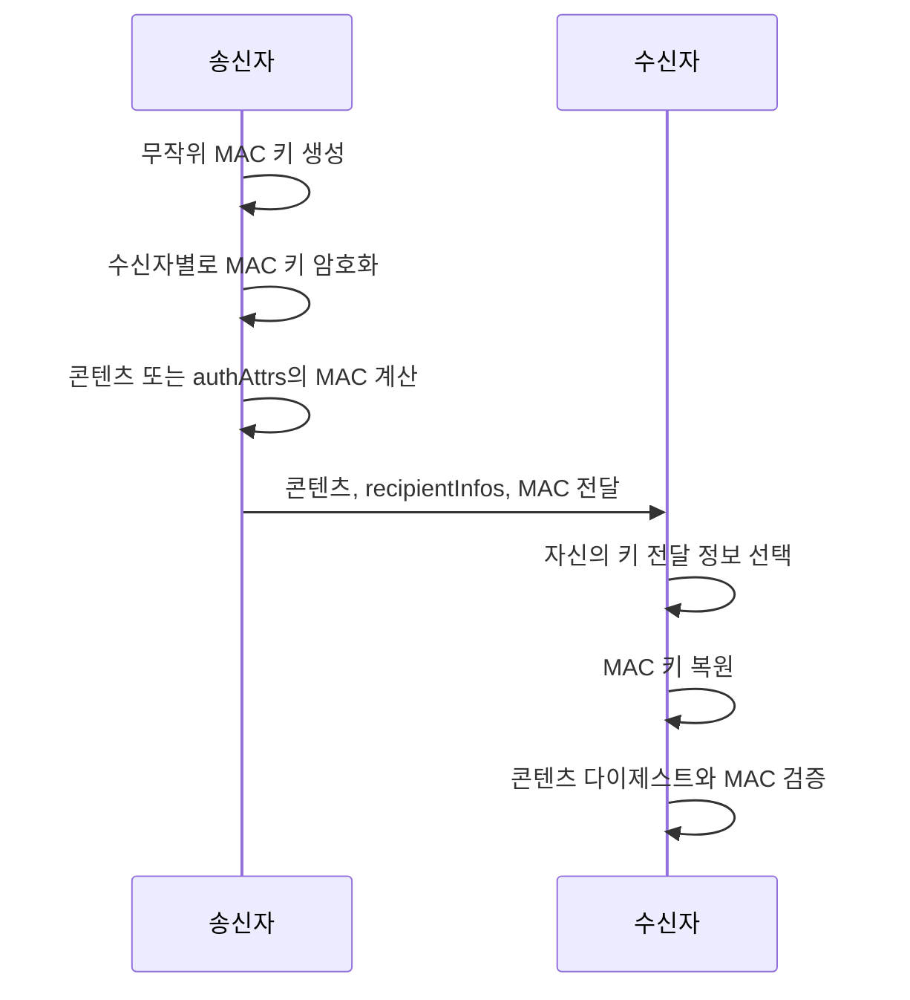
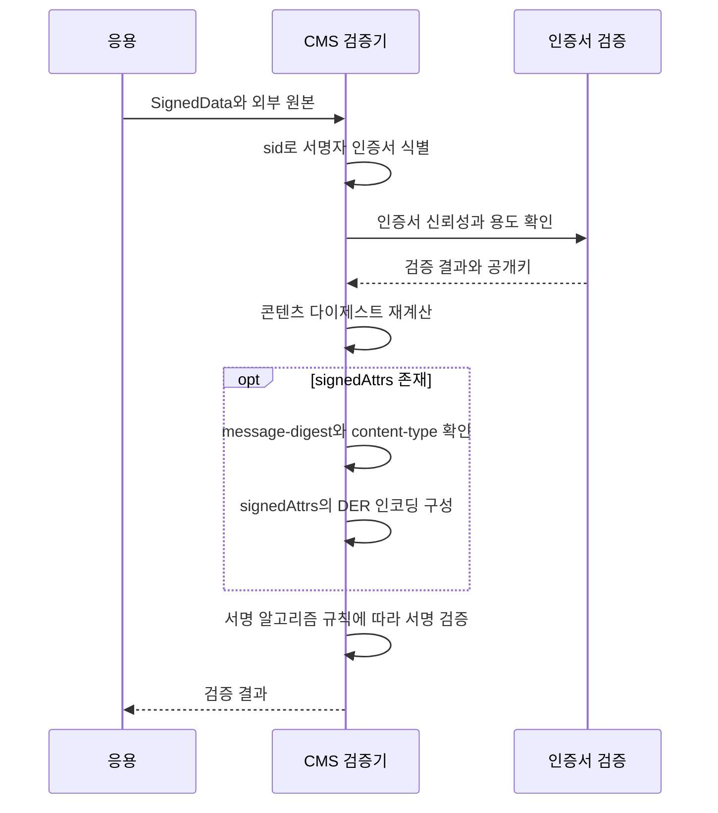
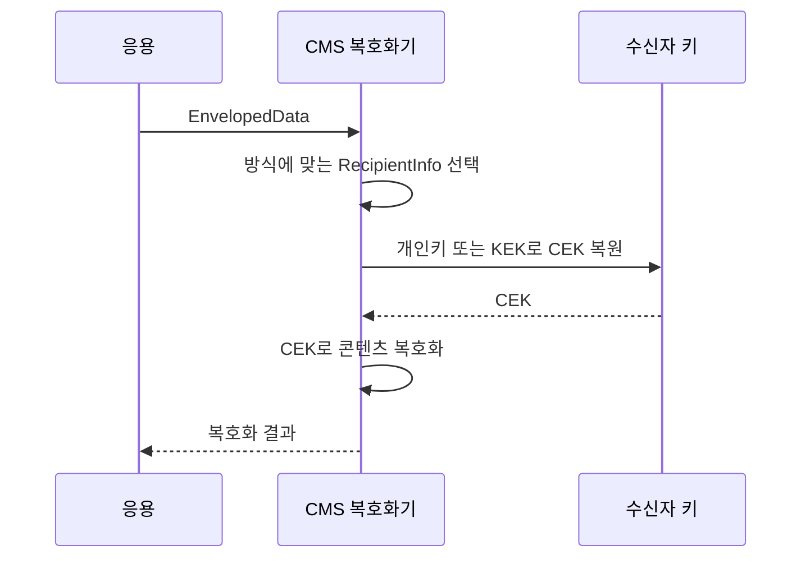

## 1. 개요

CMS(Cryptographic Message Syntax)는 임의 콘텐츠에 전자 서명·암호화·MAC(Message Authentication Code)·다이제스트를 적용한 메시지를 표현하는 암호화 메시지 포맷이다. PKCS#7을 계승한 IETF 표준이며 기본 구문은 RFC 5652에 정의되어 있다.

구조는 ASN.1(Abstract Syntax Notation One)로 정의하고 BER(Basic Encoding Rules) 또는 DER(Distinguished Encoding Rules)로 인코딩한다. X.509 인증서 기반 PKI(Public Key Infrastructure)를 지원하며, 사전 공유 키나 패스워드 기반 키 관리도 사용할 수 있다.

CMS는 보호된 콘텐츠와 암호학적 처리 정보를 담는 형식이다. 전송 방법과 응용별 처리 규칙은 S/MIME 등의 상위 규격이 정한다. OpenSSL CLI 사용법은 [[openssl-cms]]를 참고한다.

---

## 2. 주요 기능

### 2.1. 전자 서명

SignedData는 콘텐츠와 서명자별 서명 정보를 담는다. 수신자는 콘텐츠의 무결성과 서명을 검증하고, 서명자 인증서의 신뢰성을 별도로 확인한다. 여러 서명자가 같은 콘텐츠에 서명할 수 있다.

원본을 메시지에 포함하거나 분리할 수 있다. 원본을 분리한 detached 서명은 검증할 때 외부 원본이 필요하다. 구조는 §3.2, 검증 절차는 §5.2에서 설명한다.

### 2.2. 암호화

EnvelopedData는 CEK(Content Encryption Key)라는 대칭키로 콘텐츠를 암호화하고, CEK를 수신자별로 보호해 함께 전달한다. 콘텐츠를 한 번 암호화하면서 여러 수신자가 각자의 키로 CEK를 복원하도록 구성할 수 있다.

암호화와 무결성 보호를 함께 제공하려면 AEAD(Authenticated Encryption with Associated Data)를 사용하는 AuthEnvelopedData를 사용할 수 있다. 두 타입의 구조와 보호 범위는 §3.3과 §3.7에서 설명한다.

### 2.3. 메시지 인증

AuthenticatedData는 비밀 키로 계산한 MAC을 포함한다. 콘텐츠를 암호화하지 않으므로 기밀성은 제공하지 않는다.

MAC 키를 아는 당사자는 유효한 인증값을 만들 수 있다. 따라서 특정 송신자를 식별하려면 키 전달 방식의 인증 조건도 충족해야 하며, 전자 서명과 같은 부인 방지를 제공하지 않는다. MAC 키 전달과 관리 범위는 §3.6에서 설명한다.

### 2.4. 다이제스트

DigestedData는 콘텐츠와 해시 값을 함께 담는다. 수신자는 해시를 재계산해 일치 여부를 확인한다.

비밀 키나 서명이 없으므로 공격자가 콘텐츠와 해시를 함께 바꾸는 상황에는 대응하지 못한다. 구조와 계산 범위는 §3.4에서 설명한다.

### 2.5. 키 관리

RecipientInfo는 CEK나 MAC 키를 수신자에게 전달하기 위한 정보를 표현한다. 공개키를 이용한 키 전달, 키 합의, 사전 공유 대칭키, 패스워드 기반 방식을 지원한다.

콘텐츠 보호용 키와 이를 보호하는 KEK(Key Encryption Key)는 역할이 다르다. RecipientInfo의 방식별 구조는 §4에서 설명한다.

---

## 3. 콘텐츠 타입

최외곽 `ContentInfo`는 콘텐츠 타입의 OID(Object Identifier)와 해당 내용을 담는다.

```asn1
ContentInfo ::= SEQUENCE {
    contentType ContentType,
    content [0] EXPLICIT ANY DEFINED BY contentType }

ContentType ::= OBJECT IDENTIFIER
```

타입별 보호 범위는 다음과 같다.

| 타입 | 기밀성 | 무결성 확인 | 전자 서명 |
|---|---|---|---|
| data | 없음 | 없음 | 없음 |
| SignedData | 없음 | 서명으로 검증 | 있음 |
| EnvelopedData | 있음 | 타입 자체의 별도 인증값 없음 | 없음 |
| DigestedData | 없음 | 해시 비교 | 없음 |
| EncryptedData | 있음 | 타입 자체의 별도 인증값 없음 | 없음 |
| AuthenticatedData | 없음 | MAC으로 검증 | 없음 |
| AuthEnvelopedData | 있음 | AEAD 태그로 검증 | 없음 |

타입은 중첩할 수 있다. 서명과 암호화를 조합하는 방식은 §3.8에서 설명한다.

### 3.1. data

OID는 `1.2.840.113549.1.7.1`이다. 임의 바이트를 담는 옥텟 문자열이며, 내부 데이터의 해석은 응용에 맡긴다.

```asn1
Data ::= OCTET STRING
```

다른 타입이 보호하는 원본 콘텐츠로 사용한다. S/MIME에서는 이메일 본문과 첨부 파일 등을 구성한 MIME 엔티티가 여기에 담긴다.

### 3.2. SignedData

OID는 `1.2.840.113549.1.7.2`이다. 콘텐츠와 서명자별 정보를 담는다.

```asn1
SignedData ::= SEQUENCE {
    version CMSVersion,
    digestAlgorithms DigestAlgorithmIdentifiers,
    encapContentInfo EncapsulatedContentInfo,
    certificates [0] IMPLICIT CertificateSet OPTIONAL,
    crls [1] IMPLICIT RevocationInfoChoices OPTIONAL,
    signerInfos SignerInfos }
```

| 필드 | 설명 |
|---|---|
| `version` | 구문 버전 |
| `digestAlgorithms` | 서명자들이 사용하는 다이제스트 알고리즘 집합 |
| `encapContentInfo` | 콘텐츠 타입과 원본 콘텐츠 |
| `certificates` | 서명 검증 등에 사용할 인증서 집합 |
| `crls` | 인증서 폐기 정보 |
| `signerInfos` | 서명자별 `SignerInfo` 집합 |

`EncapsulatedContentInfo`의 구조는 §3.4와 같다. 내부 `eContent`를 생략하면 원본과 서명이 분리된 detached 서명이 된다. 검증 시에는 외부 원본을 제공해야 한다.[^1]

서명자별 정보는 다음과 같다.

```asn1
SignerInfo ::= SEQUENCE {
    version CMSVersion,
    sid SignerIdentifier,
    digestAlgorithm DigestAlgorithmIdentifier,
    signedAttrs [0] IMPLICIT SignedAttributes OPTIONAL,
    signatureAlgorithm SignatureAlgorithmIdentifier,
    signature SignatureValue,
    unsignedAttrs [1] IMPLICIT UnsignedAttributes OPTIONAL }
```

| 필드 | 설명 |
|---|---|
| `version` | `sid` 형식 등에 따른 구문 버전 |
| `sid` | 발급자·일련번호 또는 Subject Key Identifier로 서명자 인증서 식별 |
| `digestAlgorithm` | 콘텐츠 다이제스트 알고리즘 |
| `signedAttrs` | 서명으로 보호하는 속성 집합 |
| `signatureAlgorithm` | 서명 알고리즘과 파라미터 |
| `signature` | 서명값 |
| `unsignedAttrs` | 이 서명값으로 보호하지 않는 속성 집합 |

`signedAttrs`가 있으면 `content-type`과 `message-digest` 속성이 필수다. 콘텐츠 타입이 `id-data`가 아니면 `signedAttrs` 자체도 필수이며, 이 속성 집합은 DER로 인코딩한다. [RFC 5652 §5.3](https://www.rfc-editor.org/rfc/rfc5652.html#section-5.3)

`signing-time`은 서명자가 주장하는 서명 시각이다. 신뢰할 수 있는 시각 증거가 필요하면 §6.3의 타임스탬프 토큰을 사용한다.

서명자가 없는 certs-only 메시지도 표현할 수 있다. 이 경우 `signerInfos`는 비어 있고, `eContentType`은 `id-data`이며 `eContent`는 생략한다. 인증서 배포 용도는 §6.5에서 설명한다.

### 3.3. EnvelopedData

OID는 `1.2.840.113549.1.7.3`이다. CEK로 암호화한 콘텐츠와 수신자별 키 전달 정보를 담는다.

```asn1
EnvelopedData ::= SEQUENCE {
    version CMSVersion,
    originatorInfo [0] IMPLICIT OriginatorInfo OPTIONAL,
    recipientInfos RecipientInfos,
    encryptedContentInfo EncryptedContentInfo,
    unprotectedAttrs [1] IMPLICIT UnprotectedAttributes OPTIONAL }
```

| 필드 | 설명 |
|---|---|
| `version` | 구문 버전 |
| `originatorInfo` | 키 관리 알고리즘이 요구하는 송신자 인증서·폐기 정보 |
| `recipientInfos` | 수신자별로 보호한 CEK와 키 전달 정보 |
| `encryptedContentInfo` | 콘텐츠 타입·암호화 알고리즘·암호문 |
| `unprotectedAttrs` | 암호화나 인증으로 보호하지 않는 속성 |

`EncryptedContentInfo`는 다음과 같다.

```asn1
EncryptedContentInfo ::= SEQUENCE {
    contentType ContentType,
    contentEncryptionAlgorithm ContentEncryptionAlgorithmIdentifier,
    encryptedContent [0] IMPLICIT EncryptedContent OPTIONAL }

EncryptedContent ::= OCTET STRING
```

| 필드 | 설명 |
|---|---|
| `contentType` | 암호화 전 콘텐츠의 타입 OID |
| `contentEncryptionAlgorithm` | 콘텐츠 암호화 알고리즘과 파라미터 |
| `encryptedContent` | CEK로 암호화한 콘텐츠 |

`encryptedContent`가 생략되면 암호문을 외부에서 제공해야 한다. CEK는 수신자마다 새로 생성하는 것이 아니라 같은 콘텐츠를 복호화할 수 있도록 수신자별 방식으로 보호한다.

### 3.4. DigestedData

OID는 `1.2.840.113549.1.7.5`이다. 콘텐츠와 다이제스트를 담는다.

```asn1
DigestedData ::= SEQUENCE {
    version CMSVersion,
    digestAlgorithm DigestAlgorithmIdentifier,
    encapContentInfo EncapsulatedContentInfo,
    digest Digest }

Digest ::= OCTET STRING
```

| 필드 | 설명 |
|---|---|
| `version` | 구문 버전 |
| `digestAlgorithm` | 다이제스트 알고리즘 |
| `encapContentInfo` | 콘텐츠 타입과 원본 콘텐츠 |
| `digest` | 콘텐츠의 다이제스트 |

`EncapsulatedContentInfo`는 다음과 같다.

```asn1
EncapsulatedContentInfo ::= SEQUENCE {
    eContentType ContentType,
    eContent [0] EXPLICIT OCTET STRING OPTIONAL }

ContentType ::= OBJECT IDENTIFIER
```

| 필드 | 설명 |
|---|---|
| `eContentType` | 콘텐츠 타입 OID |
| `eContent` | 실제 콘텐츠 바이트 |

다이제스트는 `eContent`의 값 바이트에 대해 계산하며, 이를 감싸는 OCTET STRING의 태그와 길이는 포함하지 않는다. `eContent`를 생략하면 계산에 사용할 콘텐츠를 외부에서 제공해야 한다.

RFC 5652 §7은 DigestedData를 EnvelopedData의 콘텐츠로 넣는 용도를 설명한다. 다만 해시 비교 자체를 공격자에 대한 메시지 인증으로 해석해서는 안 된다.[^2]

OpenSSL로 생성·검증하고 내부 구조를 확인하는 예시는 다음과 같다.

```bash
printf '%s\n' 'hello CMS' > message.txt

openssl cms -digest_create -binary -md sha256 \
  -in message.txt -outform DER -out digested.der

openssl cms -digest_verify -binary \
  -inform DER -in digested.der -out recovered.txt

openssl cms -cmsout -print \
  -inform DER -in digested.der
```

`-digest_verify`는 다이제스트를 검증한 뒤 콘텐츠를 출력한다. [OpenSSL: openssl-cms](https://docs.openssl.org/3.5/man1/openssl-cms/)

### 3.5. EncryptedData

OID는 `1.2.840.113549.1.7.6`이다. 수신자별 키 전달 정보 없이 암호화된 콘텐츠를 담는다.

```asn1
EncryptedData ::= SEQUENCE {
    version CMSVersion,
    encryptedContentInfo EncryptedContentInfo,
    unprotectedAttrs [1] IMPLICIT UnprotectedAttributes OPTIONAL }
```

| 필드 | 설명 |
|---|---|
| `version` | 구문 버전 |
| `encryptedContentInfo` | 콘텐츠 타입·암호화 알고리즘·암호문 |
| `unprotectedAttrs` | 암호화나 인증으로 보호하지 않는 속성 |

EnvelopedData는 CEK를 수신자별로 보호한 `recipientInfos`를 포함한다. EncryptedData에는 이 정보가 없으므로 복호화 키를 외부 수단으로 확보해야 한다. 두 타입은 모두 §3.3의 `EncryptedContentInfo`를 사용한다.

RFC 5652 §8은 패스워드로부터 얻은 키 등을 이용한 로컬 저장을 전형적 용도로 제시한다. PKCS#12 적용 사례는 §6.6에서 설명한다.

### 3.6. AuthenticatedData

OID는 `1.2.840.113549.1.9.16.1.2`이다. 콘텐츠와 MAC, 수신자별로 보호한 MAC 키를 담는다.

```asn1
AuthenticatedData ::= SEQUENCE {
    version CMSVersion,
    originatorInfo [0] IMPLICIT OriginatorInfo OPTIONAL,
    recipientInfos RecipientInfos,
    macAlgorithm MessageAuthenticationCodeAlgorithm,
    digestAlgorithm [1] DigestAlgorithmIdentifier OPTIONAL,
    encapContentInfo EncapsulatedContentInfo,
    authAttrs [2] IMPLICIT AuthAttributes OPTIONAL,
    mac MessageAuthenticationCode,
    unauthAttrs [3] IMPLICIT UnauthAttributes OPTIONAL }
```

| 필드 | 설명 |
|---|---|
| `version` | 구문 버전 |
| `originatorInfo` | 키 관리 알고리즘이 요구하는 송신자 정보 |
| `recipientInfos` | 수신자별로 보호한 MAC 키와 키 전달 정보 |
| `macAlgorithm` | MAC 알고리즘과 파라미터 |
| `digestAlgorithm` | `authAttrs`가 있을 때 사용하는 콘텐츠 다이제스트 알고리즘 |
| `encapContentInfo` | 인증할 콘텐츠 타입과 원본 콘텐츠 |
| `authAttrs` | MAC으로 보호하는 속성 집합 |
| `mac` | MAC 값 |
| `unauthAttrs` | MAC으로 보호하지 않는 속성 집합 |

`authAttrs`와 `digestAlgorithm`은 함께 존재하거나 함께 생략한다. 콘텐츠 타입이 `id-data`가 아니면 `authAttrs`가 필수다. `authAttrs`가 있으면 `content-type`과 `message-digest`를 포함하며, 해당 속성 집합의 DER 인코딩에 MAC을 계산한다. 없으면 콘텐츠에 직접 계산한다.

송신자는 무작위 MAC 키를 생성하고, 같은 키를 수신자별 방식으로 보호해 `recipientInfos`에 담는다. §4의 키 전달 방식은 이 경우 CEK 대신 MAC 키를 보호한다.



수신자의 개인키·KEK·패스워드 확보와 보관·교체 정책은 외부 관리 영역이다. 수신자 공개키로 MAC 키를 암호화하는 것만으로 송신자가 인증되지는 않는다. 키 전달 방식 자체의 송신자 인증 조건을 확인해야 한다. [RFC 5652 §9·§14](https://www.rfc-editor.org/rfc/rfc5652.html#section-14)

### 3.7. AuthEnvelopedData

OID는 `1.2.840.113549.1.9.16.1.23`이다. RFC 5083이 정의한 별도 콘텐츠 타입이며, AEAD로 콘텐츠를 암호화하고 인증 태그를 포함한다.

```asn1
AuthEnvelopedData ::= SEQUENCE {
    version CMSVersion,
    originatorInfo [0] IMPLICIT OriginatorInfo OPTIONAL,
    recipientInfos RecipientInfos,
    authEncryptedContentInfo EncryptedContentInfo,
    authAttrs [1] IMPLICIT AuthAttributes OPTIONAL,
    mac MessageAuthenticationCode,
    unauthAttrs [2] IMPLICIT UnauthAttributes OPTIONAL }
```

| 필드 | 설명 |
|---|---|
| `version` | 구문 버전이며 값은 0 |
| `originatorInfo` | 키 관리 알고리즘이 요구하는 송신자 정보 |
| `recipientInfos` | 수신자별로 보호한 콘텐츠 암호화 키 |
| `authEncryptedContentInfo` | 콘텐츠 타입·AEAD 알고리즘·파라미터·암호문 |
| `authAttrs` | 암호화하지 않고 추가 인증 데이터로 보호하는 속성 |
| `mac` | AEAD 인증 태그 |
| `unauthAttrs` | 인증하지 않는 속성 |

`authAttrs`는 AAD(Additional Authenticated Data)로 처리한다. 콘텐츠 타입이 `id-data`가 아니면 필수이며, DER로 인코딩한다. AuthenticatedData와 달리 `message-digest` 속성은 포함하지 않는 것이 권고된다. [RFC 5083 §2.1](https://www.rfc-editor.org/rfc/rfc5083.html#section-2.1)

AES-GCM·AES-CCM 적용은 RFC 5084, ChaCha20-Poly1305 적용은 RFC 8103이 정의한다. AEAD 검증과 평문 처리 조건은 §5.4에서 설명한다.

### 3.8. 중첩

한 타입의 콘텐츠 자리에 다른 CMS 타입을 넣어 보호 기능을 조합할 수 있다. 내부 타입은 `eContentType` 또는 `contentType`으로 표시한다. PKCS#7의 `SignedAndEnvelopedData`와 달리 CMS는 타입을 중첩하는 방식으로 서명과 암호화를 조합한다.

서명 후 암호화하면 콘텐츠와 서명 정보가 함께 암호화된다. 다음은 SignedData를 직접 내부 콘텐츠로 넣은 구조다.

```text
ContentInfo
└─ contentType: enveloped-data
   └─ EnvelopedData
      ├─ recipientInfos
      └─ encryptedContentInfo
         ├─ contentType: signed-data
         └─ encryptedContent
            └─ 암호화된 SignedData
               ├─ encapContentInfo
               └─ signerInfos
```

암호화 후 서명하면 외부 서명을 복호화 없이 검증할 수 있다. 이 서명은 암호화된 구조를 보호하며, 서명자가 원문을 확인했다는 의미로 해석할 수는 없다.

```text
ContentInfo
└─ contentType: signed-data
   └─ SignedData
      ├─ encapContentInfo
      │  ├─ eContentType: enveloped-data
      │  └─ eContent: EnvelopedData 인코딩
      └─ signerInfos
```

S/MIME은 두 순서를 모두 허용한다. 서명 후 암호화는 서명자를 숨길 수 있고, 암호화 후 서명은 복호화 없이 외부 서명을 검증할 수 있다. 구체적인 캡슐화는 상위 규격을 따라야 한다. [RFC 8551 §3.7](https://www.rfc-editor.org/rfc/rfc8551.html#section-3.7)

---

## 4. RecipientInfo

RecipientInfo는 콘텐츠 보호용 키를 수신자에게 전달하기 위한 방식별 정보를 담는다. EnvelopedData와 AuthEnvelopedData에서는 콘텐츠 암호화 키를, AuthenticatedData에서는 MAC 키를 보호한다.

| 타입 | 방식 | 규격 |
|---|---|---|
| `KeyTransRecipientInfo` | 수신자 공개키로 보호 대상 키 암호화 | RFC 5652 |
| `KeyAgreeRecipientInfo` | 키 합의로 KEK를 유도한 뒤 보호 대상 키 암호화 | RFC 5652 |
| `KEKRecipientInfo` | 사전 공유한 KEK로 보호 대상 키 암호화 | RFC 5652 |
| `PasswordRecipientInfo` | 패스워드 기반 방식으로 KEK를 확보해 보호 대상 키 암호화 | RFC 5652 |
| `OtherRecipientInfo` | OID로 식별하는 키 관리 확장 | RFC 5652 |
| `KEMRecipientInfo` | KEM 공유 비밀에서 KEK를 유도해 보호 대상 키 암호화 | RFC 9629 |

수신자 식별 정보는 방식마다 다르다. 인증서의 발급자·일련번호, Subject Key Identifier, 사전 공유 키 식별자 등을 사용한다.

KEM(Key Encapsulation Mechanism)은 공유 비밀을 확보하는 방식이다. `KEMRecipientInfo`는 `RecipientInfo`의 새로운 최상위 선택지가 아니라 `OtherRecipientInfo`를 통해 포함된다. ML-KEM의 CMS 적용은 RFC 9936이 정의한다. [RFC 9629 §3](https://www.rfc-editor.org/rfc/rfc9629.html#section-3), [RFC 9936](https://www.rfc-editor.org/rfc/rfc9936.html)

---

## 5. 수신 처리

타입에 따라 복호화·서명 검증·MAC 검증·해시 비교를 수행한다. 서명값 검증과 인증서 신뢰성 검증은 별도 판단이다.

### 5.1. 인증서 검증

CMS에 포함된 인증서를 곧바로 신뢰해서는 안 된다. 공개키의 선택과 신뢰성 판단에는 X.509 인증 경로 검증 및 응용 정책을 적용한다.

- 신뢰 앵커까지 인증 경로 구성과 인증서 서명 검증
- 유효기간 확인
- 인증서 폐기 상태 확인
- Key Usage와 Extended Key Usage 등 용도 제한 확인
- 응용이 기대하는 서명자 또는 수신자 신원 확인

키 용도는 수행하는 연산에 맞아야 한다. 예를 들어 RSA 키 전달은 `keyEncipherment`, 키 합의는 `keyAgreement`를 확인한다. 구체적인 요구는 사용하는 인증서 프로파일과 응용 정책에 따른다. [RFC 5280 §4.2.1.3·§6](https://www.rfc-editor.org/rfc/rfc5280.html#section-4.2.1.3)

### 5.2. SignedData 검증



`signedAttrs` 검증용 인코딩에는 전송 필드의 IMPLICIT `[0]` 태그 대신 ASN.1 `SET OF` 태그를 사용한다. 콘텐츠가 분리되어 있으면 외부 원본을 사용한다.

서명 알고리즘에 따라 입력 처리 규칙이 다르다. 특히 EdDSA(Edwards-Curve Digital Signature Algorithm)는 RFC 8419의 적용 규칙을 따라야 하므로 모든 서명을 단순한 “콘텐츠 해시에 대한 서명”으로 구현해서는 안 된다. [RFC 8419 §3](https://www.rfc-editor.org/rfc/rfc8419.html#section-3)

알고리즘 식별자 보호 규칙은 §7.2에서 설명한다.

### 5.3. EnvelopedData 복호화



복호화 성공은 무결성이나 송신자 인증을 뜻하지 않는다. CBC(Cipher Block Chaining) 패딩 검사도 메시지 인증을 대신하지 않는다. 별도 보호가 필요하면 SignedData 중첩 또는 AuthEnvelopedData를 사용한다.

### 5.4. AuthEnvelopedData 검증

RecipientInfo로 콘텐츠 암호화 키를 복원한 뒤, 암호문과 AAD에 대한 AEAD 태그를 검증한다.

인증에 성공하기 전에는 평문을 외부에 제공하지 않는다. 검증에 실패하면 평문 전체를 파기해야 한다. `unauthAttrs`는 인증 범위에 포함되지 않는다. [RFC 5083 §2](https://www.rfc-editor.org/rfc/rfc5083.html#section-2)

### 5.5. DigestedData 검증

콘텐츠의 다이제스트를 독립적으로 재계산해 `digest`와 비교한다. 보호 범위의 한계는 §2.4와 같다.

### 5.6. AuthenticatedData 검증

RecipientInfo로 MAC 키를 복원해 MAC을 재계산한다. `authAttrs`가 있으면 콘텐츠 다이제스트와 `message-digest`의 일치, 콘텐츠 타입과 `content-type`의 일치를 확인한다.

MAC 검증 입력은 `authAttrs`의 DER 인코딩이며, IMPLICIT `[2]` 태그 대신 ASN.1 `SET OF` 태그를 사용한다. 송신자 인증의 조건은 §2.3과 §3.6을 따른다.

### 5.7. EncryptedData 복호화

외부에서 확보한 키와 `contentEncryptionAlgorithm`의 파라미터로 콘텐츠를 복호화한다. EncryptedData에는 자체적인 서명이나 MAC 검증 요소가 없다.

---

## 6. 활용

### 6.1. 이메일

S/MIME(Secure/Multipurpose Internet Mail Extensions)은 MIME 콘텐츠를 CMS로 보호한다.

| 목적 | 적용 방식 |
|---|---|
| 서명 | SignedData에 MIME 콘텐츠 또는 분리 서명 포함 |
| 암호화 | EnvelopedData 또는 AuthEnvelopedData에 MIME 콘텐츠 포함 |
| 서명과 암호화 | 서명·암호화 결과를 다시 MIME 엔티티로 감싸 중첩 |

분리 서명은 `multipart/signed`의 별도 부분에 `application/pkcs7-signature`로 전달한다. 포함 서명과 암호화 메시지는 `application/pkcs7-mime`을 사용한다.

S/MIME 4.0은 EnvelopedData와 AuthEnvelopedData를 모두 다룬다. 사용할 알고리즘과 타입은 수신자의 지원 정보 등을 고려해 결정한다. [RFC 8551 §2.7·§3](https://www.rfc-editor.org/rfc/rfc8551.html#section-3)

### 6.2. 전자서명 문서

CAdES(CMS Advanced Electronic Signatures)는 CMS 서명에 추가 속성과 검증 자료를 결합하는 전자서명 형식이다.

서명 타임스탬프, 인증서와 폐기 정보 등을 포함하거나 참조해 장기 검증에 필요한 증거를 표현한다. 단순한 SignedData 생성만으로 이러한 장기 검증 요건이 충족되지는 않는다. [RFC 5126](https://www.rfc-editor.org/rfc/rfc5126.html)

### 6.3. 타임스탬프

RFC 3161의 `TimeStampToken`은 SignedData를 담은 ContentInfo다. 내부 `TSTInfo`에는 대상 데이터의 해시인 `messageImprint`, 생성 시각, 일련번호, 정책 식별자 등이 들어간다.

TSA(Time Stamping Authority)는 `TSTInfo`에 서명한다. 검증자는 토큰의 서명뿐 아니라 요청한 해시와 토큰의 `messageImprint`가 일치하는지도 확인한다. 상세 구조는 [[timestamp-token]]을 참고한다. [RFC 3161 §2.4.2](https://www.rfc-editor.org/rfc/rfc3161.html#section-2.4.2)

### 6.4. 코드와 펌웨어

RFC 4108은 펌웨어 패키지를 CMS로 서명하고 선택적으로 암호화하는 방식을 정의한다. 서명은 펌웨어의 무결성과 배포자 인증에 사용한다. [RFC 4108](https://www.rfc-editor.org/rfc/rfc4108.html)

기존 코드 서명 생태계에서는 PKCS#7 기반 형식도 사용한다. JAR 서명의 `.RSA`·`.DSA`·`.EC` 블록은 `.SF` 파일에 대한 서명을 PKCS#7 구조에 담는다. CMS와 PKCS#7의 호환성 범위는 §7.1을 참고한다. [Oracle: JAR File Specification](https://docs.oracle.com/en/java/javase/25/docs/specs/jar/jar.html#digital-signatures)

### 6.5. 인증서 등록과 배포

EST(Enrollment over Secure Transport)는 인증서 발급·갱신 응답과 CA 인증서 배포에 certs-only 메시지를 사용한다. 이때 CMS는 인증서를 묶어 전달하는 컨테이너 역할을 한다.

서버가 생성한 개인키를 추가로 보호하는 경우에는 개인키를 SignedData에 넣고 다시 EnvelopedData로 암호화한다. 인증서 배포와 개인키 보호는 서로 다른 사용 사례다. [RFC 7030 §4.1·§4.2·§4.4](https://www.rfc-editor.org/rfc/rfc7030.html#section-4)

### 6.6. PKCS#12

PKCS#12의 `AuthenticatedSafe`는 여러 ContentInfo를 포함한다. 패스워드로 암호화하는 `SafeContents`는 EncryptedData에, 공개키 기반으로 암호화하는 경우는 EnvelopedData에 담는다.

이는 PKCS#12 전체가 단일 CMS 메시지라는 뜻은 아니다. PKCS#12가 내부 콘텐츠 보호에 CMS 타입을 사용하는 구조다. OpenSSL 사용법은 [[openssl-pkcs12]]를 참고한다. [RFC 7292 §4.1·§5.1](https://www.rfc-editor.org/rfc/rfc7292.html#section-4.1)

---

## 7. 관련 규격

### 7.1. 계보와 호환성

| 규격 | 연도 | 내용 |
|---|---|---|
| PKCS#7 v1.5, RFC 2315 | 1998 | CMS의 기반이 된 메시지 구문 |
| RFC 2630 | 1999 | IETF의 CMS 규격 |
| RFC 3369·RFC 3370 | 2002 | 메시지 구문과 알고리즘 규격 분리 |
| RFC 3852 | 2004 | 인증서·폐기 정보 등의 확장 |
| RFC 5652 | 2009 | 기본 CMS 구문, STD 70 |

CMS와 PKCS#7은 많은 구조를 공유하지만 완전히 동일하지 않다. 특히 SignedData에 `data` 이외의 콘텐츠를 넣으면 캡슐화 형식과 다이제스트 계산 범위가 달라질 수 있다. 호환 구현은 이 차이를 처리해야 한다. [RFC 5652 §5.2.1](https://www.rfc-editor.org/rfc/rfc5652.html#section-5.2.1)

### 7.2. 알고리즘과 확장

| 규격 | 내용 |
|---|---|
| RFC 3370 | CMS 알고리즘 적용 규칙 |
| RFC 5754 | SHA-2 계열 알고리즘 적용 |
| RFC 8419 | Ed25519·Ed448 서명 적용 |
| RFC 5083 | AuthEnvelopedData 타입 정의 |
| RFC 5084 | AES-GCM·AES-CCM 적용 |
| RFC 8103 | ChaCha20-Poly1305 적용 |
| RFC 6211 | 알고리즘 식별자를 보호하는 `CMSAlgorithmProtection` 속성 정의 |
| RFC 8933 | 해시 사용과 알고리즘 식별자 보호 요구 보완 |
| RFC 9629 | KEMRecipientInfo 확장 |
| RFC 9936 | ML-KEM 적용 |

RFC 8933은 콘텐츠와 서명 속성의 다이제스트에 같은 해시 알고리즘을 사용하도록 요구한다. 또한 RFC 6211의 `CMSAlgorithmProtection` 속성 포함을 권고한다. 이 속성을 검증할 때는 보호된 알고리즘 식별자와 실제 사용된 필드의 일치 여부를 확인한다. [RFC 8933 §3·§4](https://www.rfc-editor.org/rfc/rfc8933.html#section-3)

RFC 3370에 수록된 알고리즘 목록을 현재의 권장 목록으로 해석해서는 안 된다. 알고리즘 선택은 적용하는 상위 규격과 보안 정책을 함께 따라야 한다.

---

## Sources

- `raw/crypto/CMS.md`
- [IETF: RFC 5652, Cryptographic Message Syntax](https://www.rfc-editor.org/rfc/rfc5652.html)
- [IETF: RFC 3370, Cryptographic Message Syntax Algorithms](https://www.rfc-editor.org/rfc/rfc3370.html)
- [IETF: RFC 5754, Using SHA2 Algorithms with CMS](https://www.rfc-editor.org/rfc/rfc5754.html)
- [IETF: RFC 8419, Use of EdDSA Signatures in CMS](https://www.rfc-editor.org/rfc/rfc8419.html)
- [IETF: RFC 5083, CMS Authenticated-Enveloped-Data Content Type](https://www.rfc-editor.org/rfc/rfc5083.html)
- [IETF: RFC 5084, Using AES-CCM and AES-GCM in CMS](https://www.rfc-editor.org/rfc/rfc5084.html)
- [IETF: RFC 8103, Using ChaCha20-Poly1305 in CMS](https://www.rfc-editor.org/rfc/rfc8103.html)
- [IETF: RFC 6211, CMS Algorithm Identifier Protection Attribute](https://www.rfc-editor.org/rfc/rfc6211.html)
- [IETF: RFC 8933, Update to CMS for Algorithm Identifier Protection](https://www.rfc-editor.org/rfc/rfc8933.html)
- [IETF: RFC 9629, Using KEM Algorithms in CMS](https://www.rfc-editor.org/rfc/rfc9629.html)
- [IETF: RFC 9936, Use of ML-KEM in CMS](https://www.rfc-editor.org/rfc/rfc9936.html)
- [IETF: RFC 8551, S/MIME Version 4.0 Message Specification](https://www.rfc-editor.org/rfc/rfc8551.html)
- [IETF: RFC 5126, CMS Advanced Electronic Signatures](https://www.rfc-editor.org/rfc/rfc5126.html)
- [IETF: RFC 3161, Time-Stamp Protocol](https://www.rfc-editor.org/rfc/rfc3161.html)
- [IETF: RFC 4108, Using CMS to Protect Firmware Packages](https://www.rfc-editor.org/rfc/rfc4108.html)
- [IETF: RFC 7030, Enrollment over Secure Transport](https://www.rfc-editor.org/rfc/rfc7030.html)
- [IETF: RFC 7292, PKCS #12](https://www.rfc-editor.org/rfc/rfc7292.html)
- [IETF: RFC 5280, Internet X.509 PKI Certificate and CRL Profile](https://www.rfc-editor.org/rfc/rfc5280.html)
- [Oracle: JAR File Specification](https://docs.oracle.com/en/java/javase/25/docs/specs/jar/jar.html)
- [OpenSSL: openssl-cms](https://docs.openssl.org/3.5/man1/openssl-cms/)

---

## Related pages

- [[timestamp-token]]
- [[x509-certificate]]
- [[openssl-cms]]
- [[openssl-x509]]
- [[openssl-overview]]
- [[openssl-pkcs12]]
- [[padding-oracle-attack]]

---

[^1]: `raw/crypto/CMS.md`는 `encapContentInfo`가 없으면 detached 서명이라고 서술하지만, RFC 5652 §5.2에서 생략 가능한 필드는 내부 `eContent`다. `encapContentInfo`는 유지한다.

[^2]: `raw/crypto/CMS.md`는 DigestedData를 변조 방지 수단으로 표현한다. 키 없는 해시는 공격자가 재계산할 수 있으므로, RFC 5652의 구조와 계산 방식에 따라 해시 일치 확인과 메시지 인증을 구분한다.
