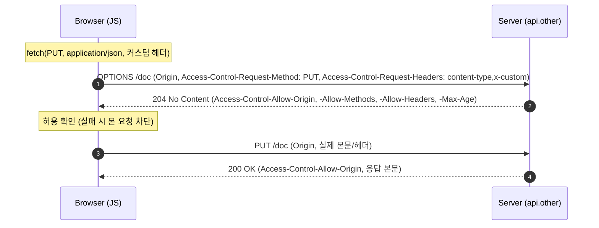

## 1. 개요

CORS(Cross-Origin Resource Sharing)는 서버가 HTTP 응답 헤더로 교차 출처 접근의 허용 범위를 지정하고, 브라우저가 이를 검사하는 메커니즘이다. 브라우저의 기본 정책인 Same-Origin Policy(SOP)를 표준화된 방법으로 완화한다.

### 1.1. Origin

origin = scheme + host + port. 셋이 모두 같아야 동일 출처다.

```
https://app.example.com:443/page   기준
├─ https://app.example.com/other      ✅ 같은 origin
├─ http://app.example.com             ✗ scheme 다름
├─ https://api.example.com            ✗ host 다름
└─ https://app.example.com:8443       ✗ port 다름
```

---

## 2. SOP(Same-Origin Policy)

브라우저는 보안상 스크립트(`fetch`, `XMLHttpRequest`)가 다른 origin의 응답을 읽는 것을 기본 차단한다. SOP가 없으면 악성 사이트의 JS가 사용자가 로그인한 다른 사이트(은행 등)의 데이터를 몰래 읽을 수 있다.

하지만 실무에선 `app.example.com`(프론트)이 `api.example.com`(백엔드)을 호출하는 등 정당한 교차 출처 요청이 필요하다. CORS는 서버가 "이 origin은 허용한다"고 명시적으로 선언해 SOP를 안전하게 완화하는 장치다.

---

## 3. 적용 범위

CORS는 브라우저가 다른 출처의 응답을 스크립트에 노출할지 판단하는 정책이다. 인증·인가를 대체하지 않는다. `curl`, 서버 측 HTTP 클라이언트는 브라우저의 SOP/CORS 검사를 강제하지 않으므로 CORS 응답 헤더 없이도 응답을 읽을 수 있다.

단순 요청은 CORS 응답 검사에 실패해도 이미 서버에 도달해 상태를 변경했을 수 있다. 프리플라이트가 필요한 요청은 사전 허용 검사에 실패하면 본 요청이 전송되지 않는다. 따라서 CORS 오류만으로 서버가 요청을 처리하지 않았다고 판단하면 안 된다.

CORS 설정만으로 [[csrf]]가 방어되지는 않는다. 다만 API가 커스텀 헤더를 필수로 요구하고 신뢰하지 않는 출처의 프리플라이트를 거부하는 설계는 CSRF 방어에 활용할 수 있다. 공개 응답에는 `Access-Control-Allow-Origin: *`가 적합할 수 있으며, 자격 증명 모드가 `include`인 요청에서는 사용할 수 없다.

---

## 4. 동작

### 4.1. 단순 요청

일반적인 교차 출처 `fetch`에서 다음 조건을 충족하면 프리플라이트 없이 전송된다. 개발자가 설정하는 요청 헤더는 이름뿐 아니라 값의 제한도 충족해야 한다. 브라우저가 자동으로 관리하는 `Origin`·`Cookie` 등은 이 조건과 구분한다.

- 메서드: GET / HEAD / POST
- 개발자가 설정하는 헤더는 CORS-safelisted 조건을 충족해야 함: `Accept`, `Accept-Language`, `Content-Language`, `Content-Type`, `Range`
- `Content-Type`을 설정하면 MIME 타입이 `application/x-www-form-urlencoded`, `multipart/form-data`, `text/plain` 중 하나
- `Range`는 단일 바이트 범위여야 하며 헤더별 길이·문자 제한을 충족해야 함

브라우저가 `Origin` 헤더를 붙여 보내고, 서버가 `Access-Control-Allow-Origin`으로 허용하면 응답이 JS에 노출된다.

### 4.2. 프리플라이트

PUT·DELETE·PATCH, 허용 목록 밖의 커스텀 헤더, `application/json` 등으로 위 조건을 벗어나면 브라우저가 본 요청 전에 OPTIONS 프리플라이트를 보낸다.



`Access-Control-Max-Age`로 프리플라이트 결과를 캐시하면 반복 OPTIONS를 줄인다.

---

## 5. 헤더

다음은 CORS 요청을 처리할 때 브라우저가 자동으로 부착하는 요청 헤더다. 브라우저는 요청의 출처와 본 요청에 사용할 메서드·헤더를 서버에 전달한다. 프리플라이트 관련 헤더는 사전 요청에만 포함된다.

| 헤더 | 의미 |
|---|---|
| `Origin` | 요청을 시작한 출처 |
| `Access-Control-Request-Method` | 프리플라이트에서 본 요청에 사용할 메서드를 전달 |
| `Access-Control-Request-Headers` | 프리플라이트에서 허용을 확인할 요청 헤더 이름을 전달. 해당 헤더가 있을 때 포함 |

다음은 서버가 CORS 허용 정책을 전달하기 위해 설정하는 응답 헤더다. 애플리케이션 서버나 리버스 프록시가 설정하며, 브라우저는 이를 검사해 본 요청의 전송과 응답의 스크립트 노출 여부를 판단한다.

| 헤더 | 의미 |
|---|---|
| `Access-Control-Allow-Origin` | 응답을 공유할 출처를 명시하거나 허용되는 조건에서 `*` 사용 |
| `Access-Control-Allow-Methods` | 프리플라이트에서 허용하는 본 요청 메서드 |
| `Access-Control-Allow-Headers` | 프리플라이트에서 허용하는 본 요청 헤더 |
| `Access-Control-Allow-Credentials` | 자격 증명 모드가 `include`인 요청의 응답 공유를 `true`로 허용 |
| `Access-Control-Max-Age` | 프리플라이트 허용 결과의 캐시 시간을 초 단위로 지정 |
| `Access-Control-Expose-Headers` | 기본 노출 대상 외에 JavaScript가 읽을 수 있는 응답 헤더를 지정 |

`Access-Control-Allow-Origin`을 요청의 origin에 따라 다르게 반환한다면 `Vary: Origin`도 함께 보낸다. 공유 캐시가 서로 다른 출처의 응답을 구분하도록 하기 위한 설정이다.

---

## 6. 자격 증명

교차 출처 `fetch`에 쿠키를 포함하려면 `credentials: "include"`를 지정한다. 쿠키는 Domain·Path·Secure·SameSite 및 브라우저의 서드파티 쿠키 정책도 충족해야 한다. 이 옵션이 쿠키 정책을 우회하지는 않는다.

자격 증명 모드가 `include`인 요청의 응답을 스크립트에 노출하려면 아래 헤더가 필요하다. 실제 쿠키가 존재하는지와 무관하게 모드를 기준으로 판정한다.

```http
Access-Control-Allow-Origin: https://app.example.com
Access-Control-Allow-Credentials: true
```

이 모드에서 `Access-Control-Allow-Origin`, `Access-Control-Allow-Methods`, `Access-Control-Allow-Headers`, `Access-Control-Expose-Headers`의 `*`는 와일드카드로 사용할 수 없다. 프리플라이트 자체에는 자격 증명을 포함하지 않지만, 서버는 본 요청의 자격 증명 사용을 허용해야 한다.

JavaScript가 직접 설정하는 `Authorization` 헤더는 credentials 모드와 별도로 다룬다. 이 헤더를 추가했다고 `include` 모드가 되는 것은 아니다. `Authorization`은 프리플라이트 허용 대상이며, `Access-Control-Allow-Headers: *`로 허용되지 않으므로 이름을 명시해야 한다.

```http
Access-Control-Allow-Headers: Authorization, Content-Type
```

자격 증명이 포함된 단순 요청은 위 응답 헤더가 없어도 전송될 수 있다. 서버의 응답 헤더는 이미 전송된 요청을 취소하지 않으며, 응답의 스크립트 노출 여부를 결정한다.

---

## 7. 서버 설정

### 7.1. Spring

`@CrossOrigin`은 컨트롤러나 메서드에 적용한다.

```java
@CrossOrigin(origins = "https://domain2.com", maxAge = 3600)
@RestController
@RequestMapping("/account")
public class AccountController {
    @GetMapping("/{id}")
    public String retrieve(@PathVariable Long id) { return "account:" + id; }
}
```

별도 값을 지정하지 않은 `@CrossOrigin`은 모든 origin·헤더와 매핑된 메서드를 허용하고 `allowCredentials`는 비활성, `maxAge`는 1800초다. 위 예제는 origin과 maxAge를 명시적으로 제한한다.

전역 설정은 `WebMvcConfigurer`로 구성한다.

```java
@Configuration
public class WebConfig implements WebMvcConfigurer {
    @Override
    public void addCorsMappings(CorsRegistry registry) {
        registry.addMapping("/api/**")
            .allowedOrigins("https://domain1.com", "https://domain2.com")
            .allowedMethods("GET", "PUT")
            .allowedHeaders("header1", "header2")
            .exposedHeaders("header1")
            .allowCredentials(true)
            .maxAge(3600);
    }
}
```

필터를 사용할 때는 `CorsConfigurationSource`에 경로별 정책을 등록한다.

```java
CorsConfiguration config = new CorsConfiguration();
config.setAllowCredentials(true);
config.addAllowedOrigin("https://domain1.com");
config.addAllowedHeader("Authorization");
config.addAllowedHeader("Content-Type");
config.addAllowedMethod("GET");
config.addAllowedMethod("POST");

var source = new UrlBasedCorsConfigurationSource();
source.registerCorsConfiguration("/**", config);
CorsFilter filter = new CorsFilter(source);
```

Spring Security에서는 CORS 처리를 인증보다 먼저 수행하도록 활성화한다.

```java
http.cors(withDefaults());   // 등록된 CORS 설정과 연동
```

`allowCredentials(true)`에서는 `allowedOrigins("*")`를 사용할 수 없다. 명시적 `allowedOrigins("https://app.example.com")`가 유효하다. 여러 서브도메인을 허용해야 할 때만 `allowedOriginPatterns`를 사용하고, 일치하는 모든 서브도메인을 신뢰할 수 있는지 확인한다.

### 7.2. nginx

```nginx
location /api/ {
    # 프리플라이트: OPTIONS는 여기서 204로 종결(백엔드까지 안 감)
    if ($request_method = OPTIONS) {
        add_header Access-Control-Allow-Origin  "https://app.example.com" always;
        add_header Access-Control-Allow-Methods "GET, POST, PUT, DELETE, OPTIONS" always;
        add_header Access-Control-Allow-Headers "Authorization, Content-Type" always;
        add_header Access-Control-Allow-Credentials "true" always;
        add_header Access-Control-Max-Age 86400 always;
        return 204;
    }

    add_header Access-Control-Allow-Origin  "https://app.example.com" always;
    add_header Access-Control-Allow-Credentials "true" always;

    proxy_pass http://backend;
}
```

- `always`: 4xx/5xx 응답에도 헤더가 붙도록 필수.
- 기본 상속 규칙에서는 현재 단계에 `add_header`가 있으면 상위 단계의 선언을 상속하지 않는다. 예제는 OPTIONS와 본 응답 양쪽에 필요한 헤더를 선언한다. nginx 1.29.3 이상의 `add_header_inherit` 설정에 따라 상속 동작은 달라질 수 있다.
- 여러 origin 허용은 `map`으로 `$http_origin`을 검사해 반영한다.

---

## 8. 기타

### 8.1. no-cors

`fetch`의 `mode: "no-cors"`는 CORS를 우회해 응답을 읽는 옵션이 아니다. 교차 출처 응답은 opaque 응답으로 제공되어 JavaScript에서 상태 코드·헤더·본문을 읽을 수 없고, 사용할 메서드와 요청 헤더도 제한된다.

### 8.2. 응답 헤더 노출

교차 출처 응답에 헤더가 존재해도 JavaScript에서 모두 읽을 수 있는 것은 아니다. 파일 다운로드의 `Content-Disposition`이나 추적용 `X-Request-ID`를 읽어야 한다면 서버가 다음처럼 명시한다.

```http
Access-Control-Expose-Headers: Content-Disposition, X-Request-ID
```

`Set-Cookie`는 노출 금지 응답 헤더이므로 여기에 지정해도 브라우저 JavaScript에서 읽을 수 없다.

### 8.3. 설정 오류

자격 증명을 허용하는 응답에서 출처 검증이 느슨하면 다른 사이트가 사용자 권한으로 응답을 읽을 수 있다.

- 요청의 `Origin` 값을 검증 없이 `Access-Control-Allow-Origin`에 그대로 반영하면 모든 출처를 허용한 것과 같다. 허용 목록과 정확히 일치하는 값만 반환한다.
- `Origin: null`은 sandboxed iframe, `file:` 문서, 일부 리다이렉트에서 전송된다. 공격자도 sandboxed iframe으로 `null`을 만들 수 있으므로 허용 목록에 넣지 않는다.
- 접미사·정규식 비교는 `endsWith("example.com")`가 `evilexample.com`과 일치하는 식의 오류를 만든다. 정규식의 `.`을 이스케이프하지 않는 경우도 같다.
- HTTPS 사이트가 `http://` 출처를 신뢰하면 네트워크 공격자가 해당 출처에 스크립트를 주입해 응답을 읽을 수 있다.

```java
private static final Set<String> ALLOWED = Set.of("https://app.example.com");

String origin = request.getHeader("Origin");
if (origin != null && ALLOWED.contains(origin)) {
    response.setHeader("Access-Control-Allow-Origin", origin);
    response.setHeader("Access-Control-Allow-Credentials", "true");
    response.addHeader("Vary", "Origin");
}
```

### 8.4. 오류 진단

브라우저 개발자 도구에서 OPTIONS와 본 요청을 구분해 확인한다. 프리플라이트 응답의 허용 메서드·헤더와 본 응답의 허용 출처·자격 증명 설정을 각각 검사한다. `curl`은 브라우저의 CORS 검사를 수행하지 않으므로, 호출 성공만으로 브라우저에서도 정상 동작한다고 판단할 수 없다.

프리플라이트 결과는 캐시될 수 있으므로 OPTIONS가 매번 발생하지 않을 수 있다. `Access-Control-Max-Age`에는 브라우저별 상한도 적용된다.

---

## Sources
- [Fetch Standard §3.3](https://fetch.spec.whatwg.org/#http-cors-protocol)
- [nginx HTTP Headers Module](https://nginx.org/en/docs/http/ngx_http_headers_module.html)
- [MDN: Cross-Origin Resource Sharing (CORS)](https://developer.mozilla.org/en-US/docs/Web/HTTP/Guides/CORS)
- [Spring Framework Reference: CORS](https://docs.spring.io/spring-framework/reference/web/webmvc-cors.html)
- [Baeldung: CORS with Spring](https://www.baeldung.com/spring-cors)
- [enable-cors.org: nginx](https://enable-cors.org/server_nginx.html)
- [getpagespeed: NGINX CORS](https://www.getpagespeed.com/server-setup/nginx/nginx-cors)
- [PortSwigger Web Security Academy: CORS](https://portswigger.net/web-security/cors)

---

## Related pages
- [[cookie]]
- [[reverse-proxy]]
- [[restful-api-design]]
- [[oauth2]]
- [[curl]]
- [[csrf]]
- [[xss]]
