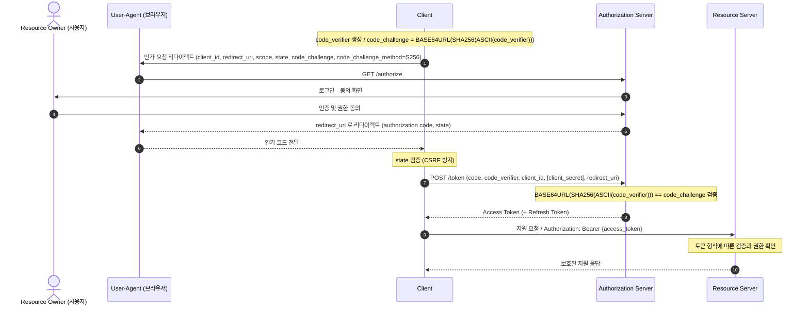
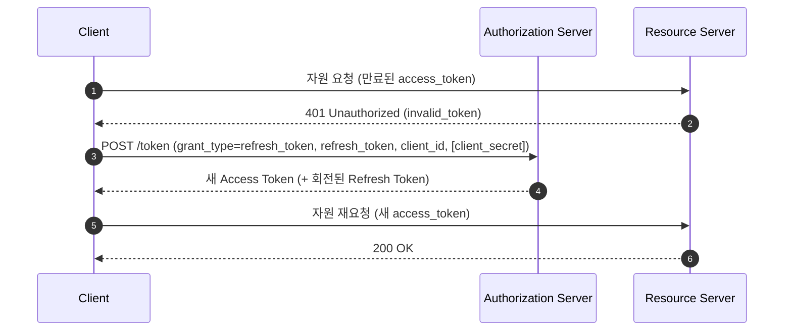

## 1. 개요

OAuth 2.0(RFC 6749)은 사용자의 자격증명을 제3자 앱에 넘기지 않고, 제한된 권한(scope)을 위임해 자원에 접근하게 하는 인가(authorization) 프레임워크다. 예를 들어 A 서비스가 사용자의 구글 계정 프로필만 읽도록 허용할 때, 사용자는 A에게 구글 비밀번호를 주지 않는다.

> 주의: OAuth 2.0은 인가 프로토콜이지 인증(로그인) 프로토콜이 아니다. 사용자 인증·신원 확인은 그 위에 얹은 OpenID Connect(OIDC)가 담당한다(8.1절). 또한 JWT는 프로토콜이 아니라 토큰 규격이며 OAuth와 층위가 다르다(8.2절).

---

## 2. 역할

| 역할 | 설명 |
|------|------|
| Resource Owner | 자원 접근 권한을 가진 주체(보통 사용자) |
| Client | 자원 소유자를 대신해 자원에 접근하는 애플리케이션 |
| Authorization Server (AS) | 인증·동의 후 토큰을 발급하는 서버 |
| Resource Server (RS) | 보호 자원을 호스팅하고 액세스 토큰으로 접근을 허용하는 서버 |

---

## 3. 구성 요소

### 3.1. 클라이언트 타입
- Confidential: 자격증명(client_secret)을 안전하게 보관 가능(서버 사이드 앱).
- Public: 비밀 보관 불가(SPA, 모바일/네이티브 앱). → Authorization Code 사용 시 PKCE 필수.

### 3.2. 엔드포인트
- Authorization Endpoint: 사용자 인증·동의를 받는 곳(브라우저 리다이렉트).
- Token Endpoint: 인가 코드/리프레시 토큰을 액세스 토큰으로 교환.
- Redirection Endpoint(redirect_uri): AS가 결과를 되돌려주는 클라이언트 주소.

### 3.3. 토큰·파라미터
- Access Token: 자원 접근용 자격. 짧은 수명, `scope`로 권한 한정. 보통 `Authorization: Bearer`로 전달(RFC 6750).
- Refresh Token: 액세스 토큰 만료 시 재발급용. 선택적, 수명이 김.
- scope: 위임 권한 범위. state: CSRF 방지 난수. PKCE(code_verifier/code_challenge): 코드 주입 방지.

---

## 4. Grant Type

| Grant | 용도 | 비고 |
|-------|------|------|
| Authorization Code (+ PKCE) | 웹/모바일/SPA 표준 |  권장 |
| Client Credentials | 서버 간(M2M), 사용자 없음 | |
| Device Code | 입력이 제한된 기기(TV, CLI) | |
| Refresh Token | 액세스 토큰 재발급 | |
| Implicit | 레거시 브라우저 앱 | 사용하지 않는 것이 권고됨. SHOULD NOT |
| ~~Resource Owner Password~~ | (레거시) 자격증명 직접 전달 | 사용 금지 |

RFC 9700은 Implicit에 SHOULD NOT, Resource Owner Password에 MUST NOT을 적용한다. 사용자 인가에는 Authorization Code + PKCE를 사용한다.

---

## 5. Authorization Code + PKCE



핵심
- 서버 측 웹앱은 백엔드가 코드를 토큰으로 교환하고 토큰을 보관한다. 브라우저가 직접 OAuth 클라이언트인 SPA는 브라우저에서 토큰 엔드포인트 응답을 받는다.
- Confidential 클라이언트만 `client_secret` 제시(백엔드 보관), Public 클라이언트는 비밀 기반 클라이언트 인증을 수행하지 않는다. PKCE는 클라이언트 인증을 대체하지 않으며, 공개·기밀 클라이언트 모두에서 인가 코드를 요청에 바인딩하는 데 사용한다.

### 5.1. 토큰 갱신

액세스 토큰은 수명이 짧다. 만료되면 클라이언트가 refresh_token으로 Authorization Server의 토큰 엔드포인트에 재요청해 새 토큰을 받는다. 갱신은 클라이언트의 책임이며, 리소스 서버나 사용자가 하지 않는다.



- 만료 감지: ① 선제적: 발급 시 받은 `expires_in`/JWT `exp`로 만료 시각을 추적해 미리 갱신. ② 반응적: 리소스 서버가 `401 Unauthorized`(`invalid_token`)를 반환하면 그때 갱신.
- 갱신 요청 상대: 리소스 서버가 아니라 Authorization Server의 토큰 엔드포인트. 리소스 서버는 토큰 검증만 한다.
- 사용자 개입 없음: refresh_token이 유효한 동안엔 재로그인 없이 갱신된다(이것이 refresh_token의 존재 이유).
- Refresh Token Rotation: 갱신 시 새 refresh_token을 함께 발급하고 이전 것을 무효화한다. 공개 클라이언트는 회전 또는 sender-constrained MUST(7장). 무효화된 refresh_token이 재사용되면 탈취 가능성을 탐지하고 관련 활성 refresh token을 폐기한다. 기존 access token까지 즉시 폐기되는 것은 아니다.
- refresh_token 만료·폐기 시: 갱신이 `invalid_grant`로 실패하므로, 클라이언트는 Authorization Code + PKCE 인가 흐름을 다시 시작해야 한다. AS의 로그인 세션과 정책에 따라 사용자의 자격증명 재입력은 생략될 수 있다.

---

## 6. PKCE

인가 코드가 탈취되어도 토큰 교환을 막는 확장이다.

1. 클라이언트가 임의의 `code_verifier` 생성.
2. `code_challenge = BASE64URL(SHA256(ASCII(code_verifier)))` (method `S256`)를 인가 요청에 포함.
3. 토큰 교환 시 원본 `code_verifier`를 제시 → AS가 `BASE64URL(SHA256(ASCII(code_verifier))) == code_challenge`를 검증.

- 탈취자는 `code_verifier`를 모르므로 코드만으로 토큰을 못 받는다 → 코드 가로채기/주입 공격 방어.
- 모든 클라이언트에 권장(공개 클라이언트는 필수). 단, "PKCE는 클라이언트 인증이 아니며 client_secret의 대체도 아니다": 둘은 병행한다.

### 6.1. code_verifier / code_challenge

- `code_verifier`: 클라이언트가 인가 요청마다 새로 만드는 고엔트로피 난수 문자열(예측 불가능한 임시 비밀). RFC 7636 규격: unreserved 문자(`[A-Z][a-z][0-9]-._~`), 43~128자, 권장 생성법은 32바이트 이상 난수 → base64url(패딩 없음).
- `code_challenge`: 난수가 아니라 `code_verifier`를 해시한 파생값: `BASE64URL( SHA-256( ASCII(code_verifier) ) )` (해시 대상은 verifier 문자열의 ASCII 바이트).

누가 무엇을 보유/전송하는가

| | 클라이언트 | Authorization Server |
|---|---|---|
| 생성 | code_verifier·code_challenge 둘 다 | 없음 |
| 인가 요청 후 | code_verifier 비밀 보관(세션 등) | code_challenge 를 인가 코드에 바인딩 저장 |
| 토큰 요청 시 | code_verifier 전송 | 받은 verifier 해시 → challenge와 대조 |

- 인가 요청 땐 `code_challenge`만 전송하고 `code_verifier`는 클라이언트가 보관한다. AS는 이 시점에 `code_verifier`를 모른다.
- `code_verifier`는 토큰 요청(발급) 단계에서 딱 한 번 전송되며, AS의 검증도 바로 그 순간에 이뤄진다(별도의 나중 검증 시점 없음). 이후 리소스 서버 호출엔 `access_token`만 쓰므로 verifier의 수명은 인가 요청~토큰 교환으로 끝난다.

```
[생성]      Client: code_verifier(랜덤) → code_challenge = BASE64URL(SHA256(ASCII(verifier)))
[인가요청]  Client --code_challenge--> AS      (AS가 code에 묶어 저장)
[콜백]      AS --authorization code--> Client
[토큰요청]  Client --code + code_verifier--> AS
[검증+발급] AS: BASE64URL(SHA256(ASCII(verifier))) == 저장된 challenge ? → 토큰 발급
```

AS는 인가 코드에 challenge를 바인딩하고 토큰 요청의 verifier로 검증한다. verifier가 노출되지 않았다면 탈취한 코드만으로 토큰을 교환할 수 없다.

> 실무에선 Spring Security OAuth2 Client, Nimbus, AppAuth 등 라이브러리가 verifier/challenge 생성·검증을 대신 처리한다.

---

## 7. 보안

### 7.1. RFC 9700 Security BCP

- PKCE: Authorization Code를 사용하는 공개 클라이언트는 PKCE 사용 MUST, 기밀 클라이언트는 사용 RECOMMENDED, AS는 PKCE 지원 MUST.
- CSRF 방지: 클라이언트는 요청을 시작한 사용자 에이전트에 트랜잭션을 바인딩해야 한다. PKCE 지원을 확인한 경우의 PKCE나 OIDC nonce를 활용할 수 있으며, 그 밖에는 일회성 state 등으로 보호한다.
- redirect_uri 정확 문자열 매칭(MUST): 패턴/부분 매칭 금지(자격 유출 방어). 네이티브 앱 localhost 포트만 예외.
- Implicit grant: 사용하지 않는 것이 권고된다. SHOULD NOT이며, 응답의 토큰 주입과 유출 위험을 방지한 경우의 예외를 RFC가 명시한다.
- Resource Owner Password grant 금지(MUST NOT): 자격증명 노출, MFA 불가.
- Access Token을 URI 쿼리 파라미터로 전달 금지(MUST NOT): 브라우저 기록·Referer 유출.
- Refresh Token: 공개 클라이언트는 회전(rotation) 또는 sender-constrained MUST: 재사용 공격 완화.
- Mix-up / 코드 주입 방지: 발급자 식별(`iss`, RFC 9207)·PKCE·`nonce`.
- 추가 실무: 액세스 토큰 짧은 수명, 토큰은 안전 저장(§7.2), 전 구간 HTTPS.

### 7.2. 토큰 저장 위치

토큰을 어디에 두느냐는 클라이언트 타입에 따라 다르며, "무조건 브라우저 저장"이 아니다. 서버 측 보관은 브라우저에서 토큰이 직접 노출되는 범위를 줄인다. `refresh_token`은 수명이 길고 재발급 권한을 가지므로 `access_token`보다 더 강하게 보호한다.

서버 측 웹앱은 토큰을 서버에 보관한다.
- 토큰을 백엔드(서버 세션·서버 저장소)에 두고 브라우저에는 세션 쿠키만 준다.
- 토큰이 브라우저 JavaScript에 직접 노출되지 않아 토큰의 직접 탈취를 줄인다. XSS가 사용자 세션을 이용해 백엔드에 요청하는 위험은 남는다.

SPA의 저장 방식은 다음 특성을 가진다.

| 저장소 | 장점 | 위험 |
|--------|------|------|
| `localStorage`/`sessionStorage` | 구현 쉬움, 새로고침 유지 | XSS에 취약(주입된 JS가 읽음). refresh_token 저장은 지양 |
| 메모리(JS 변수) | XSS 지속 탈취 어려움 | 새로고침 시 소실(access_token용) |
| HttpOnly · Secure · SameSite 쿠키 | JS가 못 읽음(XSS 토큰 절도 완화) | CSRF 방어 필요(SameSite·CSRF 토큰) |

→ JS 접근 저장소(localStorage)는 XSS에, 쿠키는 CSRF에 노출된다. 브라우저에 둘수록 공격면이 넓어지므로 가능하면 서버로 밀어낸다.

네이티브 앱은 OS의 보안 저장 기능을 사용한다.
- 토큰과 토큰 보호용 키는 플랫폼의 보안 저장 API로 관리하고 평문 파일에 저장하지 않는다.

### 7.3. 브라우저 앱 아키텍처

브라우저 앱 관련 IETF 초안은 다음 세 패턴을 비교한다. 초안의 권고와 발행된 RFC의 요구사항은 구분한다.

1. BFF(Backend-For-Frontend): 전용 백엔드가 Confidential 클라이언트로서 Authorization Code 플로우를 수행하고 토큰을 서버에 보관, 브라우저에는 세션 쿠키만 발급. 토큰을 브라우저 JavaScript에 노출하지 않는다. 모든 자원 요청은 백엔드를 경유하며 CSRF 방어가 필요하다. XSS에 의한 사용자 권한의 요청 실행은 여전히 가능하다.
2. Token-Mediating Backend: 백엔드가 OAuth를 처리하되 프론트가 access_token으로 리소스 서버를 직접 호출. 프론트는 토큰을 localStorage에 저장하지 말고 메모리에만 두고, 없으면 백엔드에 재요청해야 한다(SHOULD).
3. Browser-based OAuth Client: 브라우저가 직접 OAuth 클라이언트로 모든 책임을 진다(가장 노출 큼).

---

## 8. 비교

OAuth 2.0은 OIDC·JWT와 자주 혼동된다. 각각 층위와 역할이 다르다.

### 8.1. OAuth 2.0 vs OpenID Connect

- OAuth 2.0 = 인가(권한 위임). 액세스 토큰으로 "무엇을 할 수 있는가"를 다룬다.
- OIDC = OAuth 2.0 위의 인증 계층. ID Token(JWT)으로 "누구인가"(신원)를 다룬다.
- "소셜 로그인"은 대부분 OIDC. OAuth만으로 로그인(인증)을 구현하는 것은 안티패턴이다.

### 8.2. OAuth 2.0 vs JWT

둘은 층위가 다르다. JWT는 데이터 포맷(토큰 규격, RFC 7519), OAuth 2.0은 인가 프레임워크(프로토콜, RFC 6749)다. JWT 자체의 구조·서명·클레임·보안 상세는 [[jwt]] 참고.

관계
- OAuth 2.0의 액세스 토큰은 opaque(서버 조회형)일 수도 JWT(자기 완결형)일 수도 있다. JWT로 하면 DB 조회 없이 stateless 검증이 가능하다(RFC 9068: OAuth 액세스 토큰용 JWT 프로파일).
- OIDC의 ID Token은 항상 JWT다.
- 반대로 JWT는 OAuth와 무관한 곳(자체 세션 토큰, 서비스 간 주장 전달 등)에서도 쓸 수 있다.

---

## 9. 확장 규격

| 규격 | 내용 |
|---|---|
| RFC 7009 | Token Revocation. 클라이언트가 토큰 폐기를 AS에 요청 |
| RFC 7662 | Token Introspection. RS가 opaque 토큰의 활성 상태·속성을 AS에 조회 |
| RFC 8628 | Device Authorization Grant (4장 Device Code) |
| RFC 9126 | PAR(Pushed Authorization Requests). 인가 요청 파라미터를 백채널로 먼저 전송 |
| RFC 9449 | DPoP. 토큰을 클라이언트 키에 바인딩하는 애플리케이션 계층 sender-constraining |
| RFC 8705 | mTLS 클라이언트 인증과 인증서 바인딩 토큰 |
| RFC 9207 | 인가 응답의 `iss` 파라미터 (mix-up 방어) |
| RFC 9068 | access token용 JWT 프로파일 |

---

## 10. 리소스 서버 구현

Spring Security는 JWT access token을 검증하는 리소스 서버 설정을 제공한다. `issuer-uri`로 OP 설정과 공개키(JWK Set)를 조회해 서명·`iss`·`exp`를 검증한다. `aud` 검증은 별도 validator로 추가한다.

```yaml
spring.security.oauth2.resourceserver.jwt.issuer-uri: https://idp.example.com
```

```java
@Bean
SecurityFilterChain filterChain(HttpSecurity http) throws Exception {
    http.authorizeHttpRequests(a -> a.anyRequest().authenticated())
        .oauth2ResourceServer(rs -> rs.jwt(Customizer.withDefaults()));
    return http.build();
}
```

---

## Sources
- [OWASP Session Management Cheat Sheet](https://cheatsheetseries.owasp.org/cheatsheets/Session_Management_Cheat_Sheet.html)
- [RFC 6749: The OAuth 2.0 Authorization Framework](https://datatracker.ietf.org/doc/html/rfc6749)
- [RFC 6750: Bearer Token Usage](https://datatracker.ietf.org/doc/html/rfc6750)
- [RFC 7636: Proof Key for Code Exchange (PKCE)](https://www.rfc-editor.org/rfc/rfc7636)
- [RFC 7519: JSON Web Token (JWT)](https://datatracker.ietf.org/doc/html/rfc7519)
- [RFC 9068: JWT Profile for OAuth 2.0 Access Tokens](https://datatracker.ietf.org/doc/html/rfc9068)
- [RFC 9700: OAuth 2.0 Security Best Current Practice](https://datatracker.ietf.org/doc/html/rfc9700)
- [OAuth Grant Types](https://oauth.net/2/grant-types/)
- [IETF draft: OAuth 2.0 for Browser-Based Apps (BFF·토큰 저장)](https://datatracker.ietf.org/doc/html/draft-ietf-oauth-browser-based-apps)
- [RFC 7009: OAuth 2.0 Token Revocation](https://www.rfc-editor.org/rfc/rfc7009)
- [RFC 7662: OAuth 2.0 Token Introspection](https://www.rfc-editor.org/rfc/rfc7662)
- [RFC 8628: OAuth 2.0 Device Authorization Grant](https://www.rfc-editor.org/rfc/rfc8628)
- [RFC 9126: OAuth 2.0 Pushed Authorization Requests](https://www.rfc-editor.org/rfc/rfc9126)
- [RFC 9449: OAuth 2.0 Demonstrating Proof of Possession (DPoP)](https://www.rfc-editor.org/rfc/rfc9449)
- [RFC 8705: OAuth 2.0 Mutual-TLS Client Authentication](https://www.rfc-editor.org/rfc/rfc8705)
- [RFC 9207: OAuth 2.0 Authorization Server Issuer Identification](https://www.rfc-editor.org/rfc/rfc9207)
- [Spring Security: OAuth 2.0 Resource Server JWT](https://docs.spring.io/spring-security/reference/servlet/oauth2/resource-server/jwt.html)

---

## Related pages
- [[jwt]]
- [[restful-api-design]]
- [[cors]]
- [[ldap]]
- [[sso]]
- [[csrf]]
- [[xss]]
