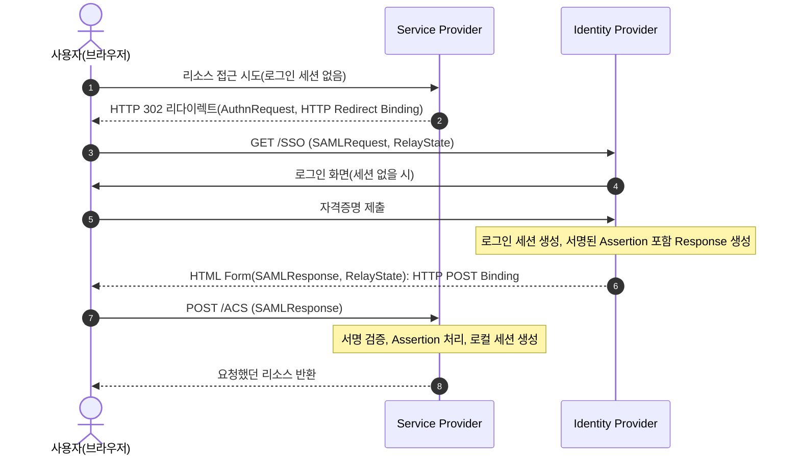
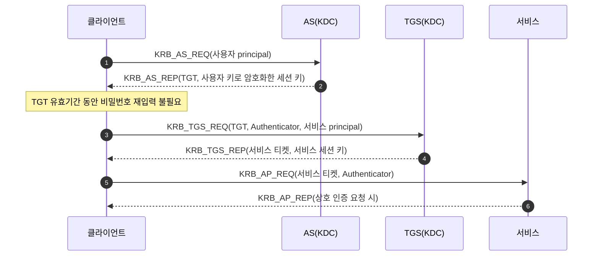

## 1. 개요

SSO(Single Sign-On)는 사용자가 한 번 인증하면, 이후 여러 독립된 서비스에 재로그인 없이 접근할 수 있게 하는 인증 모델이다. 연합 신원(federated identity)에서는 서비스가 별도 신원 제공자를 신뢰해 인증 결과를 수용한다. SSO와 신원 연합은 관련되지만 동일한 개념은 아니다.

핵심은 인증과 개별 서비스 접근을 분리하는 것이다. 사용자는 한 곳에서만 인증하고, 그 인증 결과(assertion·ticket·token)를 여러 서비스가 신뢰해 세션을 만든다.

---

## 2. 모델

| 역할 | 설명 |
|---|---|
| IdP(Identity Provider) | 사용자를 인증하고 신원 정보를 발급하는 주체 |
| SP(Service Provider) / RP(Relying Party) | IdP가 발급한 신원 정보를 신뢰해 접근을 허용하는 서비스. SAML은 SP, OIDC는 RP로 부름 |
| 신뢰 관계(trust) | IdP와 SP/RP가 사전에 맺어둔 관계(인증서 교환, 클라이언트 등록 등). 신뢰 관계가 없으면 발급된 신원 정보를 검증할 수 없음 |

SAML Web Browser SSO는 시작 지점에 따라 다음 흐름을 지원한다. OIDC의 제3자 로그인 시작은 4.2에서 구분한다.

- SP-initiated: 사용자가 SP 리소스에 먼저 접근한다. 로그인 세션이 없으면 SP가 IdP로 리다이렉트하고, 인증 후 IdP가 사용자를 SP로 되돌려보낸다.
- IdP-initiated: IdP에 이미 로그인한 사용자가 SP로 가는 링크를 클릭하면 IdP가 신원 정보를 만들어 SP로 바로 전달한다.

---

## 3. SAML 2.0

### 3.1. 구성 요소

| 구성 | 내용 |
|---|---|
| Assertion | IdP가 발급하는 XML 문서. Authentication(인증 사실)·Attribute(속성)·Authorization Decision(인가 결정) 3종 statement를 담음 |
| Protocol | Assertion을 주고받는 요청/응답 규약. 대표적으로 Authentication Request Protocol(인증 요청), Single Logout Protocol(단일 로그아웃) |
| Binding | Protocol 메시지를 실제 전송 프로토콜에 얹는 방법. HTTP Redirect, HTTP POST, HTTP Artifact, SOAP 등 |
| Profile | Assertion·Protocol·Binding을 특정 시나리오에 맞게 조합한 것. 대표적으로 Web Browser SSO Profile |

### 3.2. SP-initiated SSO



- SP는 최초 요청 URL을 로컬 상태로 저장해두고, IdP를 거쳐 돌아온 뒤 RelayState로 원래 리소스 위치를 복원한다.
- AuthnRequest(SP→IdP)에는 Redirect/POST/Artifact Binding을, Response(IdP→SP)에는 POST/Artifact Binding을 쓸 수 있으며 양쪽 Binding을 다르게 조합할 수 있다.
- POST Binding으로 전달되는 Assertion은 반드시 전자서명되어야 한다.

### 3.3. IdP-initiated SSO

사용자가 IdP에 이미 로그인된 상태에서 IdP가 제공하는 SP 바로가기 링크를 클릭하면, SP로의 AuthnRequest 없이 IdP가 곧바로 서명된 Assertion을 담은 Response를 SP로 보낸다. 대응하는 요청이 없으므로 Response에 `InResponseTo`가 없다[^1].

### 3.4. Single Logout

SLO(Single Logout)는 IdP와 참여 SP의 세션을 종료하는 프로파일이며 HTTP Redirect·POST·SOAP 바인딩을 지원한다. 프론트채널은 브라우저를 경유하고, SOAP 백채널은 서버 간 세션 식별 정보로 로그아웃을 처리할 수 있다. 프론트채널에서는 브라우저 이탈로 일부 처리가 중단될 수 있다.

---

## 4. OpenID Connect

OIDC는 OAuth 2.0 위에 얹은 인증 계층이다. OAuth 2.0만으로는 "무엇을 할 수 있는가"(인가)만 다루고 "누구인가"(인증)를 표준화하지 않는데, OIDC가 이를 채운다. OAuth2 자체의 역할·플로우·PKCE·보안 고려사항은 [[oauth2]] 참고.

### 4.1. 구성 요소

| 구성 | 내용 |
|---|---|
| OP(OpenID Provider) | OIDC를 구현한 OAuth 2.0 Authorization Server |
| RP(Relying Party) | OIDC를 사용하는 OAuth 2.0 Client |
| ID Token | 인증 사실을 담은 JWT. OIDC가 OAuth2에 추가하는 핵심 산출물 |

### 4.2. 인증 흐름

인증 요청 시 `scope`에 `openid`를 포함한다. Authorization Code 흐름에서는 RP가 코드를 토큰 엔드포인트에서 교환해 Access Token과 ID Token을 받는다.

제3자 로그인 시작에서는 OP나 포털이 RP의 로그인 시작 엔드포인트로 사용자를 보낸다. RP는 전달된 발급자 정보를 검증하고 OP에 인증 요청을 시작한다. SAML IdP-initiated처럼 요청하지 않은 ID Token을 바로 수용하는 흐름과는 다르다.

### 4.3. ID Token

ID Token의 주요 클레임은 다음과 같다. JWT 구조는 [[jwt]] 참고.

| 클레임 | 필수 여부 | 의미 |
|---|---|---|
| `iss` | REQUIRED | 발급자(OP) Issuer Identifier |
| `sub` | REQUIRED | 사용자를 나타내는 Subject Identifier |
| `aud` | REQUIRED | 대상 RP의 client_id |
| `exp` / `iat` | REQUIRED | 만료 시각 / 발급 시각 |
| `auth_time` | 조건부 REQUIRED | 실제 인증이 이뤄진 시각 |
| `nonce` | 흐름에 따라 필수 | Code 흐름에서는 선택 사항이지만, 요청에 포함했다면 응답 값의 존재와 일치를 검증 |
| `acr` / `amr` | OPTIONAL | 인증 컨텍스트 등급 / 사용된 인증 방식(비밀번호, OTP 등) |

ID Token은 원칙적으로 JWS로 서명하며 선택적으로 서명 후 JWE로 암호화한다. OIDC Core는 Code 흐름에서 등록 시 명시적으로 요청한 경우 `alg=none`을 허용하지만, 일반 구현은 서명된 ID Token을 요구하도록 구성한다. RP는 OP의 설정 정보(엔드포인트 위치, 서명키 등)를 보통 OpenID Connect Discovery로 얻는다.

### 4.4. 로그아웃

OIDC는 SAML SLO에 대응하는 로그아웃 규격을 별도로 정의한다.

| 규격 | 방식 |
|---|---|
| RP-Initiated Logout 1.0 | RP가 사용자를 OP의 `end_session_endpoint`로 보내 OP 세션 종료를 요청. `id_token_hint`, `post_logout_redirect_uri` 사용 |
| Front-Channel Logout 1.0 | OP가 브라우저에서 각 RP의 로그아웃 URI를 iframe으로 호출 |
| Back-Channel Logout 1.0 | OP가 각 RP에 서명된 Logout Token(JWT)을 서버 간 POST로 전송 |

프론트채널 방식은 브라우저의 서드파티 콘텐츠 차단으로 iframe에서 RP 세션 쿠키를 받지 못할 수 있다[^2]. 백채널 방식은 브라우저에 의존하지 않지만, RP가 `sid`·`sub`로 로컬 세션을 찾아 무효화할 수 있도록 세션 매핑을 저장해야 한다.

---

## 5. Kerberos

Kerberos(RFC 4120)는 신뢰할 수 있는 제3자(trusted third party)가 공유 비밀키 암호화로 안전하지 않은 네트워크에서 신원을 검증하는 인증 프로토콜이다. SAML·OIDC는 브라우저 리다이렉트로 신원 정보를 전달하지만, Kerberos 클라이언트는 KDC에서 티켓을 직접 받아 서비스에 제시한다.

### 5.1. 구성 요소

| 구성 | 내용 |
|---|---|
| KDC(Key Distribution Center) | AS와 TGS를 제공하는 서버. 두 서비스는 논리적으로 구분됨 |
| AS(Authentication Server) | 사용자를 인증하고 TGT(Ticket-Granting Ticket)를 발급 |
| TGS(Ticket-Granting Server) | TGT를 제시받아 특정 서비스용 서비스 티켓을 발급 |
| Ticket | 클라이언트 신원과 세션 키를 서비스의 키로 암호화한 자격증명. 서비스만 복호화할 수 있음 |
| 세션 키 | 클라이언트와 서비스가 공유하는 임시 키. 이후 통신 인증·암호화에 사용 |
| Authenticator | 클라이언트가 세션 키로 암호화해 티켓과 함께 보내는 타임스탬프 포함 정보. 티켓 재사용(replay)을 막음 |

### 5.2. SSO 흐름



- 사용자는 로그인 시 AS에 한 번만 인증해 TGT를 받는다. 이후 다른 서비스에 접근할 때는 비밀번호 없이 TGT를 TGS에 제시해 그 서비스 전용 티켓을 받는다.
- 서비스는 KRB_AP_REQ에 `MUTUAL-REQUIRED`가 설정된 경우에만 KRB_AP_REP로 응답한다.
- Windows Active Directory의 도메인 로그인이 대표 구현이다.

### 5.3. SPNEGO

웹 애플리케이션은 SPNEGO 기반 `Negotiate` HTTP 인증(RFC 4559)으로 Kerberos SSO를 적용한다. 서버가 `WWW-Authenticate: Negotiate`와 함께 401을 응답하면, 브라우저는 `HTTP/hostname` 서비스 티켓을 받아 SPNEGO 토큰을 Base64로 인코딩해 `Authorization` 헤더로 보낸다.

```
HTTP/1.1 401 Unauthorized
WWW-Authenticate: Negotiate

GET /app HTTP/1.1
Host: app.corp.example.com
Authorization: Negotiate <Base64 SPNEGO 토큰>
```

이 방식은 HTTP 헤더와 본문을 보호하지 않으므로 기밀성이 필요하면 TLS를 함께 쓴다. 인증 상태가 연결 단위로 유지되므로 프록시는 인증된 연결을 다른 클라이언트와 공유하면 안 된다.

### 5.4. 로그아웃

Kerberos에는 SAML SLO나 OIDC 로그아웃에 대응하는 규격이 없다. 발급된 티켓은 만료 시각까지 유효하므로, 노출 기간은 티켓 수명으로 제한한다[^3].

### 5.5. LDAP

Kerberos는 인증 프로토콜이고 LDAP은 디렉터리 접근 프로토콜로 계층이 다르다. Active Directory 등에서는 LDAP 디렉터리가 계정·그룹 정보를 저장하고, Kerberos가 그 계정에 대한 인증을 처리하는 식으로 함께 쓰인다. LDAP 자체의 Bind 인증·구조는 [[ldap]] 참고.

---

## 6. 프로토콜 비교

| | SAML 2.0 | OpenID Connect | Kerberos |
|---|---|---|---|
| 데이터 포맷 | XML(Assertion) | JSON/JWT(ID Token) | 바이너리 티켓(ASN.1) |
| 기반 | 독립 프로토콜 | OAuth 2.0 확장 | 독립 프로토콜(대칭키 기반) |
| 주 전송 | 브라우저 리다이렉트/POST | 브라우저 리다이렉트 + 백채널 토큰 교환 | KDC와 직접 통신. HTTP 서비스는 SPNEGO |
| 주 사용처 | 기업용 웹 SSO(B2B, 엔터프라이즈 SaaS 연동) | 웹/모바일 앱 로그인, 소셜 로그인 | 사내 인트라넷(AD 도메인 로그인) |
| 신원 정보 | 서명된 XML Assertion | 서명된 JWT(ID Token) | 암호화된 티켓 |
| 로그아웃 | SLO | RP-Initiated·Front/Back-Channel Logout | 없음(티켓 만료) |

---

## 7. 보안

- 재사용 방지: SAML은 유효기간과 Assertion ID의 재사용을 검사하고, 요청 기반 흐름에서는 `InResponseTo`도 검증한다. OIDC는 요청에 바인딩된 nonce 등을 검증한다. Kerberos 서비스는 Authenticator의 시각 검사와 replay cache를 함께 사용하며, 애플리케이션 프로토콜이 자체 재사용 방어를 제공하는 경우에만 캐시를 생략할 수 있다.
- 서명·암호화: 적용 프로파일과 등록 정책이 요구하는 서명을 검증한다. 암호화를 사용하는 경우에도 대상·발급자·유효기간 검증을 생략하지 않는다.
- 대상 검증: SAML은 `Audience`, OIDC는 `aud` 클레임으로 토큰이 자신을 대상으로 발급됐는지 확인한다.
- 세션 고정 방지: SP/RP는 SSO 로그인에 성공하면 로컬 세션 식별자를 새로 발급한다([[session-hijacking]]).
- 로그아웃 한계: 프론트채널 로그아웃은 전파 실패와 부분 로그아웃이 생길 수 있다. 민감한 서비스는 짧은 세션 수명과 재인증 정책을 병행한다.
- XML 서명 래핑(XSW): SAML 응답에 서명된 Assertion을 남긴 채 위조 Assertion을 추가하면, 서명 검증 대상과 애플리케이션이 읽는 요소가 달라질 수 있다. 서명 검증에 사용된 요소만 처리하고 스키마 검증과 검증된 라이브러리를 사용한다[^4].

---

## Sources
- [OASIS SAML 2.0 Profiles §4.1, §4.4](https://docs.oasis-open.org/security/saml/v2.0/saml-profiles-2.0-os.pdf)
- [OASIS: SAML V2.0 Technical Overview](https://docs.oasis-open.org/security/saml/Post2.0/sstc-saml-tech-overview-2.0.html)
- [OpenID Foundation: OpenID Connect Core 1.0](https://openid.net/specs/openid-connect-core-1_0.html)
- [RFC 4120: The Kerberos Network Authentication Service (V5)](https://datatracker.ietf.org/doc/html/rfc4120)
- [RFC 4559: SPNEGO-based Kerberos and NTLM HTTP Authentication in Microsoft Windows](https://www.rfc-editor.org/rfc/rfc4559)
- [OpenID Connect RP-Initiated Logout 1.0](https://openid.net/specs/openid-connect-rpinitiated-1_0.html)
- [OpenID Connect Front-Channel Logout 1.0](https://openid.net/specs/openid-connect-frontchannel-1_0.html)
- [OpenID Connect Back-Channel Logout 1.0](https://openid.net/specs/openid-connect-backchannel-1_0.html)
- [Somorovsky et al., On Breaking SAML (USENIX Security 2012)](https://www.usenix.org/conference/usenixsecurity12/technical-sessions/presentation/somorovsky)

---

## Related pages
- [[oauth2]]
- [[jwt]]
- [[ldap]]
- [[webauthn]]
- [[session-hijacking]]

---

[^1]: 요청 없이 도착한 Response를 unsolicited response라 한다. SAML Profiles §4.1.5는 IdP가 이를 보낼 수 있고 `InResponseTo`를 넣지 않는다고만 정하며, SP가 수용할지는 구현의 설정에 맡겨진다. 요청과 대조할 수 없으므로 재사용 방지는 Assertion ID 기록과 유효기간 검사에 의존한다(§7).
[^2]: OpenID Connect Front-Channel Logout 1.0의 "User Agents Blocking Access to Third-Party Content" 항목에 근거함.
[^3]: RFC 4120에는 로그아웃이나 발급된 티켓을 폐기하는 메시지가 없다. §2.3은 탈취된 자격증명이 티켓 만료 시각까지 유효하다는 점을 들어 짧은 수명의 갱신 가능 티켓(renewable ticket)을 두며, KDC는 갱신 시점에만 hot-list로 도난 신고된 티켓을 거부할 수 있다.
[^4]: Somorovsky et al.(2012)은 다수 SAML 프레임워크에서 XSW로 인증 우회가 가능했음을 보고함. 대응 방식은 같은 논문의 권고를 요약.
