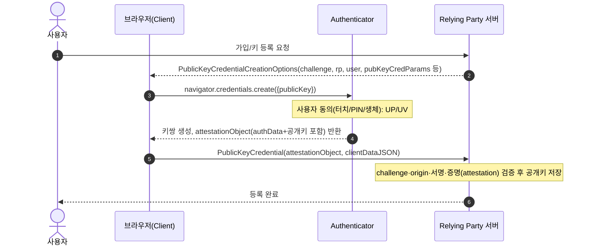
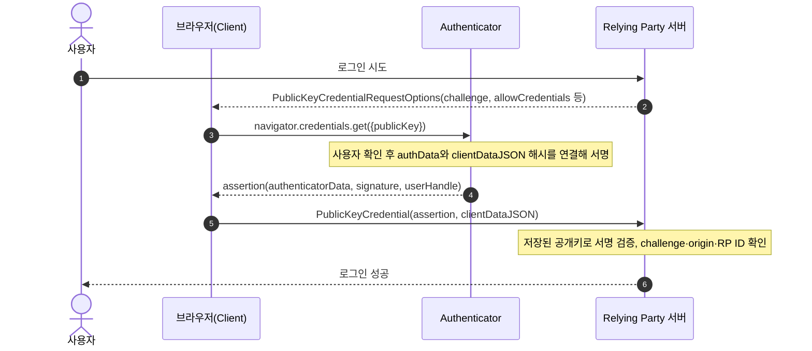

## 1. 개요

WebAuthn(Web Authentication API)은 Credential Management API를 확장한 W3C 표준으로, 공개키 암호화를 이용한 강력한 인증을 제공해 패스워드리스 인증과 SMS 없는 다중 요소 인증(Multi-Factor Authentication, MFA)을 가능하게 한다.

FIDO(Fast IDentity Online) Alliance의 CTAP(Client to Authenticator Protocol)와 결합해 FIDO2를 구성하며, WebAuthn은 브라우저(Client)와 웹앱 사이의 API를, CTAP은 Client와 Authenticator(보안키, 플랫폼 생체인증 등) 사이의 통신을 표준화한다. 웹의 Passkey는 WebAuthn 위에 구현된다.

---

## 2. 용어

| 용어 | 의미 |
|---|---|
| Relying Party(RP) | WebAuthn API를 사용해 사용자를 등록·인증하는 서비스(웹앱) |
| RP ID | RP를 식별하는 도메인 문자열. 기본값은 origin의 effective domain. 기본 규칙은 동일 도메인 또는 등록 가능한 도메인 접미사이며, Level 3은 검증된 related origins도 지원 |
| Authenticator | 키쌍을 생성·보관하고 서명을 수행하는 암호학적 개체(보안키, TPM, 플랫폼 생체인증 등) |
| Client | 브라우저 등 WebAuthn API를 구현하고 Authenticator와의 통신을 중개하는 주체 |
| Credential Key Pair | Authenticator가 생성하는 RP별 비대칭 키쌍. RP에는 공개키만 전달하며, 백업 가능한 자격 증명은 다른 Authenticator로 동기화될 수 있음 |
| Credential ID | 특정 키쌍(및 그 어설션)을 식별하는 바이트 시퀀스 |
| User Handle | RP가 지정하는 사용자 식별 값(`user.id`). 화면에 노출하지 않는 opaque 값, 최대 64바이트 |
| UP(User Presence) | 사용자가 Authenticator와 존재를 확인하는 동작을 수행했는지에 대한 결과. 터치 등의 동작을 사용하며 신원 검증과는 구분 |
| UV(User Verification) | PIN·생체인증 등으로 사용자를 로컬에서 검증했는지에 대한 결과. UP와 구분되는 로컬 사용자 확인 |
| Discoverable Credential(구 resident key) | Authenticator/Client 쪽에 저장되어 `allowCredentials` 없이도 조회 가능한 자격증명 |
| Non-discoverable Credential(구 non-resident key) | RP가 `allowCredentials`로 Credential ID를 제시해야 조회 가능. 개인키를 암호화해 Credential ID 자체로 사용하는 방식이 흔함 |

---

## 3. 등록

등록(Registration)은 사용자·RP·Authenticator가 협력해 새 키쌍을 생성하고 RP 계정에 연결하는 절차다. `navigator.credentials.create()`로 시작한다.



### 3.1. 등록 옵션

옵션 객체는 `PublicKeyCredentialCreationOptions`이며, 브라우저는 이 옵션과 origin을 검사한 뒤 Authenticator와 등록을 진행한다. 주요 옵션은 다음과 같다.

| 항목 | 필수 | 의미 |
|---|---|---|
| `challenge` | 필수 | 서버가 생성한 암호학적 난수(최소 16바이트). 재전송(replay) 공격 방지 |
| `rp` | 필수 | `{ id, name }`: RP ID와 표시용 이름 |
| `user` | 필수 | `{ id, name, displayName }`: `id`는 User Handle(바이트열), `name`/`displayName`은 표시용 문자열 |
| `pubKeyCredParams` | 필수 | 허용할 서명 알고리즘 목록 `[{ type: "public-key", alg }]`. `alg`는 COSEAlgorithmIdentifier(예: `-7` = ES256, `-257` = RS256) |
| `timeout` | 선택 | 사용자 응답 대기 제한시간(ms) |
| `excludeCredentials` | 선택 | 이미 등록된 Credential ID 목록. 동일 Authenticator에 중복 등록 방지 |
| `authenticatorSelection` | 선택 | `{ authenticatorAttachment, residentKey, userVerification }`: Platform/Roaming 제한, discoverable credential 요구 여부, UV 요구 수준(§7 참고) |
| `attestation` | 선택 | 증명 전달(Attestation Conveyance) 수준(§6.2 참고) |

RP는 등록 응답에서 다음을 검증한다. 세부 분기와 확장 처리는 Level 3의 등록 검증 절차를 따른다.

1. `clientDataJSON.type`이 `webauthn.create`이고 challenge가 발급한 값과 일치하는지 확인한다. 서버는 challenge의 만료와 사용 여부도 관리한다.
2. `origin`이 허용된 출처인지 확인하고, 교차 출처 사용 시 `crossOrigin`·`topOrigin`을 정책에 맞게 검증한다.
3. `rpIdHash`가 기대한 RP ID의 SHA-256 값인지, UP가 설정됐는지, UV가 필요한 정책에서 UV가 설정됐는지 확인한다.
4. 공개키 알고리즘이 요청 목록에 포함되는지 확인하고, attestation 형식의 검증 결과와 신뢰 경로를 RP 정책에 따라 평가한다. `none`에는 검증할 증명 서명이 없다.
5. BE·BS 플래그의 유효성을 검사하고, credential ID가 다른 계정에 중복 연결되지 않도록 확인한 뒤 계정·공개키·카운터·백업 상태를 저장한다.

---

## 4. 인증

인증(Authentication)은 사용자가 이전에 등록한 Credential의 개인키를 실제로 보유하고 있음을 RP에게 암호학적으로 증명하는 절차다. `navigator.credentials.get()`으로 시작한다.



### 4.1. 인증 옵션

옵션 객체는 `PublicKeyCredentialRequestOptions`다.

| 항목 | 필수 | 의미 |
|---|---|---|
| `challenge` | 필수 | 서버가 생성한 난수. 등록 때와 동일하게 replay 방지 목적 |
| `rpId` | 선택 | 검증할 RP ID. 생략 시 호출 origin의 effective domain 사용 |
| `allowCredentials` | 선택 | 사용 가능한 Credential ID 목록. 비워두면 discoverable credential 중 해당 RP ID의 것을 Authenticator가 직접 탐색(§8 자동완성 UI에서 활용) |
| `userVerification` | 선택 | `required`/`preferred`/`discouraged`: UV 요구 수준 |
| `timeout` | 선택 | 응답 대기 제한시간(ms) |

RP의 인증 검증은 다음을 포함한다. 세부 절차는 Level 3의 인증 검증 알고리즘을 따른다.

1. credential ID를 조회해 로그인 계정에 연결됐는지 확인한다. `allowCredentials`를 지정했다면 목록 포함 여부를 검사하며, 반환된 `userHandle`은 계정과 일치해야 한다.
2. `clientDataJSON.type`이 `webauthn.get`인지, challenge가 유효한 일회성 요청과 일치하는지, origin이 허용된 출처인지 확인한다. 필요한 경우 `crossOrigin`·`topOrigin`도 검사한다.
3. `rpIdHash`, UP와 정책상 필요한 UV, BE·BS 플래그를 검증한다.
4. 저장된 공개키로 `authenticatorData || SHA-256(clientDataJSON)`의 서명을 검증한다. challenge만 서명하는 구조가 아니다.
5. `signCount`를 평가하고 백업 상태를 갱신한다. 검증한 challenge를 재사용하지 못하게 처리한 후 로그인 세션을 만든다.

---

## 5. Authenticator Data

`authenticatorData`는 37바이트 이상의 바이트 배열로, 등록(§3) 응답의 `attestationObject` 내부와 인증(§4) 응답의 `assertion` 내부 양쪽에 공통 구조로 포함되어 인증 서명과 등록 증명 형식의 검증에 사용된다. 등록 증명이 `none`이면 증명 서명은 없다.

| 필드 | 길이 | 내용 |
|---|---|---|
| `rpIdHash` | 32B | RP ID의 SHA-256 해시 |
| `flags` | 1B | bit0 UP, bit2 UV, bit3 BE, bit4 BS, bit6 AT, bit7 ED |
| `signCount` | 4B | 서명 카운터(32bit 정수) |
| `attestedCredentialData` | 가변 | AT=1일 때만 포함(등록 시). AAGUID + Credential ID + 공개키(COSE_Key) |
| `extensions` | 가변 | ED=1일 때만 포함. CBOR map |

BE(Backup Eligibility)는 백업 가능 여부로 자격 증명 생성 후 고정되고, BS(Backup State)는 현재 백업 상태로 변경될 수 있다. BE=0이면서 BS=1인 조합은 유효하지 않다. 서버는 등록 시 BE를 저장하고 인증 시 일관성을 확인한다.

`signCount`는 자격 증명별 또는 Authenticator 전체 카운터이며, 카운터를 구현하지 않으면 0을 반환할 수 있다. 저장값과 수신값 중 하나라도 0이 아니면 증가 여부를 평가한다. 수신값이 저장값 이하인 경우 복제·오작동·응답 처리 순서 뒤바뀜의 신호일 수 있으나 복제의 증거는 아니다. 양쪽 모두 0이면 카운터로 복제를 판단할 수 없다. 서버는 이 신호를 위험 정책에 따라 처리한다.

---

## 6. 증명

증명(attestation)은 Authenticator의 출처(제조사·모델)와 그것이 생성한 데이터의 신뢰성을 보증하는 절차로, 등록 시 `attestationObject`에 담겨 전달된다.

### 6.1. 유형

WebAuthn은 여러 증명 유형을 지원하며, 각 유형은 신뢰 모델을 정의한다.

| 타입 | 설명 |
|---|---|
| Basic | Authenticator 모델(배치) 단위로 공유하는 증명 키(attestation key)로 서명하며, 배치 증명(batch attestation)이라고도 함 |
| Self | 별도 증명 키 없이 Credential 개인키로 서명. 이 사실만으로 장치 보호 수준을 판단할 수 없음 |
| AttCA | 증명 CA가 발급한 인증서를 이용하는 신뢰 모델. TPM 방식이 한 예 |
| AnonCA | 익명화 CA가 발급하는 동적 증명 인증서로 추적 가능성을 줄이는 신뢰 모델 |
| None | 증명 정보 없음 |

### 6.2. 전달

`create()`의 `attestation` 옵션은 `none`, `indirect`, `direct`, `enterprise` 중 증명 전달 선호를 지정한다. 기본값은 `none`이다. RP는 실제 반환된 증명과 신뢰 정책을 검증해야 하며, `direct` 지정만으로 신뢰할 수 있는 증명이 보장되지는 않는다.

---

## 7. Authenticator 분류

Authenticator의 특성은 세 가지 독립적인 기준으로 분류되며, 이 조합이 지원 가능한 사용 사례를 결정한다.

### 7.1. 부착 방식

- Platform Authenticator: 기기에 내장되어 분리 불가. 예: 노트북/폰의 Windows Hello, Touch ID, Face ID
- Roaming Authenticator: USB/NFC/BLE 등 cross-platform transport로 연결되는 외장형. 여러 기기를 오갈 수 있음. 예: YubiKey 등 FIDO 보안키

### 7.2. 인증 팩터 능력

- Single-factor capable: UV(사용자 검증) 미지원, 소유(UP)만 증명. 예: UV 기능이 없는 초기 FIDO U2F 보안키
- Multi-factor capable: PIN·생체인증 등으로 UV까지 지원. 예: 지문 센서 내장 보안키, Windows Hello, Face ID

### 7.3. 저장 방식

- Discoverable credential capable: Authenticator/Client 쪽에 Credential을 저장, `allowCredentials` 없이도 조회 가능(Passkey의 필수 조건). 예: 최신 보안키의 resident key 슬롯, 플랫폼 Passkey
- 비지원(구 non-resident 전용): 개인키를 암호화해 그 결과를 Credential ID로 사용하고 RP가 이를 보관·제시. 예: 저장 슬롯이 제한적인 구형 FIDO U2F 보안키

### 7.4. 주요 조합 유형

| 조합 유형 | 부착 | 인증 팩터 | 예시 |
|---|---|---|---|
| Second-factor platform authenticator | Platform | Single-factor | UV 없이 UP만 사용하는 플랫폼 인증기 |
| User-verifying platform authenticator | Platform | Multi-factor | 폰의 Face ID 기반 Passkey 로그인(비밀번호 없이) |
| Second-factor roaming authenticator | Roaming | Single-factor | 비밀번호 로그인 + USB 보안키(터치만) 2차 인증 |
| First-factor roaming authenticator | Roaming | Multi-factor | PIN 지원 보안키만으로 비밀번호 없이 로그인 |

### 7.5. Passkey

Passkey는 사용자 이름 입력 없이 로그인할 수 있는 discoverable credential을 가리키는 용어다. WebAuthn Level 3은 동기화 Passkey를 multi-device credential로 부른다.

- 동기화 Passkey: 플랫폼·비밀번호 관리자가 개인키를 사용자 계정의 여러 기기로 동기화. BE=1이며 BS는 백업 상태에 따라 1
- 기기 종속 Passkey: 단일 Authenticator에만 존재(보안키 등). BE=0

RP는 BE·BS 값으로 백업 여부를 판단해, 기기 종속 Passkey만 등록한 사용자에게 추가 등록을 안내하는 등의 정책에 활용할 수 있다.

---

## 8. 자동완성

자동완성(Autofill) UI는 조건부 중재(Conditional Mediation)라고도 하며, 로그인 폼의 username 입력란에 `autocomplete="username webauthn"`을 지정하면 페이지 로드 시 `mediation: "conditional"`로 `get()`을 호출해 사용 가능한 discoverable credential을 브라우저 자동완성에 노출하는 기능이다. `allowCredentials`는 생략하며, 사용자가 필드를 클릭하기 전까지는 대기한다. 비밀번호와 Passkey를 하나의 자동완성 UI로 통합하는 용도로 쓰인다.

```html
<input type="text" name="username" autocomplete="username webauthn" />
```

```js
const supported = await PublicKeyCredential.isConditionalMediationAvailable?.();
if (supported) {
  const assertion = await navigator.credentials.get({
    publicKey: {
      challenge: challengeFromServer, // 서버 발급 난수
      rpId: "example.com",
      userVerification: "required",
      // allowCredentials 생략: discoverable credential을 자동 탐색
    },
    mediation: "conditional",
  });
  // assertion을 서버로 전송해 §4.1과 동일하게 검증
}
```

---

## 9. 장단점

장점
- 피싱 저항: 서명이 origin에 종속되어, 가짜 로그인 사이트가 정상 사이트로 인증을 재사용할 수 없음
- 유출 피해 감소: 서버는 공개키만 저장하므로 데이터 유출 시에도 개인키 없이는 인증 불가
- 무차별 대입 내성: 공개키 서명 검증과 challenge의 일회성 검사로 인증 요청의 위조·재사용을 방어
- UX 개선: 생체인증 등과 결합 시 비밀번호 암기·입력이 불필요

단점
- Authenticator 분실·기기 변경 시 별도 복구 절차 필요(백업 Authenticator 등록, Passkey 동기화 등)
- 브라우저·OS·Authenticator 조합에 따라 지원 범위가 달라 구형 환경 호환성 이슈 존재
- RP 서버 구현 복잡도 증가(challenge 발급·검증, 증명 검증, 다중 Credential 관리 로직 필요)
- 증명(attestation)을 direct로 요구할 경우 일부 정보 노출 가능(§10 참고)

---

## 10. 보안

- Origin 바인딩: 서명이 origin/RP ID에 종속되므로 도메인 유사 피싱에 강함
- Signature Counter: 5장 참고. 자격 증명별 카운터가 권장되며, 전역 카운터는 RP 간 추적에 사용될 수 있다.
- 증명과 프라이버시: 증명 정보의 식별 가능성을 평가한다. RP가 Authenticator 신뢰 정책을 적용해야 하면 검증 결과와 신뢰 경로를 사용하고, 모델 정보만으로 사용자 신원을 판단하지 않는다.
- RP ID: 기본 도메인 접미사 규칙과 Level 3의 related origins 검증을 구분한다. Related origins는 RP ID의 HTTPS `/.well-known/webauthn` 문서에 허용 origin 목록을 제공하며, RP 서버도 실제 origin을 허용 목록과 대조해야 한다. API는 secure context를 요구하며 localhost 같은 신뢰 가능한 개발 출처는 예외가 될 수 있다.
- Challenge: 최소 16바이트의 암호학적 난수 필요. 재사용 시 재전송(replay) 공격에 노출

---

## 11. 구현

### 11.1. 구현 예시

Java 구현 예시는 [[webauthn-java]] 참조.

### 11.2. 서비스 제공자

- 플랫폼 Passkey 관리자: Apple·Google·Microsoft의 OS·브라우저 내장 기능
- 서드파티 비밀번호 관리자: 1Password 등이 브라우저 확장으로 Passkey를 저장·동기화
- IdP/IAM: Okta 등이 WebAuthn을 MFA·패스워드리스 수단으로 통합
- 하드웨어 보안키: Yubico 등이 FIDO2 Authenticator 공급
- Passkey 서버 SDK·BaaS: RP가 서버 구현 없이 Passkey 인증을 도입하도록 지원

---

## Sources
- [W3C WebAuthn Level 3 §6.1, §7](https://www.w3.org/TR/webauthn-3/)
- [MDN: Web Authentication API](https://developer.mozilla.org/en-US/docs/Web/API/Web_Authentication_API)
- [FIDO Alliance: FIDO Specifications Overview (CTAP/WebAuthn 관계)](https://fidoalliance.org/specifications/)
- [Okta Developer: Web Authentication integration guide](https://developer.okta.com/docs/guides/authenticators-web-authn/main/)
- [MDN: Passkeys](https://developer.mozilla.org/en-US/docs/Web/Security/Authentication/Passkeys)

---

## Related pages
- [[webauthn-java]]
- [[sso]]
- [[x509-certificate]]
- [[cookie]]
- [[session-vs-cookie]]
