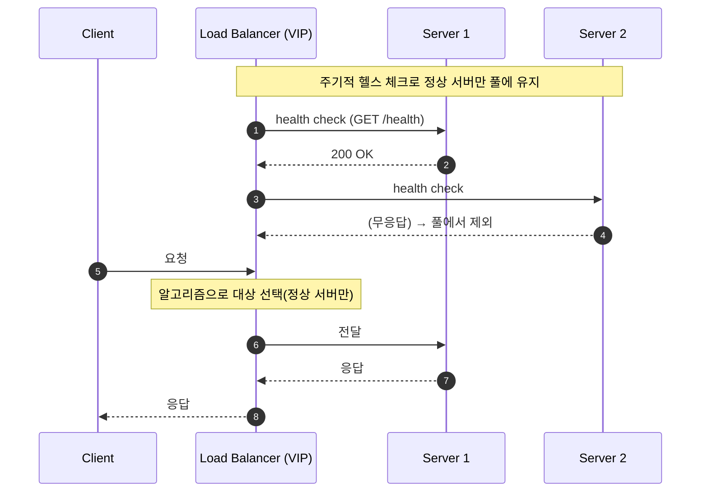

## 1. 개요

로드 밸런서(Load Balancer, LB)는 들어오는 트래픽을 여러 백엔드 서버로 분산해 한 서버에 부하가 몰리지 않게 하고, 전체 처리량과 가용성을 높이는 장치 또는 소프트웨어다. 클라이언트는 LB의 단일 주소(VIP)로 접속하고, LB가 실제 서버를 골라 전달한다.

주 목적:
- **부하 분산**: 요청을 여러 서버로 나눠 단일 서버 과부하를 방지한다.
- **고가용성(HA)**: 헬스 체크로 장애 서버를 자동 제외한다.
- **수평 확장(scale-out)**: 서버를 추가한 만큼 처리량이 증가한다.
- **운영**: 무중단 배포(rolling), 서버 추가·제거를 클라이언트 영향 없이 수행한다.
- **단일 진입점**: 백엔드를 직접 노출하지 않는다. L7은 TLS 종료·압축·콘텐츠 라우팅으로 백엔드 부담을 줄인다.

---

## 2. 동작

LB는 서버 풀(pool)을 두고 각 요청이나 연결마다 분산 알고리즘(§4)으로 대상 서버를 선택한다. 헬스 체크(health check)로 서버 상태를 주기적으로 확인해, 실패한 서버는 풀에서 빼고 정상 복구되면 다시 넣는다.

헬스 체크는 L4에서 TCP 연결·포트를 확인하고, L7에서 `GET /health` 등의 응답 코드·본문을 검사한다.

---

## 3. L4 vs L7

LB가 OSI 어느 계층의 정보를 보고 분산하는지에 따라 나뉜다.

| | L4 (Transport) | L7 (Application) |
|---|---|---|
| 판단 기준 | IP·포트, TCP/UDP | HTTP 헤더·URL·쿠키·본문 |
| 내용 인지 | 애플리케이션 데이터 해석 안 함 | 요청 내용 해석 |
| 라우팅 | 연결 단위 전달 | 경로·호스트·헤더 기반 라우팅 |
| 성능 | 빠름(파싱 없음) | 상대적으로 느림(파싱·TLS 종료) |
| 부가 기능 | 단순 전달 | TLS 종료, 콘텐츠 라우팅, 세션 고정, 압축 |
| 대표 | LVS, AWS NLB, HAProxy(tcp) | nginx, AWS ALB, HAProxy(http), Envoy |

- **L4**: 애플리케이션 계층을 해석하지 않으므로 CPU 부담이 적고 처리량이 크다. LVS는 NAT·IP 터널링·Direct Routing 방식으로 패킷을 전달하고, HAProxy(tcp)는 클라이언트 연결을 받아 서버 연결과 결합하는 TCP 프록시로 동작한다. non-HTTP 프로토콜이나 최대 성능이 필요할 때 사용한다.
- **L7**: 요청을 해석하므로 `/api`는 API 서버로, `/img`는 정적 서버로 보내는 내용 기반 라우팅이 가능하다. HTTP 워크로드의 기본 선택이며, L7 LB는 [[reverse-proxy]]의 한 형태다.
- **혼합 구조**: 엣지에 L4(대용량 연결·DDoS 흡수), 내부에 L7(라우팅)을 두는 2계층 구성이 흔하다.

---

## 4. 분산 알고리즘

| 알고리즘 | 방식 | 용도 |
|---|---|---|
| 라운드 로빈(Round Robin) | 서버를 순서대로 순환 배정 | 서버 성능이 같고 요청 비용이 균일할 때 |
| 가중 라운드 로빈(Weighted RR) | 서버 용량에 비례한 가중치로 배정 | 성능이 다른 서버가 섞여 있을 때 |
| 최소 연결(Least Connections) | 활성 연결이 가장 적은 서버로 배정 | 연결 수명이 제각각일 때(롱 커넥션) |
| 가중 최소 연결(Weighted LC) | 가중치와 활성 연결을 함께 고려 | 이기종 서버와 롱 커넥션 |
| 최소 응답 시간(Least Response Time) | 응답이 빠른 서버 우선 | 실측 지연 반영 |
| IP 해시(IP Hash) | 출발지(와 목적지) IP 해시로 서버 결정 | 같은 클라이언트를 같은 서버로 보냄. 서버 증감 시 대량 재배치 발생 |
| 일관성 해시(Consistent Hashing) | 해시 링에 서버·키 배치 | 서버 증감 시 재배치 최소화. 캐시·샤딩에서 주로 사용 |
| 랜덤(Random) / P2C | 무작위, 또는 둘을 뽑아 덜 바쁜 쪽 선택 | 대규모 환경에서 적은 상태로 균형(Power of Two Choices) |

IP 해시는 서버 대수가 바뀌면 `hash % N`의 N이 변해 거의 모든 매핑이 깨진다. 이를 피하려고 일관성 해시를 쓴다.

---

## 5. 배포 형태

- **하드웨어 LB**: F5 BIG-IP, Citrix 등 전용 어플라이언스
- **소프트웨어 LB**: nginx, HAProxy, Envoy, LVS
- **클라우드 LB**: AWS ELB(ALB는 L7, NLB는 L4), GCP·Azure LB. 관리형이며 자동 확장
- **DNS 로드 밸런싱**: DNS 응답으로 여러 IP를 돌려 분산한다([[dns-configuration]]). 단순하지만 DNS 캐싱 때문에 헬스 상태 반영과 세밀한 제어가 어렵다

---

## 6. 기타

### 6.1. 세션 고정 (sticky session)

세션 고정(sticky session, session persistence)은 특정 클라이언트를 항상 같은 서버로 보내는 기능이다. 분산 알고리즘이 아니라 알고리즘의 결정을 고정하는 제약으로, 첫 요청만 알고리즘으로 배정하고 이후 같은 클라이언트의 요청은 같은 서버로 보낸다.

서버가 로그인 상태 등을 로컬 메모리 세션에 보관하면 다른 서버로 간 요청은 세션을 찾지 못한다. 세션 고정이 필요한 원인은 세션 저장 위치에 있다([[session-vs-cookie]]).

| 방식 | 동작 | 알고리즘과의 관계 |
|---|---|---|
| IP 해시 | 출발지 IP 해시로 항상 같은 서버 선택 | 알고리즘 자체가 고정 효과를 가짐 |
| 쿠키 기반 | LB가 자체 쿠키를 삽입하거나 앱 쿠키(`JSESSIONID`)를 읽어 매핑. L7에서만 가능 | 알고리즘과 독립(예: RR + 쿠키 고정) |

세션 고정은 특정 서버로 트래픽을 몰리게 하고, 해당 서버 장애 시 묶인 세션이 모두 끊긴다. 세션을 Redis 등 외부 저장소로 분리하면 어느 서버로 가도 세션을 공유하므로 세션 고정이 필요 없다.

### 6.2. 관련 개념

- **리버스 프록시**: 백엔드 앞에서 요청을 대신 받는 서버. L7 LB는 부하 분산을 수행하는 리버스 프록시다([[reverse-proxy]])
- **API 게이트웨이**: LB·프록시에 인증, 레이트 리밋, 응답 집계 등 API 특화 기능을 더한 것
- **CDN**: 지리적으로 분산된 엣지 캐시. 글로벌 트래픽 분산에 관여

---

## Sources
- [Cloudflare: Types of load balancing algorithms](https://www.cloudflare.com/learning/performance/types-of-load-balancing-algorithms/)
- [A10 Networks: Layer 4 vs Layer 7 load balancing](https://www.a10networks.com/glossary/how-do-layer-4-and-layer-7-load-balancing-differ/)
- [NGINX: HTTP Load Balancing](https://docs.nginx.com/nginx/admin-guide/load-balancer/http-load-balancer/)
- [AWS: Elastic Load Balancing](https://docs.aws.amazon.com/elasticloadbalancing/)
- [LVS: How Virtual Server Works](http://www.linuxvirtualserver.org/how.html)
- [HAProxy: Starter Guide](https://docs.haproxy.org/2.8/intro.html)

---

## Related pages
- [[reverse-proxy]]
- [[session-vs-cookie]]
- [[dns-configuration]]
- [[restful-api-design]]
