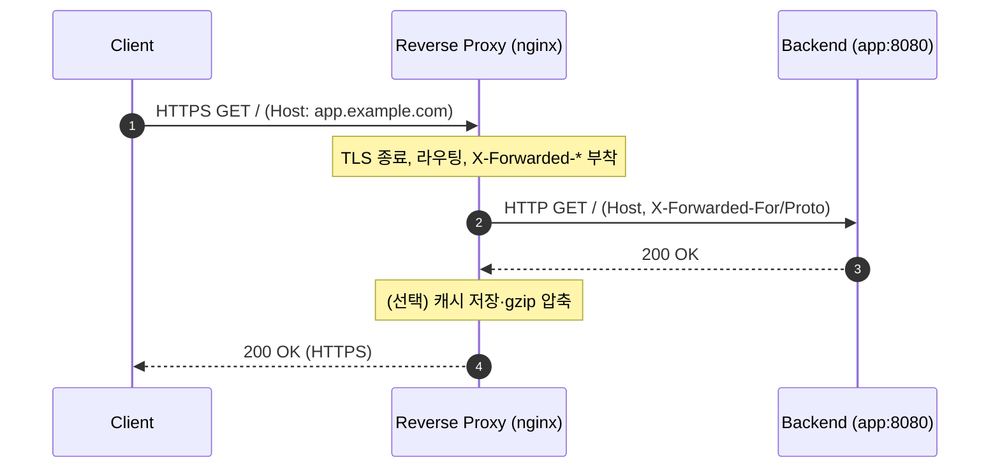

## 1. 개요

리버스 프록시(Reverse Proxy)는 하나 이상의 백엔드(origin) 서버 앞에서 클라이언트 요청을 대신 받아 백엔드로 전달하고, 응답을 클라이언트에게 돌려주는 서버다. 클라이언트에게는 리버스 프록시가 실제 서버처럼 보이며 백엔드는 직접 노출되지 않는다.

대표 구현은 nginx, HAProxy, Envoy, Apache httpd(mod_proxy), Traefik, 클라우드 LB다.

---

## 2. 포워드 프록시 vs 리버스 프록시

둘 다 중간에서 요청을 대신 전달하지만 대리하는 대상이 다르다. 포워드 프록시는 클라이언트를 대리해 요청을 외부로 내보내고, 리버스 프록시는 서버를 대리해 외부 요청을 받아 백엔드로 넘긴다.

| | 포워드 프록시 | 리버스 프록시 |
|---|---|---|
| 위치 | 클라이언트 앞 | 서버 앞 |
| 대리 대상 | 클라이언트(요청자) | 서버(응답자) |
| 클라이언트 인지 | 프록시를 알고 설정함 | 프록시를 모름(투명) |
| 주 용도 | 사내 아웃바운드 통제, 우회, 익명화, 캐시 | 로드 밸런싱, TLS 종료, 캐시, 보호, 라우팅 |

```
[포워드 프록시]  Client → (Forward Proxy) → Internet → Server
[리버스 프록시]  Client → Internet → (Reverse Proxy) → Backend(s)
```

---

## 3. 용도

- **로드 밸런싱**: 여러 백엔드로 요청을 분산하고, 한 대가 장애 나면 우회한다
- **TLS 종료(SSL Termination)**: 프록시가 HTTPS 복호화를 담당해 백엔드는 평문 HTTP만 처리하고, 인증서 관리가 한곳으로 모인다
- **캐싱**: 정적·반복 응답을 캐시해 백엔드 부하를 줄이고 응답 속도를 높인다
- **보안·은닉**: 백엔드 IP와 구조를 숨기며 WAF·DDoS 완화 지점이 된다
- **압축·버퍼링**: gzip 등으로 응답을 압축하고, 느린 클라이언트로부터 백엔드를 보호한다
- **라우팅**: 경로·호스트별로 다른 서비스로 분배하는 단일 진입점 역할을 한다
- **정적 파일 서빙**: 정적 자원은 프록시가 직접 응답하고 동적 요청만 백엔드로 보낸다

---

## 4. 전달 헤더

요청이 리버스 프록시를 거쳐 백엔드로 넘어가면 원래 클라이언트 정보가 가려진다. 백엔드가 실제 클라이언트 IP·프로토콜·호스트를 알려면 프록시가 헤더로 전달해야 한다.

| 헤더 | 의미 |
|------|------|
| `X-Forwarded-For` | 원래 클라이언트 IP(경유 프록시 체인) |
| `X-Forwarded-Proto` | 원래 스킴(http/https) |
| `X-Forwarded-Host` / `Host` | 원래 요청 호스트 |
| `X-Real-IP` | 클라이언트 IP(nginx 관례) |
| `Forwarded` | 위 정보를 하나로 표준화한 헤더(RFC 7239). 사용 빈도는 낮음 |

이 헤더를 전달하지 않으면 애플리케이션이 만드는 redirect URL이 내부 포트나 HTTP로 바뀌는 문제가 생긴다. Spring에서의 처리는 [[forward-headers-proxy]] 참고.

`X-Forwarded-For`는 클라이언트가 임의 값으로 보낼 수 있다. 레이트 리밋이나 IP 접근 제어 같은 보안 판단에는 신뢰하는 프록시가 추가한 값만 사용한다. 오른쪽부터 신뢰 프록시 주소를 건너뛴 첫 주소가 클라이언트 주소다. 백엔드가 인터넷에서 직접 접근 가능하면 목록 전체를 신뢰할 수 없다. 가장 앞단 프록시에서는 받은 값을 이어 붙이지 않고 `$remote_addr`로 덮어쓰는 구성도 쓴다[^1].



---

## 5. nginx 설정

### 5.1. 기본 프록시
```nginx
server {
    listen 443 ssl;
    server_name app.example.com;
    # ssl_certificate ...;  (TLS 종료)

    location / {
        proxy_pass http://127.0.0.1:8080;

        proxy_set_header Host              $host;
        proxy_set_header X-Real-IP         $remote_addr;
        proxy_set_header X-Forwarded-For   $proxy_add_x_forwarded_for;
        proxy_set_header X-Forwarded-Proto $scheme;
    }
}
```

헤더를 전달하지 않으려면 값을 빈 문자열로 지정한다: `proxy_set_header Accept-Encoding "";`

### 5.2. 로드 밸런싱(upstream)
```nginx
upstream backend {
    # least_conn;            # 부하 분산 전략(기본 round-robin)
    server 10.0.0.11:8080;
    server 10.0.0.12:8080;
    server 10.0.0.13:8080 backup;
}

server {
    location / {
        proxy_pass http://backend;
        proxy_set_header Host $host;
        proxy_set_header X-Forwarded-For $proxy_add_x_forwarded_for;
    }
}
```

### 5.3. 버퍼링 제어
스트리밍·SSE 응답은 버퍼링을 꺼서 즉시 전달한다.
```nginx
location /stream/ {
    proxy_pass http://127.0.0.1:8080;
    proxy_buffering off;      # 즉시 전달(기본 on)
}
```

CORS를 프록시 계층에서 처리하는 설정은 [[cors]] §7.2 참고.

---

## 6. 인접 개념

- **로드 밸런서(LB)**: 트래픽 분산에 특화된 장치. L7 LB는 부하 분산을 수행하는 리버스 프록시다([[load-balancer]])
- **API 게이트웨이**: 리버스 프록시에 인증·인가, 레이트 리밋, 라우팅, 응답 집계 등 API 특화 기능을 더한 것
- **CDN**: 지리적으로 분산된 캐시형 리버스 프록시(엣지)
- **포워드 프록시**: 클라이언트 측 프록시(§2)

---

## Sources
- [NGINX Admin Guide: Reverse Proxy](https://docs.nginx.com/nginx/admin-guide/web-server/reverse-proxy/)
- [Cloudflare: What is a reverse proxy?](https://www.cloudflare.com/learning/cdn/glossary/reverse-proxy/)
- [Kemp: Forward Proxy vs Reverse Proxy](https://kemptechnologies.com/blog/forward-proxy-vs.-reverse-proxy-differences-and-similarities)
- [MDN: X-Forwarded-For](https://developer.mozilla.org/en-US/docs/Web/HTTP/Reference/Headers/X-Forwarded-For)
- [RFC 7239: Forwarded HTTP Extension](https://www.rfc-editor.org/rfc/rfc7239)

---

## Related pages
- [[load-balancer]]
- [[forward-headers-proxy]]
- [[cors]]
- [[restful-api-design]]
- [[curl]]

---

[^1]: MDN은 신뢰 프록시가 추가한 값만 보안 판단에 사용하라고 권고한다. 앞단 프록시가 값을 덮어쓰면 이후 체인의 값이 모두 신뢰 프록시가 설정한 값이 된다는 점에서 도출한 구성이다.
